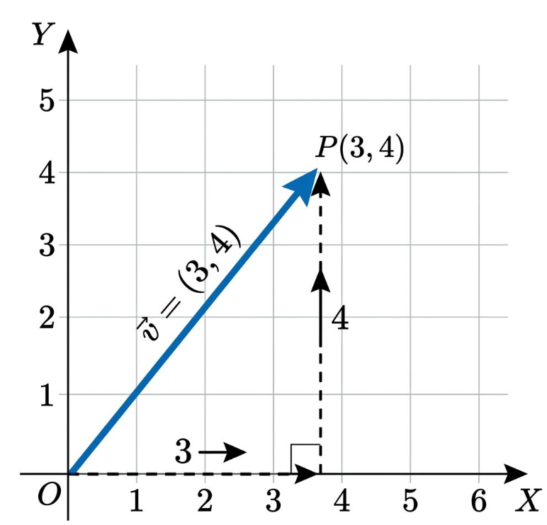
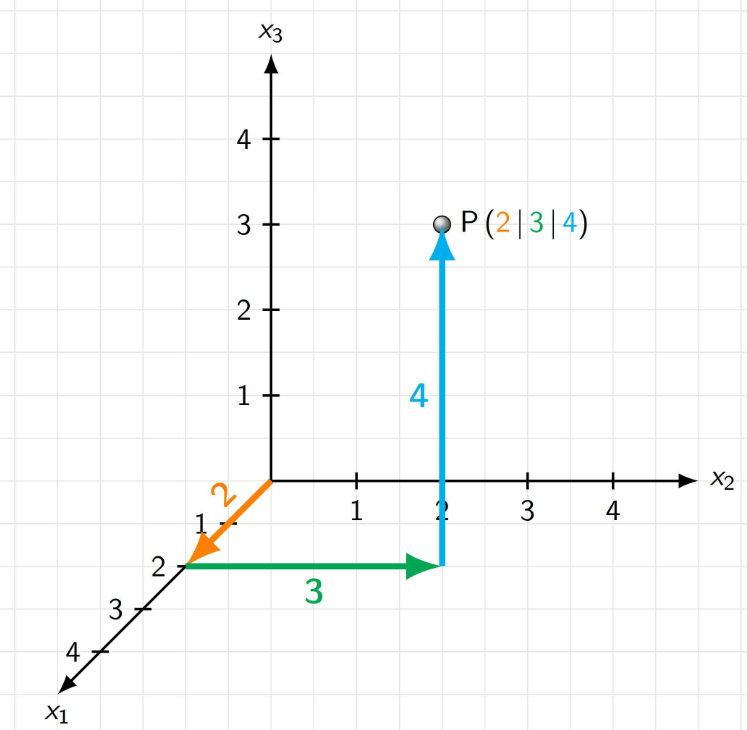

# 29\. Vectors

## 1\. What is a vector?

A **vector** is a mathematical quantity represented by multiple numerical values. It can represent magnitude and direction, or simply a collection of numerical features in Machine Learning.

Examples\:

- Velocity of a moving car
- Position of a point in 2D or 3D space
- Marks of a student in different subjects
- Features of a customer in a Machine Learning dataset

A vector is commonly represented using square brackets.

$$
\vec{v} = [3,4]
$$

This vector contains two components: 3 and 4.

## 2\. Scalar vs Vector

| Scalar | Vector |
|--------|--------|
| Contains one numerical value | Contains multiple components |
| Has magnitude only | Can represent magnitude and direction |
| Example: temperature = 30°C | Example: velocity = $$3, 4$$ |
| ML example: one feature value | ML example: multiple feature values |

## 3\. Types of vectors

**A. 2D Vector**




$$
\vec{v}=[3,4]
$$

Has two components: $x$ and $y$\. It can represent a point or direction in a two-dimensional plane.

---


**B. 3D Vector**



$$
\vec{v}=[2,3,4]
$$

Has three components: $x$, $y$, and $z$\. It can represent a position or direction in three-dimensional space.

---

**C. Column Vector**

$$
\vec{v}=
\begin{bmatrix}
3\\4\\5
\end{bmatrix}
$$

Components are arranged vertically. Column vectors are commonly used in linear algebra and ML calculations.

## 4\. Magnitude of a vector

The **magnitude** is the length of a vector.

For a 2D vector\:

$$
\vec{v}=[x,y]
$$

$$
\|\vec{v}\|=\sqrt{x^2+y^2}
$$

Example\:

$$
\vec{v}=[3,4]
$$

$$
\|\vec{v}\|=\sqrt{3^2+4^2}
=\sqrt{25}=5
$$

Therefore, the magnitude is **5 units**\.

For a 3D vector\:

$$
\|\vec{v}\|=\sqrt{x^2+y^2+z^2}
$$

For $[2,3,4]$, the magnitude is $\sqrt{29}$\.

## 5\. Vector operations

Consider two vectors\:

$$
\vec{a}=[2,3],\qquad \vec{b}=[4,5]
$$

| Operation | Calculation | Result |
|--------|--------|--------|
| Addition | $[2+4,3+5]$ | $[6,8]$ |
| Subtraction | $[2-4,3-5]$ | $[-2,-2]$ |
| Scalar multiplication | $3[2,3]$ | $[6,9]$ |
| Magnitude of $\vec a$ | $\sqrt{2^2+3^2}$ | $\sqrt{13}$ |

Vector addition and subtraction are performed component by component. For these operations, both vectors must have the same number of components.

## 6\. Implement vectors using NumPy

```python
import numpy as np

a = np.array([2, 3])
b = np.array([4, 5])

print("Addition:", a + b)
print("Subtraction:", a - b)
print("Scalar multiplication:", 3 * a)
print("Magnitude:", np.linalg.norm(a))
```

Output\:

```text
Addition: [6 8]
Subtraction: [-2 -2]
Scalar multiplication: [6 9]
Magnitude: 3.605551275463989
```

## 7\. Why are vectors important in Machine Learning?

Suppose a student has these features\:

| Feature | Value |
|--------|--------|
| Study hours | 5 |
| Attendance (%) | 80 |
| Previous score | 75 |

The student's feature vector is\:

$$
\vec{x}=[5,80,75]
$$

A Machine Learning model can use this vector as input to predict whether the student will pass.

Vectors are used in\:

- Representing input features
- Calculating predictions in linear regression
- Measuring similarity between data points
- Calculating distances in clustering algorithms
- Representing word embeddings in Natural Language Processing

## Practice questions

1. Find the magnitude of $[6,8]$\.
2. Add $[2,5]$ and $[3,7]$\.
3. Subtract $[4,6]$ from $[8,10]$\.
4. Multiply $[3,4]$ by 5.
5. Represent a customer with age 25, annual income ₹500,000, and spending score 80 as a feature vector.
