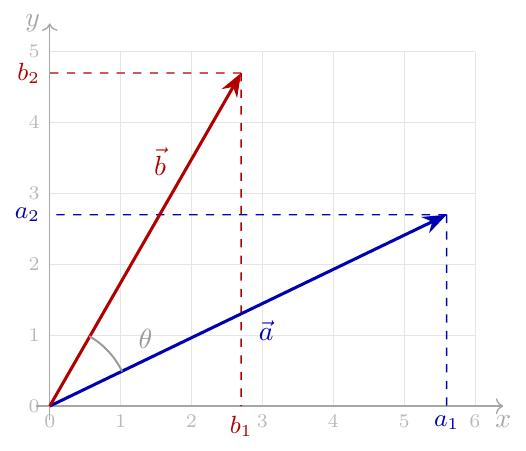
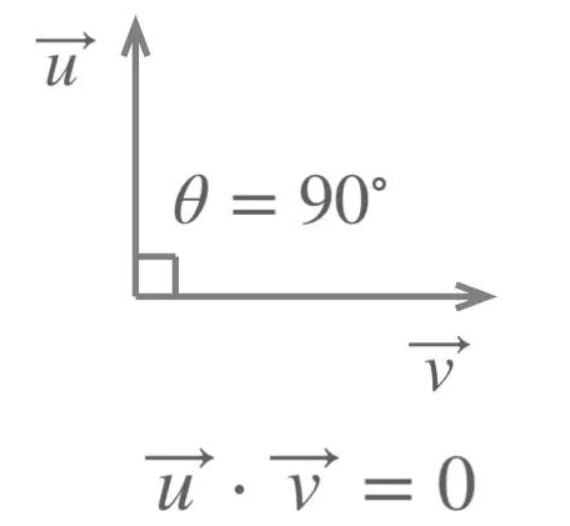
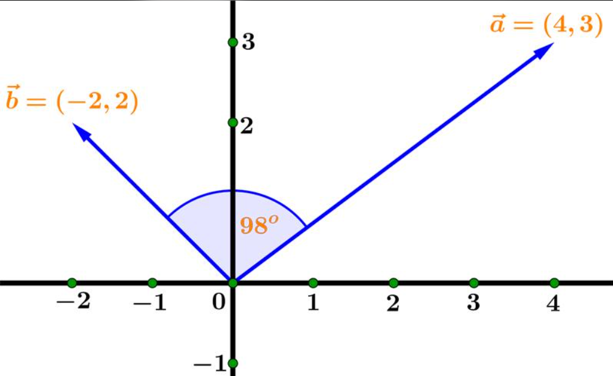

# 31\. Dot Product

## 1\. What is a dot product?

The **dot product** is a mathematical operation that multiplies the corresponding elements of two vectors and adds the results.

It is also called the **scalar product** because the result is a single number (a scalar), not a vector.

Suppose\:

$$
\vec{a}=[2,3],\qquad \vec{b}=[4,5]
$$

Then\:

$$
\vec{a}\cdot\vec{b}=(2\times4)+(3\times5)
$$

$$
=8+15=\boxed{23}
$$

The dot product is 23.

## 2\. Formula of the dot product

For two vectors with $n$ components\:

$$
\vec{a}\cdot\vec{b}
=\sum_{i=1}^{n}a_i b_i
$$

For a 2D vector\:

$$
\vec{a}\cdot\vec{b}=a_xb_x+a_yb_y
$$

For a 3D vector\:

$$
\vec{a}\cdot\vec{b}
=a_xb_x+a_yb_y+a_zb_z
$$

**Important\:** Both vectors must have the same number of components.

## 3\. Step-by-step example

Calculate the dot product of\:

$$
\vec{a}=[3,4],\qquad \vec{b}=[5,2]
$$

### Step 1: Multiply corresponding elements

$3\times5$

## 15

$4\times2$

## 8

### Step 2: Add the products

$$
15+8=\boxed{23}
$$

## 4\. Geometric meaning of the dot product

The dot product also tells us about the angle between two vectors.

$$
\vec{a}\cdot\vec{b}
=\|\vec{a}\|\|\vec{b}\|\cos\theta
$$

Where\:

- $\|\vec{a}\|$ \= magnitude of vector A
- $\|\vec{b}\|$ \= magnitude of vector B
- $\theta$ \= angle between the vectors

**Acute angle: less than 90°**



The dot product is positive because $\cos\theta>0$\.

The vectors generally point in similar directions.

---


**Right angle: 90°**



The dot product is zero because $\cos90^\circ=0$\.

The vectors are perpendicular.

---


**Obtuse angle: greater than 90° and less than 180°**



The dot product is negative because $\cos\theta<0$\.

The vectors point in generally opposing directions.

## 5\. Calculate the angle between vectors

Rearrange the dot product formula\:

$$
\cos\theta=
\frac{\vec{a}\cdot\vec{b}}
{\|\vec{a}\|\|\vec{b}\|}
$$

Therefore\:

$$
\theta=\cos^{-1}\left(
\frac{\vec{a}\cdot\vec{b}}
{\|\vec{a}\|\|\vec{b}\|}
\right)
$$

Example\:

$$
\vec{a}=[1,0],\qquad \vec{b}=[0,1]
$$

Their dot product is\:

$$
(1\times0)+(0\times1)=0
$$

Both magnitudes are 1, so\:

$$
\theta=\cos^{-1}(0)=90^\circ
$$

The vectors are perpendicular.

## 6\. Implement the dot product using NumPy

```python
import numpy as np

a = np.array([3, 4])
b = np.array([5, 2])

dot_product = np.dot(a, b)

print("Dot product:", dot_product)
```

Output\:

```text
Dot product: 23
```

You can also use `a @ b` for the dot product of two 1D NumPy arrays.

### Calculate the angle using Python

```python
import numpy as np

a = np.array([1, 0])
b = np.array([0, 1])

cos_theta = np.dot(a, b) / (
    np.linalg.norm(a) * np.linalg.norm(b)
)

angle = np.degrees(np.arccos(np.clip(cos_theta, -1, 1)))

print("Angle:", angle, "degrees")
```

Output\:

```text
Angle: 90.0 degrees
```

The `np.clip()` call protects against tiny floating-point rounding errors. Both vectors must be nonzero to calculate the angle this way.

## 7\. Applications in Machine Learning

### A. Linear regression

A model calculates predictions using a dot product between input features and model weights.

$$
\hat{y}=\vec{w}\cdot\vec{x}+b
$$

Suppose\:

$$
\vec{x}=[5,80],\qquad
\vec{w}=[2,0.5],\qquad b=10
$$

Then\:

$$
\hat{y}=(5\times2)+(80\times0.5)+10
$$

$$
\boxed{\hat{y}=60}
$$

Here, the weights determine how much each feature contributes to the prediction.

### B. Similarity measurement

Dot products help measure alignment between vectors. In text processing, normalized dot products are used to calculate **cosine similarity**, which is useful for comparing document or sentence embeddings.

### C. Neural networks

Neurons calculate weighted sums of their input values using dot products, then apply an activation function.

## Practice questions

1. Calculate the dot product of $[2,4]$ and $[3,5]$\.
2. What is the dot product of $[1,0]$ and $[0,1]$?
3. If two nonzero vectors have a dot product of zero, what is their relationship?
4. Calculate the dot product of $[1,2,3]$ and $[4,5,6]$\.
5. Explain how a dot product is used in linear regression.

