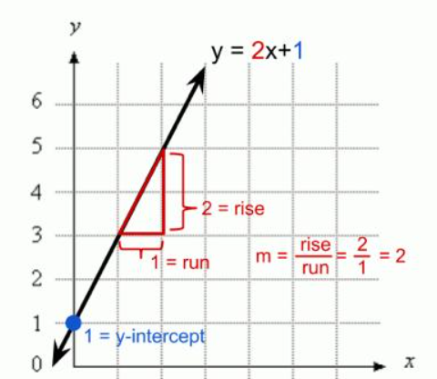

# 32\. Linear Equations

## 1\. What is a linear equation?

A **linear equation** is an equation in which the variables have a power of 1 and the relationship between the variables forms a straight line when graphed in two dimensions.

Examples\:

$$
2x+3=7
$$

$$
y=2x+5
$$

$$
2x+3y=12
$$

Linear equations are important in Machine Learning because models such as Linear Regression learn relationships between input features and output values.

## 2\. Basic components of a linear equation

Consider\:

$$
y=3x+2
$$

| Component | Value | Meaning |
|--------|--------|--------|
| $x$ | Input variable | Independent variable |
| $y$ | Output variable | Dependent variable |
| $3$ | Slope | Change in $y$ for a one-unit increase in $x$ |
| $2$ | Y-intercept | Value of $y$ when $x=0$ |

The standard equation of a straight line is\:

$$
\boxed{y=mx+c}
$$

Where\:

- $m$ \= slope
- $c$ \= y-intercept
- $x$ \= input
- $y$ \= output

## 3\. Understanding slope and intercept


Consider\:

$$
y=2x+1
$$

Calculate some values\:

| $x$ | Calculation | $y$ |
|--------|--------|--------|
| 0 | $2(0)+1$ | 1 |
| 1 | $2(1)+1$ | 3 |
| 2 | $2(2)+1$ | 5 |
| 3 | $2(3)+1$ | 7 |

**Slope\:** $m=2$\. For every increase of 1 in $x$, $y$ increases by 2.

**Y-intercept\:** $c=1$\. The line crosses the y-axis at $(0,1)$\.

## 4\. Solving a linear equation

Suppose\:

$$
3x+6=18
$$

Step 1: Subtract 6 from both sides.

$$
3x=18-6=12
$$

Step 2: Divide both sides by 3.

$$
x=\frac{12}{3}
$$

$$
\boxed{x=4}
$$

The goal is to isolate the unknown variable while keeping both sides of the equation equal.

## 5\. System of linear equations

Sometimes, we have two equations with two unknown variables.

$$
x+y=10
$$

$$
x-y=2
$$

Add the two equations\:

$$
2x=12
$$

Therefore\:

$$
x=6
$$

Substitute into $x+y=10$\:

$$
6+y=10
$$

$$
\boxed{x=6,\quad y=4}
$$

The solution satisfies both equations simultaneously.

## 6\. Implement linear equations using Python

### A. Calculate outputs from a line

```python
import numpy as np

x = np.array([0, 1, 2, 3, 4])

m = 2
c = 1

y = m * x + c

print("X:", x)
print("Y:", y)
```

Output\:

```text
X: [0 1 2 3 4]
Y: [1 3 5 7 9]
```

### B. Solve a system of equations

```python
import numpy as np

# x + y = 10
# x - y = 2

A = np.array([
    [1, 1],
    [1, -1]
])

B = np.array([10, 2])

solution = np.linalg.solve(A, B)

print("x =", solution[0])
print("y =", solution[1])
```

Output\:

```text
x = 6.0
y = 4.0
```

Here, `A` contains the coefficients, and `B` contains the right-hand-side values.

## 7\. Application in Machine Learning: Linear Regression

Suppose we want to predict a student's marks using study hours.

A simple model might be\:

$$
\hat{y}=10x+20
$$

Where\:

- $x$ \= study hours
- $\hat{y}$ \= predicted marks
- $10$ \= learned coefficient (slope)
- $20$ \= learned intercept

For 5 study hours\:

$$
\hat{y}=10(5)+20=70
$$

The predicted marks are 70.

In real Machine Learning, the slope and intercept are learned from training data rather than chosen arbitrarily. Actual predictions may not match the observed marks exactly.

For multiple input features, Linear Regression generalizes to\:

$$
\hat{y}=w_1x_1+w_2x_2+\cdots+w_nx_n+b
$$

This is the foundation of multiple linear regression.

## Practice questions

1. Solve $2x+4=14$\.
2. Identify the slope and intercept of $y=5x+3$\.
3. Find $y$ when $x=4$ in $y=3x+2$\.
4. Solve $x+y=8$ and $x-y=4$\.
5. If a model predicts marks using $\hat{y}=8x+15$, calculate the prediction for 6 study hours.
