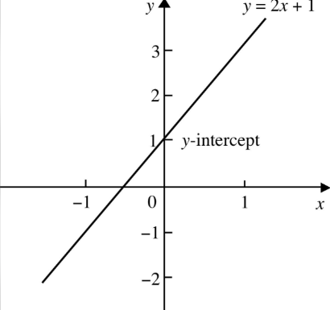
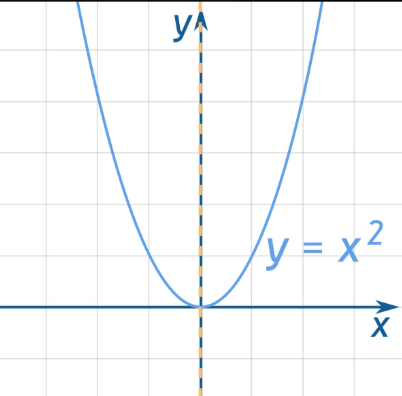
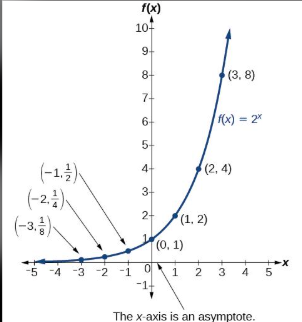
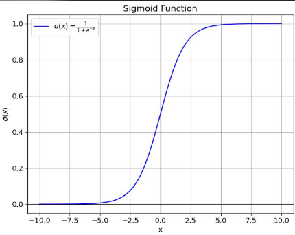

# 33\. Functions

## 1\. What is a function?

A **function** is a mathematical rule that maps each valid input to exactly one output.

A function is commonly written as\:

$$
y=f(x)
$$

Here\:

- $x$ \= input
- $f$ \= function or rule
- $y$ \= output

For example\:

$$
f(x)=2x+3
$$

If the input is $x=4$\:

$$
f(4)=2(4)+3=11
$$

Therefore, the output is **11**\.

### How a function works

Input

# 4

Function

## $2x+3$

Output

# 11

Every valid input must have exactly one output.

## 2\. How to calculate a function

Consider\:

$$
f(x)=x^2+2
$$

Substitute different input values.

| Input $x$ | Calculation | Output $f(x)$ |
|--------|--------|--------|
| 0 | $0^2+2$ | 2 |
| 1 | $1^2+2$ | 3 |
| 2 | $2^2+2$ | 6 |
| 3 | $3^2+2$ | 11 |
| 4 | $4^2+2$ | 18 |

The same function produces different outputs for different inputs.

## 3\. Domain, codomain, and range

Consider\:

$$
f(x)=x^2
$$

- **Domain\:** The set of permitted inputs.
- **Codomain\:** The specified set in which outputs are expected to lie.
- **Range\:** The set of outputs the function actually produces.

If the domain is all real numbers and the codomain is all real numbers, then\:

- Domain: $\mathbb{R}$
- Codomain: $\mathbb{R}$
- Range: $[0,\infty)$

Why? Squaring a real number cannot produce a negative result.

## 4\. Common types of functions


**A. Linear function**

$$
f(x)=2x+1
$$

Produces a straight-line graph. Used in Linear Regression.


---


**B. Quadratic function**

$$
f(x)=x^2
$$

Produces a parabolic graph. Used in polynomial models and optimization problems.


---


**C. Exponential function**

$$
f(x)=2^x
$$

Represents exponential growth or decay, depending on the base and form.


---


**D. Sigmoid function**

$$
\sigma(x)=\frac{1}{1+e^{-x}}
$$

Maps real inputs into the interval $(0,1)$\. Commonly used to produce probability estimates in binary classification.



## 5\. Functions in Python

```python
def predict_marks(study_hours):
    return 10 * study_hours + 20

print(predict_marks(2))
print(predict_marks(5))
print(predict_marks(8))
```

Output\:

```text
40
70
100
```

The function takes study hours as input and returns predicted marks.

You can also calculate a mathematical function using NumPy\:

```python
import numpy as np

x = np.array([0, 1, 2, 3, 4])

y = x**2 + 2

print(y)
```

Output\:

```text
[ 2  3  6 11 18]
```

## 6\. Functions in Machine Learning

A Machine Learning model can be understood as a learned function\:

$$
\hat{y}=f(X)
$$

Where\:

- $X$ \= input features
- $f$ \= trained model
- $\hat{y}$ \= predicted output

For example, a house-price model learns a relationship between features such as area, number of rooms, and location and the estimated price.

Different models learn different functions. Linear Regression learns a linear relationship, while a Decision Tree learns a series of feature-based rules.

## 7\. Loss functions

A **loss function** measures how far a model's prediction is from the actual value.

For a single regression prediction, squared error is\:

$$
L(y,\hat{y})=(y-\hat{y})^2
$$

If the actual price is ₹50 lakh and the predicted price is ₹45 lakh\:

$$
L=(50-45)^2=25
$$

The squared error is 25 in squared-lakh units. Training algorithms attempt to minimize an appropriate loss function across the training dataset.

## Practice questions

1. Calculate $f(3)$ if $f(x)=4x+2$\.
2. Find the outputs of $f(x)=x^2-1$ for $x=0,1,2$\.
3. Explain the difference between domain and range.
4. Why is the sigmoid function useful in binary classification?
5. What is the purpose of a loss function in Machine Learning?
