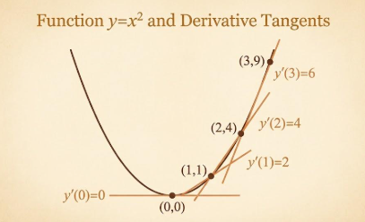

# 34\. Derivatives

## 1\. What is a derivative?

A **derivative measures the instantaneous rate of change of a function with respect to its input.**

In simple words, it tells us how quickly the output changes when the input changes by a very small amount.

Consider the function\:

$$
f(x)=x^2
$$

When $x=2$, the output is $f(2)=4$\. The derivative at $x=2$ is 4, meaning the function's instantaneous rate of change at that point is 4.

Derivatives are essential in Machine Learning because they help models determine how to adjust their parameters to reduce prediction errors.

## 2\. Derivative as the slope of a curve

For a straight line\:

$$
y=mx+c
$$

The slope is constant and equals $m$\.

For a curved function such as\:

$$
f(x)=x^2
$$

the slope changes at different points. The derivative tells us the slope at a particular point.



For $f(x)=x^2$\:

- At $x=1$, the derivative is 2.
- At $x=2$, the derivative is 4.
- At $x=3$, the derivative is 6.

As $x$ increases, the slope becomes steeper.

## 3\. Derivative notation

A derivative can be represented in several ways.

| Notation | Meaning |
|--------|--------|
| $f'(x)$ | Derivative of function $f$ |
| $\frac{dy}{dx}$ | Derivative of $y$ with respect to $x$ |
| $\frac{d}{dx}f(x)$ | Differentiate $f(x)$ with respect to $x$ |

All three notations can represent the same derivative.

## 4\. Basic differentiation rules

These are the most important rules to understand before learning Gradient Descent.

| Function | Derivative |
|--------|--------|
| $f(x)=c$ | $f'(x)=0$ |
| $f(x)=x$ | $f'(x)=1$ |
| $f(x)=x^2$ | $f'(x)=2x$ |
| $f(x)=x^3$ | $f'(x)=3x^2$ |
| $f(x)=ax^n$ | $f'(x)=anx^{n-1}$ |
| $f(x)=mx+c$ | $f'(x)=m$ |

Here, $a$, $c$, $m$, and $n$ are constants where applicable.

### The power rule

For a power function\:

$$
f(x)=x^n
$$

The derivative is\:

$$
\boxed{f'(x)=nx^{n-1}}
$$

**Remember\:** Multiply by the original power, then reduce the power by one.

## 5\. Step-by-step examples

### Example 1: Differentiate $f(x)=x^2$

Apply the power rule\:

$$
f'(x)=2x^{2-1}
$$

Therefore\:

$$
\boxed{f'(x)=2x}
$$

At $x=3$\:

$$
f'(3)=2(3)=6
$$

The instantaneous rate of change at $x=3$ is 6.

### Example 2: Differentiate $f(x)=3x^2+4x+5$

Differentiate each term separately\:

$$
\frac{d}{dx}(3x^2)=6x
$$

$$
\frac{d}{dx}(4x)=4
$$

$$
\frac{d}{dx}(5)=0
$$

Combine the results\:

$$
\boxed{f'(x)=6x+4}
$$

At $x=2$\:

$$
f'(2)=6(2)+4=16
$$

### Example 3: A linear function

$$
f(x)=5x+10
$$

Its derivative is\:

$$
\boxed{f'(x)=5}
$$

The slope is always 5, regardless of the value of $x$\.

## 6\. The mathematical definition of a derivative

The formal definition uses a limit\:

$$
f'(x)=\lim_{h\to0}
\frac{f(x+h)-f(x)}{h}
$$

This represents the instantaneous rate of change as the input difference $h$ approaches zero.

For example, let\:

$$
f(x)=x^2
$$

Substitute into the definition\:

$$
f'(x)=\lim_{h\to0}
\frac{(x+h)^2-x^2}{h}
$$

Expand the square\:

$$
=\lim_{h\to0}
\frac{x^2+2xh+h^2-x^2}{h}
$$

Simplify\:

$$
=\lim_{h\to0}(2x+h)
$$

As $h\to0$\:

$$
\boxed{f'(x)=2x}
$$

This is the mathematical foundation of differentiation.

## 7\. Derivatives using Python

You can calculate derivatives symbolically with SymPy.

```python
import sympy as sp

x = sp.symbols("x")

f = 3 * x**2 + 4 * x + 5

derivative = sp.diff(f, x)

print("Function:", f)
print("Derivative:", derivative)
print("Derivative at x=2:", derivative.subs(x, 2))
```

Output\:

```text
Function: 3*x**2 + 4*x + 5
Derivative: 6*x + 4
Derivative at x=2: 16
```

Install SymPy if required\:

```bash
pip install sympy
```

## 8\. Why derivatives matter in Machine Learning

Suppose a model uses a parameter $w$ and has a loss function\:

$$
L(w)=(w-5)^2
$$

The derivative is\:

$$
\frac{dL}{dw}=2(w-5)
$$

At $w=2$\:

$$
\frac{dL}{dw}=2(2-5)=-6
$$

The negative derivative indicates that increasing $w$ from this point will initially decrease the loss.

A training algorithm can use this derivative to update the parameter in a direction that reduces the loss.

This leads directly to the next topic: **Gradient**, which extends derivatives to functions with multiple input variables.

## Practice questions

1. Differentiate $f(x)=x^3$\.
2. Differentiate $f(x)=4x^2+3x+7$\.
3. Find the derivative of $f(x)=7x+9$\.
4. Calculate $f'(2)$ if $f(x)=x^2+3x$\.
5. For $L(w)=(w-4)^2$, calculate the derivative and evaluate it at $w=1$\.
