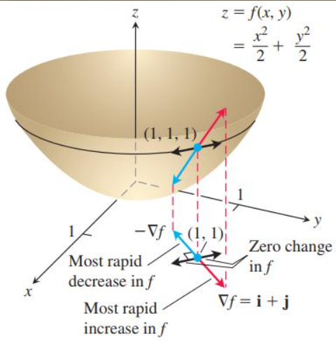

# 35\. Gradient

## 1\. What is a gradient?

A **gradient is a vector containing the partial derivatives of a function with respect to its input variables.**

A derivative tells us the rate of change of a function with respect to one variable. A gradient extends this idea to functions with multiple variables.

For a function\:

$$
f(x,y)=x^2+y^2
$$

The gradient is\:

$$
\boxed{\nabla f=
\begin{bmatrix}
\frac{\partial f}{\partial x}\\[4pt]
\frac{\partial f}{\partial y}
\end{bmatrix}}
$$

Here, $\nabla$ $called *nabla*$ is the gradient operator, and $\partial$ represents a partial derivative.

## 2\. Derivative vs partial derivative vs gradient

| Concept | Meaning | Example |
|--------|--------|--------|
| Derivative | Rate of change with respect to one variable | $\frac{df}{dx}$ |
| Partial derivative | Rate of change with respect to one variable while holding others constant | $\frac{\partial f}{\partial x}$ |
| Gradient | Vector of all partial derivatives | $\nabla f$ |

For a function of one variable, the derivative is a scalar. For a differentiable function of multiple variables, the gradient is a vector.

## 3\. How to calculate a gradient

Consider\:

$$
f(x,y)=x^2+y^2
$$

**Step 1: Differentiate with respect to $x$\.**

Treat $y$ as a constant.

$$
\frac{\partial f}{\partial x}=2x
$$

**Step 2: Differentiate with respect to $y$\.**

Treat $x$ as a constant.

$$
\frac{\partial f}{\partial y}=2y
$$

**Step 3: Combine the partial derivatives.**

$$
\boxed{\nabla f(x,y)=
\begin{bmatrix}
2x\\
2y
\end{bmatrix}}
$$

At the point $(x,y)=(3,4)$\:

$$
\nabla f(3,4)=
\begin{bmatrix}
6\\
8
\end{bmatrix}
$$

The gradient at this point is $[6,8]$\.

## 4\. Visual interpretation of a gradient


Imagine standing on a curved surface\:

- The **gradient points in the direction of steepest increase** of the function at that point.
- Its magnitude indicates the maximum rate of increase per unit distance.
- The negative gradient points in the direction of steepest local decrease.

For the function $f(x,y)=x^2+y^2$, the gradient at $(3,4)$ is $[6,8]$\. It points away from the origin, where the function increases.

## 5\. Interactive example: Calculate a gradient

Try changing the values of $x$ and $y$\.

## Function: $f(x,y)=x^2+y^2$

x coordinate

> **Slider**
>
> Current value unavailable.
>
> **Range:** -5 to 5
>
> **Step:** 1
>
> **Scale labels:** -5 - \-5 · 0 - 0 · 5 - 5

y coordinate

> **Slider**
>
> Current value unavailable.
>
> **Range:** -5 to 5
>
> **Step:** 1
>
> **Scale labels:** -5 - \-5 · 0 - 0 · 5 - 5

---

Function value

Gradient magnitude

Gradient vector at (, \)

$$
\nabla f=\begin{bmatrix}\\\end{bmatrix}
$$

At the origin, the gradient is zero.

## 6\. Gradient for a Machine Learning loss function

Suppose a model has two parameters, $w$ and $b$, and a loss function\:

$$
L(w,b)=(w-3)^2+(b-2)^2
$$

We calculate the partial derivatives\:

$$
\frac{\partial L}{\partial w}=2(w-3)
$$

$$
\frac{\partial L}{\partial b}=2(b-2)
$$

Therefore, the gradient is\:

$$
\boxed{\nabla L=
\begin{bmatrix}
2(w-3)\\
2(b-2)
\end{bmatrix}}
$$

At $w=1$ and $b=5$\:

$$
\nabla L=
\begin{bmatrix}
-4\\
6
\end{bmatrix}
$$

The negative gradient is\:

$$
-\nabla L=
\begin{bmatrix}
4\\
-6
\end{bmatrix}
$$

This indicates that a small update in the direction of increasing $w$ and decreasing $b$ will locally reduce the loss.

## 7\. Calculate gradients using Python

Using SymPy for symbolic differentiation\:

```python
import sympy as sp

w, b = sp.symbols("w b")

loss = (w - 3)**2 + (b - 2)**2

gradient_w = sp.diff(loss, w)
gradient_b = sp.diff(loss, b)

print("dL/dw:", gradient_w)
print("dL/db:", gradient_b)

print("Gradient at (1, 5):", (
    gradient_w.subs({w: 1, b: 5}),
    gradient_b.subs({w: 1, b: 5})
))
```

Output\:

```text
dL/dw: 2*w - 6
dL/db: 2*b - 4
Gradient at (1, 5): (-4, 6)
```

## 8\. Why gradients matter in Machine Learning

Gradients are used in\:

- **Linear Regression\:** Updating weights and bias to minimize prediction error.
- **Logistic Regression\:** Optimizing model parameters using a loss function.
- **Neural Networks\:** Backpropagation computes gradients for network parameters.
- **Deep Learning\:** Gradient-based optimizers update millions of parameters efficiently.

A gradient tells us how the loss changes with each parameter. An optimization algorithm uses that information to update the parameters.

## Practice questions

1. Calculate the gradient of $f(x,y)=x^2+3y^2$\.
2. Evaluate the gradient of $f(x,y)=x^2+y^2$ at $(2,3)$\.
3. What does a zero gradient mean, and why does it not always guarantee a minimum?
4. What is the difference between a gradient and a negative gradient?
5. Why does a Machine Learning model need gradients during training?
