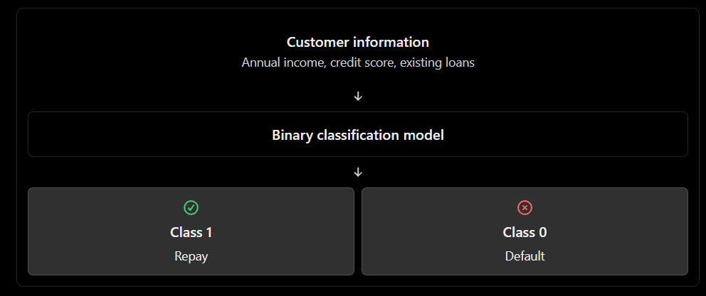

## Topic 2: Binary Classification

### 1\. Definition

**Binary Classification is a supervised machine learning task in which a model predicts one of exactly two possible classes.**

Examples\:

| Problem | Class 0 | Class 1 |
|--------|--------|--------|
| Student result | Fail | Pass |
| Email detection | Not Spam | Spam |
| Loan approval | Rejected | Approved |
| Fraud detection | Genuine | Fraud |
| Customer churn | Not Churn | Churn |
| Disease screening | Negative | Positive |

The class labels can be `0` and `1`, or names such as `"Approved"` and `"Rejected"`\. The numerical labels are simply a representation of the categories.

### 2\. How binary classification works

Suppose a bank wants to predict whether a customer will repay a loan.


The model learns relationships between historical customer information and the observed outcomes, then predicts a class for a new customer.

### 3\. Dataset example

Consider this student dataset.

```python
import pandas as pd

df = pd.DataFrame({
    "study_hours": [1, 2, 3, 4, 5, 6, 7, 8, 2, 6],
    "attendance":  [35, 40, 50, 55, 65, 75, 85, 95, 45, 80],
    "result":      [0, 0, 0, 0, 1, 1, 1, 1, 0, 1]
})

print(df)
```

Here\:

- `study_hours` and `attendance` are the input features.
- `result` is the target variable.
- `0` represents Fail.
- `1` represents Pass.

These records are illustrative teaching data, not a real-world validated dataset.

### 4\. Train a binary classification model

We will use Logistic Regression from Scikit-learn.

```python
from sklearn.linear_model import LogisticRegression
from sklearn.model_selection import train_test_split
from sklearn.metrics import accuracy_score, classification_report

# Separate features and target
X = df[["study_hours", "attendance"]]
y = df["result"]

# Split data into training and testing sets
X_train, X_test, y_train, y_test = train_test_split(
    X,
    y,
    test_size=0.3,
    random_state=42,
    stratify=y
)

# Create and train the classifier
model = LogisticRegression()
model.fit(X_train, y_train)

# Predict classes for unseen test records
y_pred = model.predict(X_test)

print("Actual:", y_test.to_list())
print("Predicted:", y_pred.tolist())

print("Accuracy:", accuracy_score(y_test, y_pred))
print(classification_report(y_test, y_pred, zero_division=0))
```

`stratify=y` helps preserve the approximate class proportions in both sets. With only 10 records, however, the evaluation is highly uncertain; use a substantially larger representative dataset for meaningful performance estimates.

### 5\. Understanding probability and the class label

A binary classifier can estimate the probability of belonging to class `1`\.

For example, suppose a model estimates\:

$$
P(\text{Pass})=0.82
$$

Then\:

$$
P(\text{Fail})=1-0.82=0.18
$$

With the default decision threshold of `0.5`, the model predicts Pass because $0.82 \geq 0.5$\.

In Python\:

```python
new_student = pd.DataFrame({
    "study_hours": [5],
    "attendance": [70]
})

# Predicted class
print(model.predict(new_student))

# Probability for each class
print(model.predict_proba(new_student))
```

`predict_proba()` returns probabilities in the order of `model.classes_`\. Check that attribute rather than assuming column positions for arbitrary label encodings.

### 6\. Important concept: the decision threshold

The default threshold of `0.5` is not mandatory.

- Lower threshold: more observations may be classified as positive.
- Higher threshold: fewer observations may be classified as positive.

For fraud detection, a lower threshold may help catch more fraudulent transactions, but it can also generate more false alarms. The appropriate threshold depends on the business costs of false positives and false negatives.

### 7\. Key takeaways

- Binary classification predicts one of two classes.
- The target may be represented as `0/1` or categorical labels.
- A classifier can provide both predicted classes and probabilities.
- The threshold converts a probability into a class prediction.
- Accuracy alone may be misleading when the classes are imbalanced; precision, recall, F1-score and the confusion matrix are also important.
