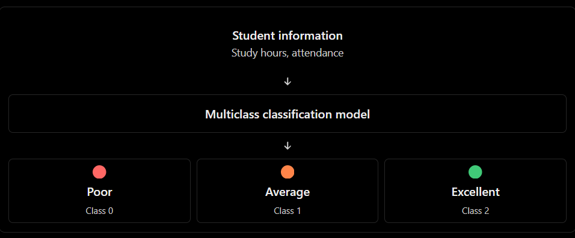

## Topic 3: Multiclass Classification

### 1\. Definition

**Multiclass Classification is a supervised machine learning task in which a model predicts one class from three or more mutually exclusive classes.**

Each observation belongs to exactly one class.

Real-world examples\:

| Problem | Possible classes |
|--------|--------|
| Fruit classification | Apple, Banana, Orange |
| Student performance | Poor, Average, Excellent |
| Customer support | Billing, Technical, Account |
| Handwritten digit recognition | 0, 1, 2, …, 9 |
| Animal classification | Cat, Dog, Horse, Elephant |
| Product classification | Electronics, Clothing, Furniture |

The important distinction is that each observation receives **one class out of several possible classes**\.

## 2\. How multiclass classification works

Suppose a college wants to classify students into three performance categories based on study hours and attendance.


## 3\. Dataset for practice

We will use a DataFrame with three target classes.

```python
import pandas as pd

df = pd.DataFrame({
    "study_hours": [
        1, 2, 3, 2, 3, 4,
        4, 5, 6, 5, 6, 7,
        7, 8, 9, 8, 9, 10
    ],
    "attendance": [
        30, 35, 40, 45, 38, 42,
        55, 60, 65, 70, 62, 68,
        80, 85, 90, 88, 92, 95
    ],
    "performance": [
        "Poor", "Poor", "Poor", "Poor", "Poor", "Poor",
        "Average", "Average", "Average", "Average",
        "Average", "Average",
        "Excellent", "Excellent", "Excellent",
        "Excellent", "Excellent", "Excellent"
    ]
})

print(df.head())
print(df["performance"].value_counts())
```

The target contains three possible values\:

- `Poor`
- `Average`
- `Excellent`

These are categorical labels, not continuous numerical targets.

## 4\. Train a multiclass classification model

Scikit-learn's `LogisticRegression` supports multiclass classification. We can use it directly without manually converting the target into separate binary columns.

```python
from sklearn.linear_model import LogisticRegression
from sklearn.model_selection import train_test_split
from sklearn.metrics import (
    accuracy_score,
    confusion_matrix,
    classification_report
)

# Features and target
X = df[["study_hours", "attendance"]]
y = df["performance"]

# Split the dataset
X_train, X_test, y_train, y_test = train_test_split(
    X,
    y,
    test_size=0.33,
    random_state=42,
    stratify=y
)

# Train the model
model = LogisticRegression(max_iter=1000)
model.fit(X_train, y_train)

# Predictions
y_pred = model.predict(X_test)

print("Actual:", y_test.to_list())
print("Predicted:", y_pred.tolist())

print("Accuracy:", accuracy_score(y_test, y_pred))

print("\nConfusion Matrix:")
print(confusion_matrix(
    y_test,
    y_pred,
    labels=model.classes_
))

print("\nClassification Report:")
print(classification_report(
    y_test,
    y_pred,
    zero_division=0
))
```

## 5\. How does the model choose one class?

A multiclass Logistic Regression model can estimate a probability for each class.

Suppose the model returns the following probabilities for a student\:

| Class | Predicted probability |
|--------|--------|
| Poor | 0.10 |
| Average | 0.25 |
| Excellent | 0.65 |
| **Total** | **1.00** |

The predicted class is Excellent because it has the highest probability.

$$
\hat{y}=\arg\max_{k} P(y=k\mid X)
$$

Here, $\arg\max$ means selecting the class with the largest estimated probability.

In Python\:

```python
new_student = pd.DataFrame({
    "study_hours": [8],
    "attendance": [85]
})

# Predicted class
print(model.predict(new_student))

# Probabilities for all classes
probabilities = model.predict_proba(new_student)

probability_df = pd.DataFrame(
    probabilities,
    columns=model.classes_
)

print(probability_df.round(3))
```

The probability columns follow the order in `model.classes_`\.

## 6\. How to evaluate multiclass classification

| Metric | What it tells us |
|--------|--------|
| Accuracy | Percentage of correctly classified observations |
| Precision | How many predictions for a class were correct |
| Recall | How many actual observations of a class were identified |
| F1-score | Harmonic mean of precision and recall |
| Confusion matrix | Which classes the model confuses with others |

For example, a model might frequently confuse Average students with Excellent students. The confusion matrix helps identify this specific weakness, which a single accuracy score cannot explain.
