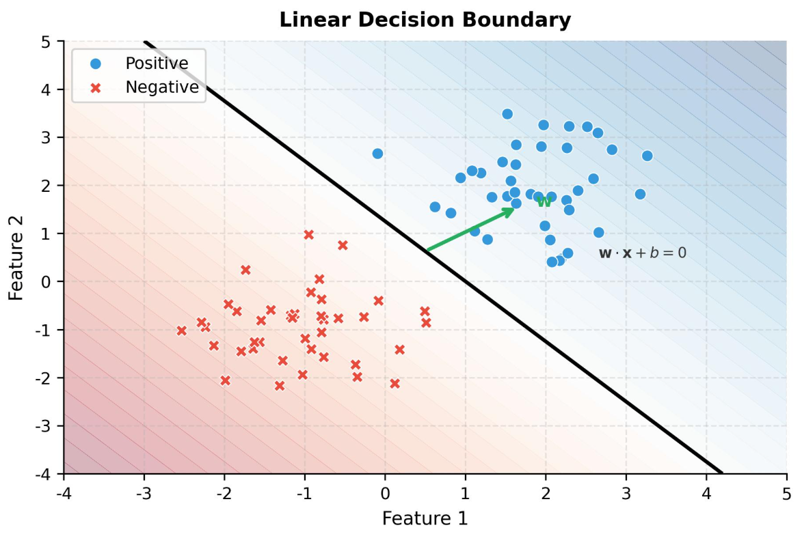

# Module 6 - Classification

## Topic 6: Decision Boundary

### 1\. Definition

A **decision boundary** is a line, curve, or surface that separates different predicted classes in a machine learning model.

For example, a model may classify students based on study hours\:

- Below the boundary → Fail (Class 0)
- Above the boundary → Pass (Class 1)

The exact boundary depends on the model, its learned parameters, and the features used.

### 2\. Visual intuition



Imagine a dataset containing two classes. The classifier learns a boundary that separates regions where it predicts different classes.

Common boundary shapes include\:

- **Linear\:** a straight line in two dimensions.
- **Nonlinear\:** a curve that separates complex patterns.
- **Higher-dimensional\:** a plane or hyperplane when there are more features.

### 3\. Decision boundary in Logistic Regression

For binary Logistic Regression\:

$$
P(y=1\mid X)=\sigma(w_1x_1+w_2x_2+b)
$$

Using the default threshold of 0.5, the boundary occurs where\:

$$
P(y=1\mid X)=0.5
$$

Because $\sigma(0)=0.5$, this is equivalent to\:

$$
\boxed{w_1x_1+w_2x_2+b=0}
$$

For two features, this equation represents a straight line.

Rearranging\:

$$
x_2=-\frac{w_1}{w_2}x_1-\frac{b}{w_2}
$$

This is the familiar straight-line form $y=mx+c$\.

### 4\. Python example

The following code trains Logistic Regression and plots its decision boundary using two numerical features.

```python
import numpy as np
import matplotlib.pyplot as plt

from sklearn.datasets import make_classification
from sklearn.linear_model import LogisticRegression

# Create an illustrative binary dataset
X, y = make_classification(
    n_samples=200,
    n_features=2,
    n_informative=2,
    n_redundant=0,
    n_clusters_per_class=1,
    class_sep=1.2,
    random_state=42
)

# Train the model
model = LogisticRegression()
model.fit(X, y)

# Create a grid covering the feature space
x_min, x_max = X[:, 0].min() - 1, X[:, 0].max() + 1
y_min, y_max = X[:, 1].min() - 1, X[:, 1].max() + 1

xx, yy = np.meshgrid(
    np.linspace(x_min, x_max, 300),
    np.linspace(y_min, y_max, 300)
)

# Predict probabilities across the grid
grid = np.column_stack([xx.ravel(), yy.ravel()])
probabilities = model.predict_proba(grid)[:, 1]
probabilities = probabilities.reshape(xx.shape)

# Plot probability regions and the 0.5 boundary
plt.contourf(xx, yy, probabilities, levels=20, alpha=0.3)
plt.contour(
    xx, yy, probabilities,
    levels=[0.5],
    colors="black",
    linewidths=2
)

plt.scatter(
    X[:, 0], X[:, 1],
    c=y, edgecolors="black"
)

plt.xlabel("Feature 1")
plt.ylabel("Feature 2")
plt.title("Logistic Regression Decision Boundary")
plt.show()
```

### 5\. Important observations

- The black line represents the 0.5 probability boundary.
- Points on one side are predicted as Class 0; points on the other side as Class 1.
- A point near the boundary has a predicted probability near 0.5.
- Changing the threshold changes the classification boundary when the model's probability varies across the feature space.
- Logistic Regression produces a linear boundary in the original feature space when it uses only ordinary linear features. Adding polynomial features can produce nonlinear boundaries.

### 6\. Which algorithms create which boundaries?

| Algorithm | Typical decision boundary |
|--------|--------|
| Logistic Regression | Linear |
| K-Nearest Neighbors | Often irregular and nonlinear |
| Naive Bayes | Depends on the probability distributions |
| Decision Tree | Step-like regions |
| Random Forest | Complex, nonlinear regions |
| SVM | Linear or nonlinear, depending on the kernel |
| Gradient Boosting | Complex, nonlinear regions |
