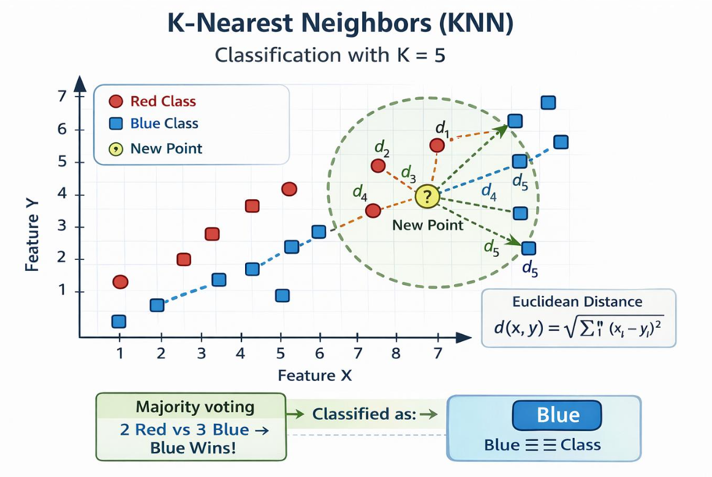

## Topic 7: K-Nearest Neighbors (KNN)

### 1\. Definition

**K-Nearest Neighbors (KNN) is a supervised machine learning algorithm that predicts the class of a new observation by examining the classes of its nearest training observations.**

KNN is an example of a *distance-based* algorithm. It does not usually learn a fixed set of model coefficients during training. Instead, it stores the training data and calculates distances when making predictions.

### 2\. Real-world example

Suppose a bank wants to classify a new customer as Low Risk or High Risk using income and credit score.

KNN works as follows\:

1. Calculate the distance between the new customer and existing customers.
2. Find the $K$ closest customers.
3. Examine their known risk classes.
4. Predict the majority class among those neighbors.

If $K=5$ and the five nearest customers contain three Low Risk and two High Risk labels, the prediction is **Low Risk**\.



## 3\. What does K mean?

The value $K$ represents the number of nearest neighbors considered when predicting a class.

| K value | Behavior |
|--------|--------|
| 1 | Uses only the closest observation; sensitive to noise |
| 3 | Uses the three closest observations |
| 5 | Uses the five closest observations |
| 15 | Uses a larger neighborhood; may smooth away local patterns |

A very small $K$ may overfit, while a very large $K$ may underfit. The best value depends on the dataset and should be selected using validation or cross-validation.

## 4\. How does KNN calculate distance?

One common distance measure is **Euclidean distance**\.

For two observations with features $x_1,x_2$ and $y_1,y_2$\:

$$
d=\sqrt{(x_1-y_1)^2+(x_2-y_2)^2}
$$

For example, consider two students\:

- Student A: 4 study hours, 60% attendance.
- Student B: 6 study hours, 70% attendance.

Their Euclidean distance is\:

$$
d=\sqrt{(6-4)^2+(70-60)^2}
$$

$$
d=\sqrt{4+100}=\sqrt{104}\approx10.20
$$

This calculation treats the two numerical features as coordinates. However, attendance has a much larger numerical scale than study hours, so it can dominate the distance calculation.

**This is why feature scaling is particularly important for KNN.**

## 5\. Python implementation using Scikit-learn

We will predict whether a student passes or fails based on study hours and attendance.

```python
import pandas as pd

from sklearn.model_selection import train_test_split
from sklearn.pipeline import make_pipeline
from sklearn.preprocessing import StandardScaler
from sklearn.neighbors import KNeighborsClassifier
from sklearn.metrics import accuracy_score, classification_report

# Student dataset
df = pd.DataFrame({
    "study_hours": [
        1, 2, 2, 3, 3, 4, 4, 5, 5, 6,
        6, 7, 7, 8, 8, 9, 2, 4, 6, 9
    ],
    "attendance": [
        35, 40, 45, 48, 52, 55, 60, 62, 68, 70,
        75, 78, 82, 85, 90, 95, 38, 58, 73, 92
    ],
    "result": [
        0, 0, 0, 0, 0, 0, 0, 1, 1, 1,
        1, 1, 1, 1, 1, 1, 0, 0, 1, 1
    ]
})

X = df[["study_hours", "attendance"]]
y = df["result"]

X_train, X_test, y_train, y_test = train_test_split(
    X, y,
    test_size=0.25,
    random_state=42,
    stratify=y
)

# Scale features and train KNN
model = make_pipeline(
    StandardScaler(),
    KNeighborsClassifier(n_neighbors=5)
)

model.fit(X_train, y_train)

y_pred = model.predict(X_test)

print("Accuracy:", accuracy_score(y_test, y_pred))
print(classification_report(y_test, y_pred, zero_division=0))

# Predict for a new student
new_student = pd.DataFrame({
    "study_hours": [6],
    "attendance": [72]
})

prediction = model.predict(new_student)[0]

print("Prediction:", "Pass" if prediction == 1 else "Fail")
```

The dataset is illustrative. The accuracy on a small test set will be unstable and should not be treated as a reliable estimate of real-world performance.

### 6\. Why use `StandardScaler`?

Standardization transforms numerical features approximately to mean 0 and standard deviation 1\:

$$
z=\frac{x-\mu}{\sigma}
$$

Without scaling, attendance values such as `70` may contribute much more to distance than study hours such as `6`\.

The pipeline ensures that the scaler is fitted only on the training data, avoiding leakage from the test set.

### 7\. How to select the best K

You can compare multiple values of $K$ using cross-validation.

```python
from sklearn.model_selection import GridSearchCV, StratifiedKFold

cv = StratifiedKFold(
    n_splits=5,
    shuffle=True,
    random_state=42
)

search = GridSearchCV(
    estimator=model,
    param_grid={
        "kneighborsclassifier__n_neighbors": [3, 5, 7, 9]
    },
    scoring="f1",
    cv=cv,
    n_jobs=-1
)

search.fit(X_train, y_train)

print("Best K:", search.best_params_)
print("Best CV F1:", search.best_score_)
```

For small datasets, ensure every training fold has enough observations in each class and that the selected $K$ does not exceed the training-fold size. The example's cross-validation scores are for practice, not a production-quality estimate.

## 8\. Advantages and limitations

| Advantages | Limitations |
|--------|--------|
| Simple to understand | Prediction can be slow on large datasets |
| No complex training process | Sensitive to feature scaling |
| Can model nonlinear boundaries | Sensitive to irrelevant features and noise |
| Supports multiclass classification | Performance depends on $K$ and the distance metric |
