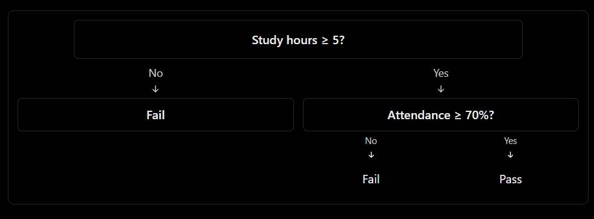

## Topic 9: Decision Tree

### 1\. Definition

A **Decision Tree is a supervised machine learning algorithm that predicts a class by applying a sequence of decision rules to the input features.**

It works like a flowchart: each internal node asks a question, each branch represents an answer, and each leaf node provides a prediction.

Common applications include loan approval, fraud detection, customer churn prediction, and medical risk classification.

## 2\. Understand the intuition

Suppose a college wants to predict whether a student will pass or fail.



This is a simplified illustration of a possible tree, not a tree learned from actual data.

The model learns splitting rules from training observations rather than requiring us to write every rule manually.

## 3\. Important Decision Tree terminology

| Term | Meaning |
|--------|--------|
| Root node | First decision in the tree |
| Internal node | A decision based on a feature |
| Branch | Outcome of a decision |
| Leaf node | Final predicted class |
| Splitting | Dividing observations into groups |
| Depth | Number of edges from the root to the deepest leaf |
| Pruning | Restricting or removing branches to reduce overfitting |

## 4\. How does a Decision Tree select a split?

A classification tree searches for splits that make the resulting groups more homogeneous-that is, groups containing mostly one class.

Two common criteria are **Gini impurity** and **entropy**\.

### Gini impurity

$$
Gini=1-\sum_{i=1}^{K}p_i^2
$$

Where $p_i$ is the proportion of observations belonging to class $i$, and $K$ is the number of classes.

For a binary node containing 50% Pass and 50% Fail\:

$$
Gini=1-(0.5^2+0.5^2)=0.5
$$

For a pure node containing only Pass observations\:

$$
Gini=1-(1^2+0^2)=0
$$

A Gini value of zero indicates a pure node.

### Entropy

$$
H=-\sum_{i=1}^{K}p_i\log_2(p_i)
$$

For a node containing 50% Pass and 50% Fail\:

$$
H=-[0.5\log_2(0.5)+0.5\log_2(0.5)]=1
$$

For a pure node, entropy is zero.

Both criteria help a classification tree find useful splits. The tree typically chooses splits based on the greatest reduction in impurity, weighted by the sizes of the resulting groups.

## 5\. Python implementation using Scikit-learn

We will train a Decision Tree using study hours and attendance.

```python
import pandas as pd

from sklearn.model_selection import train_test_split
from sklearn.tree import DecisionTreeClassifier, plot_tree
from sklearn.metrics import accuracy_score, classification_report
import matplotlib.pyplot as plt

# Student dataset
df = pd.DataFrame({
    "study_hours": [1, 2, 3, 4, 5, 6, 7, 8, 2, 4, 6, 8],
    "attendance":  [30, 40, 45, 55, 65, 75, 80, 95, 35, 50, 78, 90],
    "result":      [0, 0, 0, 0, 1, 1, 1, 1, 0, 0, 1, 1]
})

X = df[["study_hours", "attendance"]]
y = df["result"]

X_train, X_test, y_train, y_test = train_test_split(
    X,
    y,
    test_size=0.25,
    random_state=42,
    stratify=y
)

# Train the Decision Tree
model = DecisionTreeClassifier(
    criterion="gini",
    max_depth=3,
    min_samples_leaf=2,
    random_state=42
)

model.fit(X_train, y_train)

# Evaluate
y_pred = model.predict(X_test)

print("Accuracy:", accuracy_score(y_test, y_pred))
print(classification_report(y_test, y_pred, zero_division=0))

# Predict for a new student
new_student = pd.DataFrame({
    "study_hours": [6],
    "attendance": [75]
})

prediction = model.predict(new_student)[0]

print("Predicted result:", "Pass" if prediction == 1 else "Fail")

# Visualize the trained tree
plt.figure(figsize=(14, 7))

plot_tree(
    model,
    feature_names=X.columns,
    class_names=["Fail", "Pass"],
    filled=True,
    rounded=True
)

plt.show()
```

The dataset is illustrative and small. Its test accuracy is not a reliable estimate of performance on real student records.

## 6\. Understanding the important parameters

| Parameter | Purpose |
|--------|--------|
| `criterion="gini"` | Uses Gini impurity to evaluate splits |
| `criterion="entropy"` | Uses entropy to evaluate splits |
| `max_depth=3` | Limits the maximum depth of the tree |
| `min_samples_split=4` | Requires at least four samples to split a node |
| `min_samples_leaf=2` | Requires at least two samples in each leaf |
| `random_state=42` | Makes randomized aspects reproducible |

### What happens if the tree grows too deep?

- A very deep tree can memorize training data and overfit.
- A very shallow tree may fail to learn important patterns and underfit.
- Limiting depth, increasing minimum leaf size, and using cross-validation can help select an appropriate model.

Decision Trees generally do not require feature standardization because their splits are based on feature thresholds rather than distances.

## 7\. Advantages and limitations

| Advantages | Limitations |
|--------|--------|
| Easy to explain and visualize | Can overfit without constraints |
| Handles nonlinear relationships | Small data changes can produce a different tree |
| Requires little preprocessing for numerical features | Greedy splitting does not guarantee a globally optimal tree |
| Supports binary and multiclass classification | A single tree may generalize less effectively than an ensemble |
