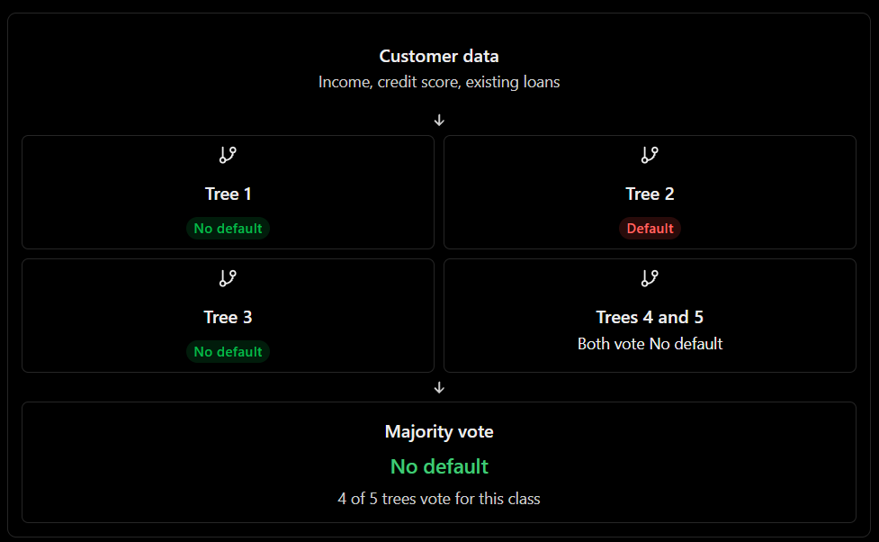

## Topic 10: Random Forest

### 1\. Definition

**Random Forest is an ensemble learning algorithm that combines multiple Decision Trees to make a classification prediction.**

Instead of relying on one tree, Random Forest builds many trees and combines their predictions. For classification, the final predicted class is generally selected by majority vote, with probability estimates aggregated across trees.

Random Forest is commonly used for\:

- Loan default prediction
- Customer churn classification
- Fraud detection
- Customer segmentation labels
- Employee attrition prediction
- Medical risk classification

## 2\. Understand the intuition

Suppose five Decision Trees predict whether a customer will default on a loan.



### 3\. How Random Forest works

1. **Bootstrap sampling\:** Each tree is trained on a random sample of the training observations, typically sampled with replacement.
2. **Feature randomness\:** At each split, the algorithm considers a randomly selected subset of features.
3. **Tree building\:** Each tree learns its own sequence of decision rules.
4. **Prediction\:** The trees independently predict a class.
5. **Aggregation\:** The forest combines the predictions to produce the final result.

The two sources of randomness help make the trees less correlated. Combining less-correlated trees can reduce prediction variance compared with relying on one unstable tree.

## 4\. Python implementation using Scikit-learn

We will use the same student-performance problem to compare the idea of a single Decision Tree with a Random Forest.

```python
import pandas as pd

from sklearn.model_selection import train_test_split
from sklearn.ensemble import RandomForestClassifier
from sklearn.metrics import (
    accuracy_score,
    confusion_matrix,
    classification_report
)

# Student dataset
df = pd.DataFrame({
    "study_hours": [
        1, 2, 2, 3, 3, 4, 4, 5, 5, 6,
        6, 7, 7, 8, 8, 9, 2, 4, 6, 9
    ],
    "attendance": [
        35, 40, 45, 48, 52, 55, 60, 62, 68, 70,
        75, 78, 82, 85, 90, 95, 38, 58, 73, 92
    ],
    "result": [
        0, 0, 0, 0, 0, 0, 0, 1, 1, 1,
        1, 1, 1, 1, 1, 1, 0, 0, 1, 1
    ]
})

X = df[["study_hours", "attendance"]]
y = df["result"]

X_train, X_test, y_train, y_test = train_test_split(
    X, y,
    test_size=0.25,
    random_state=42,
    stratify=y
)

# Create and train the Random Forest
model = RandomForestClassifier(
    n_estimators=100,
    max_depth=5,
    min_samples_leaf=2,
    max_features="sqrt",
    random_state=42,
    n_jobs=-1
)

model.fit(X_train, y_train)

# Evaluate
y_pred = model.predict(X_test)

print("Accuracy:", accuracy_score(y_test, y_pred))
print("\nConfusion Matrix:")
print(confusion_matrix(y_test, y_pred))

print("\nClassification Report:")
print(classification_report(
    y_test, y_pred, zero_division=0
))

# Predict for a new student
new_student = pd.DataFrame({
    "study_hours": [6],
    "attendance": [72]
})

prediction = model.predict(new_student)[0]
probabilities = model.predict_proba(new_student)[0]

print("\nPrediction:", "Pass" if prediction == 1 else "Fail")
print("Class probabilities:", dict(zip(model.classes_, probabilities)))
```

The data is illustrative. With only 20 records, the test-set metrics are highly uncertain; use a larger, representative dataset and cross-validation before drawing conclusions.

## 5\. Important Random Forest parameters

| Parameter | Meaning |
|--------|--------|
| `n_estimators=100` | Builds 100 Decision Trees |
| `max_depth=5` | Limits each tree's depth |
| `min_samples_leaf=2` | Requires at least two training observations in each leaf |
| `max_features="sqrt"` | Considers approximately the square root of the feature count at each split |
| `bootstrap=True` | Enables bootstrap sampling; this is the default |
| `class_weight="balanced"` | Adjusts class weights inversely to their frequencies |
| `n_jobs=-1` | Uses available CPU cores for parallelizable work |

Increasing `n_estimators` often stabilizes predictions, but also increases training time, prediction cost, and memory usage.

## 6\. Decision Tree vs Random Forest

| Decision Tree | Random Forest |
|--------|--------|
| Uses one tree | Uses many trees |
| Easier to visualize | Harder to interpret as a whole |
| Can have high variance | Often reduces variance |
| Usually faster to train | Usually requires more computation |
| Can overfit easily | Often generalizes better when appropriately configured |

Random Forest is not guaranteed to outperform every Decision Tree or every other algorithm. Performance depends on the dataset, configuration, and evaluation method.

## 7\. Feature importance

Random Forest can estimate which features contribute most to reducing impurity across the forest.

```python
importance = pd.Series(
    model.feature_importances_,
    index=X.columns
).sort_values(ascending=False)

print(importance)
```
