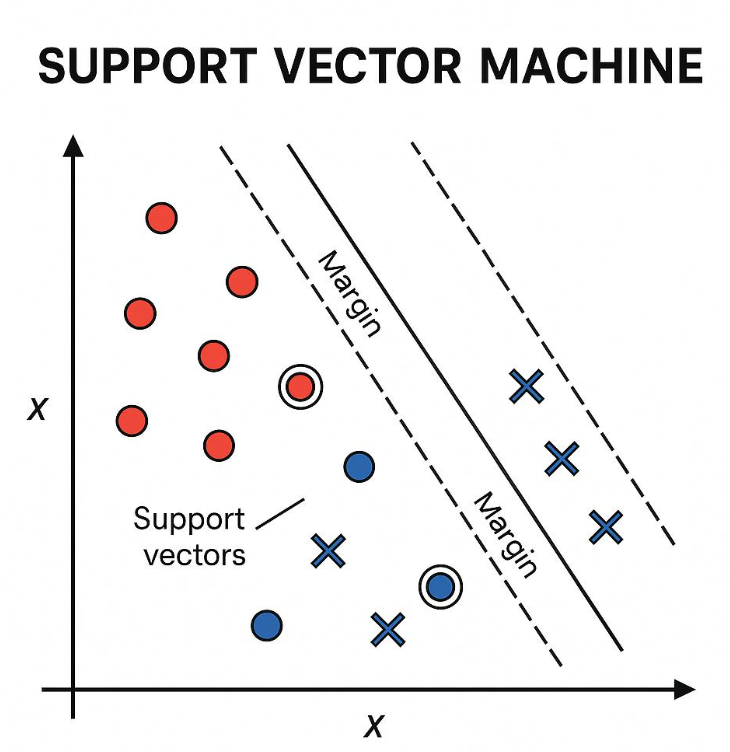

## Topic 11: Support Vector Machine (SVM)

### 1\. Definition

**Support Vector Machine (SVM) is a supervised machine learning algorithm that classifies observations by finding a decision boundary that maximizes the margin between classes.**

SVM is useful for classification problems involving numerical features, high-dimensional data, and datasets where a clear separating boundary can be learned.

Common applications include\:

- Text classification
- Image classification
- Spam detection
- Biological data classification
- Customer behavior classification

## 2\. Understand the intuition

Imagine a dataset containing two classes: Pass and Fail. Several straight lines might separate the two groups.

SVM aims to find a separating line that maximizes the distance between the boundary and the closest training observations from each class.



The wider margin helps SVM find a boundary that may generalize better to unseen observations.

## 3\. Important SVM terminology

| Term | Meaning |
|--------|--------|
| Hyperplane | The decision boundary separating classes |
| Margin | The distance between the boundary and the closest observations |
| Support vectors | Training observations that determine the margin and boundary |
| Kernel | A function that allows SVM to learn nonlinear decision boundaries |
| Regularization parameter `C` | Controls the trade-off between margin width and training errors |

For two features, a linear decision boundary is a line\:

$$
w_1x_1+w_2x_2+b=0
$$

For higher-dimensional features, the same expression represents a hyperplane.

## 4\. What are support vectors?

Support vectors are the training observations closest to the separating boundary, under the SVM formulation.

These observations are especially important because they determine the position of the maximum-margin boundary. Observations far from the boundary generally have less direct influence on the fitted linear SVM.

For a linearly separable dataset, SVM seeks a boundary with the largest margin between the two classes.

## 5\. How does SVM maximize the margin?

For a linear SVM, the decision boundary is\:

$$
w^T x+b=0
$$

The two margin boundaries for the canonical hard-margin formulation are\:

$$
w^T x+b=+1
$$

$$
w^T x+b=-1
$$

The distance between these boundaries is\:

$$
\boxed{\text{Margin}=\frac{2}{\|w\|}}
$$

Therefore, maximizing the margin is equivalent to minimizing\:

$$
\boxed{\frac{1}{2}\|w\|^2}
$$

subject to correct separation of the training observations.

Real-world datasets are often not perfectly separable. A soft-margin SVM allows some violations, controlled by the regularization parameter $C$\.

## 6\. Understanding the `C` parameter

| Value of C | Typical effect |
|--------|--------|
| Small `C` | Allows more training violations in exchange for a wider margin |
| Large `C` | Penalizes training violations more heavily, potentially producing a narrower margin |

A large `C` can overfit noisy data, while a small `C` can underfit. The best value should be selected through cross-validation.

## 7\. What is a kernel?

A linear SVM works well when a linear boundary is appropriate. But what if the classes form curved or more complex patterns?

A **kernel** allows SVM to learn nonlinear decision boundaries without explicitly constructing all the transformed features.

| Kernel | Typical use |
|--------|--------|
| `linear` | Approximately linearly separable data |
| `rbf` | Complex nonlinear boundaries |
| `poly` | Polynomial relationships |
| `sigmoid` | Certain nonlinear patterns; often requires careful tuning |

For the RBF kernel\:

$$
K(x,x')=\exp(-\gamma\|x-x'\|^2)
$$

The parameter $\gamma$ controls how quickly the influence of individual observations decreases with distance. Larger values can create more intricate boundaries; smaller values produce smoother ones.

## 8\. Python implementation using Scikit-learn

SVM is distance- and scale-sensitive, so standardization is generally important.

```python
import pandas as pd

from sklearn.model_selection import train_test_split
from sklearn.pipeline import make_pipeline
from sklearn.preprocessing import StandardScaler
from sklearn.svm import SVC
from sklearn.metrics import (
    accuracy_score,
    classification_report,
    confusion_matrix
)

df = pd.DataFrame({
    "study_hours": [
        1, 2, 2, 3, 3, 4, 4, 5, 5, 6,
        6, 7, 7, 8, 8, 9, 2, 4, 6, 9
    ],
    "attendance": [
        35, 40, 45, 48, 52, 55, 60, 62, 68, 70,
        75, 78, 82, 85, 90, 95, 38, 58, 73, 92
    ],
    "result": [
        0, 0, 0, 0, 0, 0, 0, 1, 1, 1,
        1, 1, 1, 1, 1, 1, 0, 0, 1, 1
    ]
})

X = df[["study_hours", "attendance"]]
y = df["result"]

X_train, X_test, y_train, y_test = train_test_split(
    X, y,
    test_size=0.25,
    random_state=42,
    stratify=y
)

model = make_pipeline(
    StandardScaler(),
    SVC(kernel="rbf", C=1.0, gamma="scale")
)

model.fit(X_train, y_train)

y_pred = model.predict(X_test)

print("Accuracy:", accuracy_score(y_test, y_pred))
print("Confusion matrix:\n", confusion_matrix(y_test, y_pred))
print(classification_report(y_test, y_pred, zero_division=0))

new_student = pd.DataFrame({
    "study_hours": [6],
    "attendance": [72]
})

prediction = model.predict(new_student)[0]

print("Prediction:", "Pass" if prediction == 1 else "Fail")
```

This dataset is illustrative and too small for reliable real-world performance estimates.

**Important\:** `SVC` does not provide class probabilities by default. If calibrated probabilities are needed, use a suitable probability-calibration method fitted without leaking test data.

## 9\. Advantages and limitations

| Advantages | Limitations |
|--------|--------|
| Effective in high-dimensional spaces | Can be expensive on large datasets |
| Supports nonlinear classification using kernels | Requires appropriate scaling |
| Uses support vectors to define the boundary | Kernel and parameter selection can be challenging |
| Supports binary and multiclass classification | Less directly interpretable than a simple Decision Tree |
