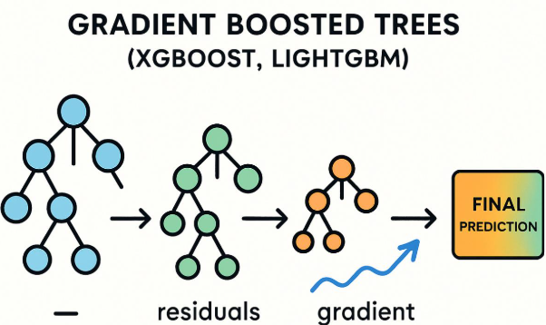

## Topic 12: Gradient Boosting

### 1\. Definition

**Gradient Boosting is an ensemble learning technique that builds a sequence of weak models, usually decision trees, where each new model helps correct the errors made by the existing ensemble.**

Instead of training many independent trees like Random Forest, Gradient Boosting trains trees sequentially, improving the combined model step by step.

Common applications include\:

- Customer churn prediction
- Loan default classification
- Fraud detection
- Customer response prediction
- Medical risk classification

## 2\. Understand the intuition

Imagine predicting whether a customer will leave a company.

1. The first small decision tree makes predictions.
2. The algorithm measures how wrong those predictions are.
3. The next tree learns to improve the existing predictions.
4. Additional trees continue refining the model.
5. The final prediction combines the contributions of all the trees.



**Key difference\:** Gradient Boosting builds trees sequentially, whereas Random Forest generally builds trees independently and combines their predictions.

## 3\. How Gradient Boosting works

Consider a binary classification target\:

- `0` \= Customer stays
- `1` \= Customer leaves

The algorithm proceeds as follows\:

| Step | What happens? |
|--------|--------|
| 1 | Start with an initial prediction |
| 2 | Calculate the prediction errors using a differentiable loss function |
| 3 | Train a small decision tree to model the direction in which the loss can be reduced |
| 4 | Multiply the tree's contribution by the learning rate |
| 5 | Update the existing model |
| 6 | Repeat for additional trees |
| 7 | Convert the final model output into a class prediction |

For classification, the algorithm typically optimizes a loss such as **log loss**, rather than simply predicting raw errors as in a basic regression example.

## 4\. Important parameters

| Parameter | Meaning |
|--------|--------|
| `n_estimators` | Number of boosting stages |
| `learning_rate` | How much each new tree contributes |
| `max_depth` | Maximum depth of each individual tree |
| `min_samples_leaf` | Minimum observations required in a leaf |
| `subsample` | Fraction of training observations used per stage; below `1.0` introduces stochastic boosting |

The learning rate and number of estimators work together. A smaller learning rate often requires more boosting stages.

## 5\. Python implementation using Scikit-learn

We'll use a small customer-churn dataset to predict whether a customer will leave.

```python
import pandas as pd

from sklearn.model_selection import train_test_split
from sklearn.ensemble import GradientBoostingClassifier
from sklearn.metrics import (
    accuracy_score,
    confusion_matrix,
    classification_report
)

df = pd.DataFrame({
    "tenure_months": [
        1, 2, 3, 4, 5, 6, 7, 8, 9, 10,
        12, 15, 18, 20, 24, 30, 36, 40, 45, 50
    ],
    "monthly_charges": [
        90, 85, 95, 80, 88, 75, 92, 70, 82, 78,
        72, 65, 68, 60, 62, 55, 58, 50, 52, 48
    ],
    "support_calls": [
        5, 4, 6, 4, 5, 3, 4, 3, 4, 3,
        3, 2, 3, 2, 2, 1, 2, 1, 1, 0
    ],
    "churn": [
        1, 1, 1, 1, 1, 0, 1, 0, 1, 0,
        0, 0, 1, 0, 0, 0, 0, 0, 0, 0
    ]
})

X = df[[
    "tenure_months",
    "monthly_charges",
    "support_calls"
]]

y = df["churn"]

X_train, X_test, y_train, y_test = train_test_split(
    X, y,
    test_size=0.25,
    random_state=42,
    stratify=y
)

model = GradientBoostingClassifier(
    n_estimators=100,
    learning_rate=0.1,
    max_depth=2,
    random_state=42
)

model.fit(X_train, y_train)

y_pred = model.predict(X_test)

print("Accuracy:", accuracy_score(y_test, y_pred))
print("Confusion Matrix:\n", confusion_matrix(y_test, y_pred))
print(classification_report(y_test, y_pred, zero_division=0))

new_customer = pd.DataFrame({
    "tenure_months": [3],
    "monthly_charges": [90],
    "support_calls": [5]
})

prediction = model.predict(new_customer)[0]

print("Prediction:", "Churn" if prediction == 1 else "No Churn")
```

The dataset is illustrative. Because it contains only 20 records, the resulting metrics are not reliable evidence of real-world performance.

### 6\. How does the learning rate work?

Suppose a newly trained tree suggests a correction of `0.8` to the model's raw prediction score.

With a learning rate of `0.1`, the contribution becomes\:

$$
0.1 \times 0.8 = 0.08
$$

The model incorporates this smaller correction rather than the entire amount.

- **Smaller learning rate\:** smaller updates, usually requiring more trees.
- **Larger learning rate\:** larger updates, potentially fitting the training data too aggressively.

This is why `learning_rate` and `n_estimators` should generally be tuned together.

## 7\. Gradient Boosting vs Random Forest

| Feature | Random Forest | Gradient Boosting |
|--------|--------|--------|
| Training | Trees trained independently | Trees trained sequentially |
| Main idea | Combine many trees | Improve the ensemble stage by stage |
| Error correction | No direct sequential correction | Each stage reduces the loss |
| Overfitting control | Tree depth, leaf size, features | Learning rate, tree depth, number of stages |
| Training speed | Often easier to parallelize | Usually more sequential |
| Scaling numerical features | Usually unnecessary | Usually unnecessary for tree-based features |

## 8\. Advantages and limitations

**Advantages**

- Can learn complex nonlinear relationships.
- Captures feature interactions.
- Often performs well on structured, tabular datasets.
- Supports feature importance analysis.

**Limitations**

- Can overfit when too complex.
- Requires parameter tuning.
- Sequential training can be slower than training independent trees.
- Feature importance does not establish causation.

**Remember\:** Gradient Boosting is a general boosting technique. XGBoost, which we'll cover next, is a separate optimized implementation of gradient-boosted trees with additional regularization and engineering features.
