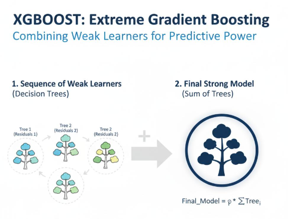

## Topic 13: XGBoost

### 1\. Definition

**XGBoost (Extreme Gradient Boosting)** is an optimized implementation of gradient-boosted decision trees. It builds trees sequentially, with each new tree helping improve the ensemble's predictions.

It is widely used for structured/tabular data, such as\:

- Loan approval and default prediction
- Customer churn prediction
- Fraud detection
- Sales and customer response classification
- Risk prediction

XGBoost builds on gradient boosting with features such as regularization, efficient training, and handling of missing feature values.

## 2\. How XGBoost works


1. The model makes an initial prediction.
2. It calculates how the predictions differ from the actual labels using a loss function.
3. It builds a tree to improve the model's predictions.
4. It adds the tree's contribution to the existing ensemble.
5. It repeats this process while controlling model complexity through regularization.
6. The final model produces a prediction, such as `0 = No Default` or `1 = Default`\.

Unlike a single decision tree, XGBoost combines many trees into one model.

## 3\. Why use XGBoost instead of basic Gradient Boosting?

| Feature | Scikit-learn Gradient Boosting | XGBoost |
|--------|--------|--------|
| Boosting | Sequential gradient boosting | Optimized gradient boosting |
| Regularization | Mainly controlled through tree settings and learning rate | Includes explicit L1/L2 regularization |
| Missing values | Usually requires suitable preprocessing | Can learn default directions for missing feature values |
| Tree growth | Standard boosting stages | Offers multiple tree-growth strategies |
| Performance | Effective for many datasets | Often efficient on large tabular datasets |
| Installation | Included in Scikit-learn | Requires the `xgboost` package |

XGBoost is not guaranteed to outperform every other model. Its performance depends on the dataset, features, parameters, and validation method.

## 4\. Important XGBoost parameters

| Parameter | Meaning |
|--------|--------|
| `n_estimators` | Maximum number of boosting rounds |
| `learning_rate` | Contribution of each new tree |
| `max_depth` | Maximum depth of each tree |
| `subsample` | Fraction of training rows sampled for each boosting round |
| `colsample_bytree` | Fraction of features sampled for each tree |
| `reg_alpha` | L1 regularization strength |
| `reg_lambda` | L2 regularization strength |
| `objective` | Defines the prediction task and loss |
| `eval_metric` | Metric used to evaluate the model during training |

For binary classification, a common choice is `objective="binary:logistic"`\. It produces probabilities between 0 and 1.

## 5\. Python implementation

First, install XGBoost in your terminal\:

```bash
pip install xgboost scikit-learn
```

We'll use Scikit-learn's breast cancer benchmark dataset. It contains numerical measurements and a binary target, making it useful for learning classification without creating artificial random data.

```python
from sklearn.datasets import load_breast_cancer
from sklearn.model_selection import train_test_split
from sklearn.metrics import (
    accuracy_score,
    confusion_matrix,
    classification_report,
    roc_auc_score
)

from xgboost import XGBClassifier

# 1. Load dataset
data = load_breast_cancer(as_frame=True)

X = data.data
y = data.target

# 2. Split the dataset
X_train, X_test, y_train, y_test = train_test_split(
    X,
    y,
    test_size=0.20,
    random_state=42,
    stratify=y
)

# 3. Create model
model = XGBClassifier(
    n_estimators=100,
    learning_rate=0.05,
    max_depth=3,
    subsample=0.8,
    colsample_bytree=0.8,
    objective="binary:logistic",
    eval_metric="logloss",
    random_state=42
)

# 4. Train
model.fit(X_train, y_train)

# 5. Predict classes and probabilities
y_pred = model.predict(X_test)
y_prob = model.predict_proba(X_test)[:, 1]

# 6. Evaluate
print("Accuracy:", accuracy_score(y_test, y_pred))
print("ROC-AUC:", roc_auc_score(y_test, y_prob))

print("\nConfusion Matrix:")
print(confusion_matrix(y_test, y_pred))

print("\nClassification Report:")
print(classification_report(
    y_test,
    y_pred,
    target_names=data.target_names
))
```

The dataset's target labels are `0 = malignant` and `1 = benign`\. The class probabilities in `y_prob` therefore represent the probability of the **benign** class.

The results are benchmark results, not a guarantee of performance on real clinical data.

## 6\. Predicting a new observation

```python
# Select one observation from the test set
new_customer = X_test.iloc[[0]]

# Predict class
predicted_class = model.predict(new_customer)[0]

# Get probabilities for both classes
probabilities = model.predict_proba(new_customer)[0]

print("Predicted class:", data.target_names[predicted_class])
print("Probability of malignant:", probabilities[0])
print("Probability of benign:", probabilities[1])
```

**Understanding the output\:**

- `predict()` returns the predicted class.
- `predict_proba()` returns the probabilities for both classes.
- The class with the higher probability is typically selected by `predict()` for binary classification with the default threshold.

## 7\. Feature importance

XGBoost can help identify which features the trained model relies on.

```python
import pandas as pd

importance_df = pd.DataFrame({
    "Feature": X.columns,
    "Importance": model.feature_importances_
})

importance_df = importance_df.sort_values(
    by="Importance",
    ascending=False
)

print(importance_df.head(10))
```

This displays the ten highest-ranked features according to the model's default feature-importance measure.

Remember: **feature importance does not prove that a feature causes the outcome.**

## 8\. How to reduce overfitting

| Problem | Possible adjustment |
|--------|--------|
| Training performance is much better than validation performance | Reduce `max_depth` |
| Trees are too complex | Increase `min_child_weight` |
| Model is too sensitive to individual observations | Reduce `subsample` |
| Too many features are used per tree | Reduce `colsample_bytree` |
| Model is too complex overall | Increase `reg_alpha` or `reg_lambda` |
| Model is learning too aggressively | Reduce `learning_rate` and tune `n_estimators` |
