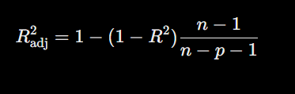
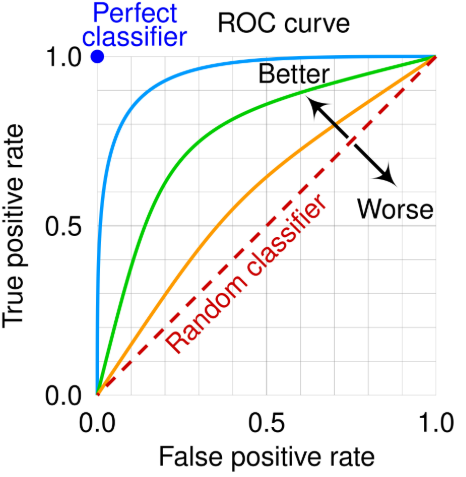
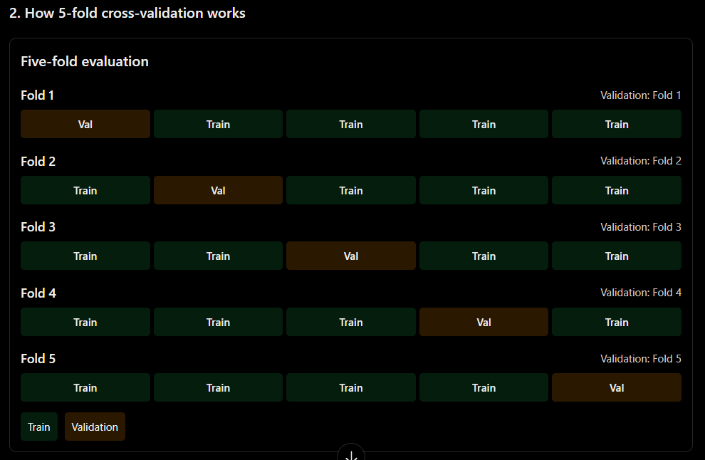

# Module 7: Model Evaluation (Student Notes)

**Goal:** Learn how to check whether a machine learning model is actually good, and how to pick the right metric for the problem.

**Simple words mein:** Model bana liya, ab pata kaise chalega ki woh sahi kaam kar raha hai? Yehi evaluation hai.

---

## How these notes are organised

Every idea is explained **once**, in the place where it belongs. Later sections only point back to it.

| Part | What you learn | New ideas |
|------|----------------|-----------|
| 1 | Why we evaluate and how to split data | Train/test split, overfitting |
| 2 | Regression metrics | MAE, MSE, RMSE, R², Adjusted R² |
| 3 | Classification basics | Confusion matrix, TP/TN/FP/FN, Accuracy, Precision, Recall, F1, Classification Report |
| 4 | Scores and thresholds | Threshold, Precision-Recall trade-off, ROC, AUC |
| 5 | Reliable testing | Cross-validation (regression and classification together) |
| 6 | Real-world decisions | FP/FN cost, choosing the right metric |

Cross-validation sits in Part 5 (not right after regression) because its classification example needs F1 from Part 3.

Practice questions are at the end of each part. Answers are in the answer key at the very end.

---

# Part 1: The Basics

## 1.1 Why evaluate?

Evaluation means measuring how well a model performs on data **it has not seen during training**.

The kind of metric depends on what the model predicts:

| | Regression | Classification |
|---|---|---|
| Predicts | A number (e.g. house price) | A category (e.g. fraud / not fraud) |
| We measure | How big the errors are | What kinds of decisions are right or wrong |
| Metrics | MAE, MSE, RMSE, R² | Accuracy, Precision, Recall, F1, AUC |

## 1.2 Train/test split and overfitting

A model can score very well on the data it learned from and badly on new data. This is **overfitting** (model ne answers ratta maar liye, samjha nahi).

To catch it, we split the data:

- **Training set** (commonly 80%): used to fit the model.
- **Testing set** (commonly 20%): kept aside and used only for the final check.

80:20 is a common choice, not a rule. It depends on dataset size.

## 1.3 The workflow we reuse in this module

This is the only full setup code in the notes. Later code assumes these variables already exist.

```python
from sklearn.datasets import fetch_california_housing
from sklearn.model_selection import train_test_split
from sklearn.linear_model import LinearRegression

X, y = fetch_california_housing(return_X_y=True, as_frame=True)

X_train, X_test, y_train, y_test = train_test_split(
    X, y, test_size=0.20, random_state=42
)

model = LinearRegression()
model.fit(X_train, y_train)        # learn from training data
y_pred = model.predict(X_test)     # predict on unseen data
```

- `fit()` learns the pattern. `predict()` produces predictions.
- `y_test` = actual values, `y_pred` = predicted values. Every regression metric compares these two.
- The target here is in units of $100,000, so an error of `0.5` means about $50,000.
- The first run downloads the dataset, so you need internet once.

---

# Part 2: Regression Metrics

All regression metrics compare **actual** and **predicted** numbers. We use one tiny example for all of them.

## 2.1 Running example: daily sales

| Day | Actual | Predicted | Error (actual − predicted) | Absolute error | Squared error |
|---|---|---|---|---|---|
| 1 | 100 | 110 | −10 | 10 | 100 |
| 2 | 200 | 190 | 10 | 10 | 100 |
| 3 | 150 | 140 | 10 | 10 | 100 |
| 4 | 300 | 320 | −20 | 20 | 400 |
| 5 | 250 | 240 | 10 | 10 | 100 |
| **Total** | | | | **60** | **800** |

Notice that errors can be negative. If we just averaged them, plus and minus would cancel out. MAE and MSE both fix this, in different ways.

## 2.2 MAE (Mean Absolute Error)

**Idea:** On average, how far off are the predictions? (Average galti kitni hai?)

```
MAE = (1/n) × Σ |actual − predicted|
```

From the table: `60 / 5 = 12`. The model is off by **12 sales units per day on average**.

- Same units as the target, so it is easy to explain to anyone.
- Treats all errors equally: an error of 20 counts twice as much as an error of 10.
- Limitation: it does not tell you whether predictions are too high or too low, and you cannot compare it across targets with different scales.

## 2.3 MSE (Mean Squared Error)

**Idea:** Same as MAE, but errors are squared first, so **big mistakes are punished much harder**.

```
MSE = (1/n) × Σ (actual − predicted)²
```

From the table: `800 / 5 = 160`.

Why squaring matters: errors of 2 and 10 become 4 and 100. The error is 5 times bigger, but its penalty is 25 times bigger.

- The unit is squared (160 *squared sales units*), which is hard to explain to a client.
- A few outliers can dominate MSE, so check outliers before relying on it.

## 2.4 RMSE (Root Mean Squared Error)

**Idea:** Take the square root of MSE to get back to the original units.

```
RMSE = √MSE = √160 ≈ 12.65
```

RMSE keeps MSE's strong penalty on big errors but is easy to read, because it is in sales units again.

Two facts to remember:

- RMSE is **always ≥ MAE** on the same data. They are equal only when all absolute errors are the same. Here RMSE (12.65) > MAE (12) because of the single error of 20.
- RMSE is not literally the "average error". It is a root-mean-square measure.

## 2.5 MAE vs MSE vs RMSE (the one comparison table)

| | MAE | MSE | RMSE |
|---|---|---|---|
| Calculation | Mean of absolute errors | Mean of squared errors | √MSE |
| Units | Same as target | Squared units | Same as target |
| Punishes big errors | Normal | Heavily | Heavily |
| Easy to explain | Yes | No | Yes |

**When to use which:**

- Pick **MAE** when every unit of error costs about the same (e.g. average delivery-time error).
- Pick **RMSE** when large errors are especially bad (e.g. demand forecasting, where a big miss means empty shelves).
- MSE is mostly used inside training algorithms, rarely for reporting.

## 2.6 R² (Coefficient of Determination)

**Idea:** MAE/RMSE tell you the size of the errors. R² tells you **how much better your model is than a lazy model that always predicts the average.**

```
R² = 1 − (SS_res / SS_tot)

SS_res = Σ (actual − predicted)²     → your model's squared errors
SS_tot = Σ (actual − mean)²          → the lazy model's squared errors
```

On our sales data: the mean of the actual values is 200.

- `SS_res = 800` (same as the squared-error total in the table).
- `SS_tot = (−100)² + 0² + (−50)² + 100² + 50² = 25,000`.
- `R² = 1 − 800/25,000 = 0.968`.

So the model has 96.8% less squared error than always guessing the mean. This does **not** mean 96.8% of predictions are correct.

**Reading R² values:**

| R² | Meaning |
|---|---|
| 1.0 | Perfect predictions |
| 0.5 | Squared error is half of the "always predict the mean" baseline |
| 0.0 | No better than predicting the mean |
| Negative | **Worse** than predicting the mean (common when a model fails on test data) |

```python
from sklearn.metrics import r2_score
print(r2_score(y_test, y_pred))
print(model.score(X_test, y_test))   # for regression models, .score() is also R²
```

**Limitations:** R² gives no error in original units, does not prove cause and effect, and does not guarantee good performance on new data. Always compute it on the **test set**. It also has one more weakness, covered next.

## 2.7 Adjusted R²

**Problem:** In ordinary linear regression, adding *any* feature (even random noise) never lowers training R². So R² can make a bloated model look better.

**Fix:** Adjusted R² charges a penalty for each extra feature.



```
Adjusted R² = 1 − (1 − R²) × (n − 1) / (n − p − 1)

n = number of observations      p = number of features
```

Example: R² = 0.85, n = 100, p = 5.

```
= 1 − 0.15 × (99 / 94) = 1 − 0.15 × 1.0532 ≈ 0.842
```

Adding a useful feature can raise Adjusted R². Adding a useless one lowers it.

| | Model A | Model B |
|---|---|---|
| Features | 4 | 12 |
| R² | 0.82 | 0.84 |
| Adjusted R² | 0.81 | 0.82 |

Model B has the higher R², but after the penalty the gain is tiny. The 8 extra features are probably not worth it.

```python
r2 = r2_score(y_train, model.predict(X_train))
n, p = X_train.shape
adj_r2 = 1 - (1 - r2) * (n - 1) / (n - p - 1)
print(f"R²: {r2:.4f}  Adjusted R²: {adj_r2:.4f}")
```

This code uses training data only to show the formula. For picking a final model, also look at test MAE/RMSE and cross-validation (Part 5). Adjusted R² compares linear regression models on the same data. It is not a universal metric.

## 2.8 All regression metrics in one block

```python
from sklearn.metrics import (mean_absolute_error, mean_squared_error,
                             root_mean_squared_error, r2_score)

print("MAE :", mean_absolute_error(y_test, y_pred))
print("MSE :", mean_squared_error(y_test, y_pred))
print("RMSE:", root_mean_squared_error(y_test, y_pred))   # scikit-learn 1.4+
print("R²  :", r2_score(y_test, y_pred))
```

On older scikit-learn, use `mean_squared_error(y_test, y_pred) ** 0.5` for RMSE. Your numbers depend on your run, so execute the code to see them.

## Practice: Part 2

1. Actual `[50, 80, 100]`, predicted `[60, 70, 90]`. What is the MAE?
2. Actual `[10, 20, 30]`, predicted `[12, 18, 33]`. What is the MSE?
3. A model has MSE = 144. What is its RMSE?
4. A model has R² = −0.20 on test data. What does this tell you?
5. You add a feature and Adjusted R² goes down. What is the likely reason?

---

# Part 3: Classification Basics

In classification, the model picks a **class**. We call the class we are trying to detect the **positive** class (e.g. "fraud"). Positive does not mean "good", it means "the thing we are looking for".

## 3.1 The confusion matrix

A confusion matrix is a table of actual classes against predicted classes. It shows not just *how many* predictions were wrong, but *what kind* of wrong.

Running example: a fraud model checks 100 transactions (20 are really fraud).

| | Predicted Fraud | Predicted Legitimate | Total |
|---|---|---|---|
| **Actual Fraud** | 18 (TP) | 2 (FN) | 20 |
| **Actual Legitimate** | 8 (FP) | 72 (TN) | 80 |
| **Total** | 26 | 74 | 100 |

## 3.2 The four outcomes

| Outcome | Meaning | Fraud example | Simple words mein |
|---|---|---|---|
| **TP** (True Positive) | Predicted positive, actually positive | Fraud caught | Sahi pakda |
| **TN** (True Negative) | Predicted negative, actually negative | Honest payment passed | Sahi jaane diya |
| **FP** (False Positive) | Predicted positive, actually negative | Honest payment blocked | Galat alarm |
| **FN** (False Negative) | Predicted negative, actually positive | Fraud missed | Chor nikal gaya |

Memory trick: the **second word** (Positive/Negative) is what the model *said*. The **first word** (True/False) says whether the model was *right*.

The same four outcomes apply in every domain:

| Domain | FP (false alarm) | FN (missed case) |
|---|---|---|
| Fraud | Legit payment blocked | Fraud approved |
| Disease screening | Healthy person flagged | Sick person cleared |
| Spam filter | Real email sent to spam | Spam reaches inbox |
| Customer churn | Loyal customer predicted to leave | Leaving customer missed |

**In code** (here `1` = positive, `0` = negative):

```python
from sklearn.metrics import confusion_matrix

y_true = [1, 1, 1, 0, 0, 0, 0, 0]     # small dataset reused in Parts 3 and 4
y_pred = [1, 0, 1, 1, 0, 0, 0, 0]

tn, fp, fn, tp = confusion_matrix(y_true, y_pred, labels=[0, 1]).ravel()
print(tn, fp, fn, tp)      # 4 1 1 2
```

Scikit-learn puts actual classes in rows and predicted classes in columns. With `labels=[0, 1]` the layout is `[[TN, FP], [FN, TP]]`. Always pass `labels=` so you never mix up the order.

To draw it: `ConfusionMatrixDisplay.from_predictions(y_true, y_pred, labels=[0, 1])`.

## 3.3 Counts vs rates

Counts depend on how much data you have. **Rates** divide by the relevant group so models can be compared fairly.

| Metric | Formula | Fraud example (18/2/8/72) | Question it answers |
|---|---|---|---|
| Accuracy | (TP+TN) / all | 90/100 = **90%** | How often is the model right overall? |
| Precision | TP / (TP+FP) | 18/26 = **69.2%** | When it says "positive", how often is it right? |
| Recall (Sensitivity, TPR) | TP / (TP+FN) | 18/20 = **90%** | Of all real positives, how many did it find? |
| Specificity | TN / (TN+FP) | 72/80 = **90%** | Of all real negatives, how many did it clear? |
| FPR (False Positive Rate) | FP / (FP+TN) | 8/80 = **10%** | What share of negatives got false alarms? |
| FNR (False Negative Rate) | FN / (FN+TP) | 2/20 = **10%** | What share of positives were missed? |

Handy links: `FPR = 1 − Specificity` and `FNR = 1 − Recall`.

Count vs rate: **FP = 8** is the number of false alarms. **FPR = 10%** is the share of honest transactions that got a false alarm.

## 3.4 Accuracy

Accuracy is the simplest metric: correct predictions divided by all predictions.

**The big trap: class imbalance.** Say a dataset has 990 legitimate and 10 fraud transactions. A useless model that says "legitimate" for everything gets:

- Accuracy = 990/1000 = **99%**
- Fraud caught = **0 out of 10**

So high accuracy can hide a model that does nothing useful. When one class is rare, look at Precision, Recall, F1 and the confusion matrix instead.

Use accuracy only when classes are fairly balanced and FP and FN cost about the same.

## 3.5 Precision

Precision judges the model's **positive predictions**. It is the metric to watch when **false alarms are costly**.

Fraud example: the model flagged 26 transactions and 18 were truly fraud, so Precision = 18/26 ≈ 69%. About 31 of every 100 flagged transactions are honest customers being bothered.

Edge case: if the model never predicts positive, then TP+FP = 0 and Precision is undefined. Scikit-learn handles this with `zero_division=0`.

## 3.6 Recall

Recall judges how many **real positives** the model finds. It is the metric to watch when **missed cases are costly**.

Fraud example: 20 frauds exist and 18 were caught, so Recall = 90%.

Precision and Recall look at the same positive class but divide by different things:

| | Divides by | Worry |
|---|---|---|
| Precision | TP + FP (everything the model flagged) | Too many false alarms |
| Recall | TP + FN (everything that is really positive) | Too many misses |

Example: Model A flags very few transactions but nearly all are fraud (high Precision, low Recall). Model B flags a lot and catches nearly all fraud but also many honest payments (high Recall, low Precision). Neither is automatically better. It depends on which mistake costs more (Part 6).

## 3.7 F1 Score

**Idea:** One number that combines Precision and Recall. It uses the **harmonic mean**, which punishes the model if either one is low.

```
F1 = 2 × (Precision × Recall) / (Precision + Recall)
```

Why not a simple average? With Precision = 0.90 and Recall = 0.30, the average is 0.60, which sounds okay. F1 is 0.45, which correctly shows the model is weak.

Fraud example: `F1 = 2 × (0.6923 × 0.90) / (0.6923 + 0.90) ≈ 0.783`.

Use F1 when both FP and FN matter and classes are imbalanced. Limitations: it ignores TN, it weighs Precision and Recall equally, and a good F1 does not guarantee the model fits your business goal.

## 3.8 All classification metrics in code

```python
from sklearn.metrics import (accuracy_score, precision_score,
                             recall_score, f1_score)

print("Accuracy :", accuracy_score(y_true, y_pred))    # 0.75
print("Precision:", precision_score(y_true, y_pred))   # 0.667
print("Recall   :", recall_score(y_true, y_pred))      # 0.667
print("F1       :", f1_score(y_true, y_pred))          # 0.667
```

Check by hand using TP=2, FP=1, FN=1, TN=4: Precision = 2/3, Recall = 2/3, Accuracy = 6/8.

## 3.9 Classification Report

One function that shows Precision, Recall and F1 **for every class**, plus support.

```python
from sklearn.metrics import classification_report

print(classification_report(
    y_true, y_pred, labels=[0, 1],
    target_names=["Legitimate", "Fraud"], zero_division=0
))
```

```text
              precision    recall  f1-score   support

  Legitimate       0.80      0.80      0.80         5
       Fraud       0.67      0.67      0.67         3

    accuracy                           0.75         8
   macro avg       0.73      0.73      0.73         8
weighted avg       0.75      0.75      0.75         8
```

How to read it:

- **Support** = number of *actual* samples in that class (5 legitimate, 3 fraud). It is not the number predicted correctly.
- **Macro avg** = plain average of the class scores. Every class counts equally, so a weak rare class pulls it down.
- **Weighted avg** = average weighted by support. Bigger classes count more.
- On imbalanced data, read the row of the rare class (here Fraud) first, not the averages.

## Practice: Part 3

6. A screening model says a patient is healthy, but the patient has the disease. Which outcome is this?
7. A spam filter checks 100 emails. 5 are spam and it catches 4. What are TP and Recall?
8. A model makes 200 predictions and 170 are correct. What is its accuracy?
9. A model flags 50 transactions as fraud and 40 are truly fraud. What is its Precision?
10. In a classification report, the Fraud row shows support = 40. What does that mean?

---

# Part 4: Scores, Thresholds and Curves

Most classifiers first produce a **probability** (e.g. 0.72 chance of fraud) and only then turn it into a class. The cutoff that does this is the **threshold**.

## 4.1 Threshold

```
probability ≥ threshold  →  predict positive (1)
probability <  threshold  →  predict negative (0)
```

The default is 0.5, but 0.5 is not magic. Changing it does not change the model's probabilities, only the final decisions.

Raising the threshold makes the model stricter (fewer flags). Lowering it makes the model more eager (more flags).

We use this small set of probabilities for the rest of Part 4:

```python
import numpy as np
from sklearn.metrics import confusion_matrix, precision_score, recall_score

y_true = np.array([1, 1, 1, 0, 0, 0])
y_prob = np.array([0.92, 0.75, 0.58, 0.43, 0.21, 0.65])

for t in [0.3, 0.5, 0.7]:
    pred = (y_prob >= t).astype(int)     # the key line
    tn, fp, fn, tp = confusion_matrix(y_true, pred, labels=[0, 1]).ravel()
    print(t, "| TP", tp, "FP", fp, "FN", fn, "TN", tn,
          "| Precision", round(precision_score(y_true, pred), 2),
          "| Recall", round(recall_score(y_true, pred), 2))
```

Results:

| Threshold | TP | FP | FN | TN | Precision | Recall |
|---|---|---|---|---|---|---|
| 0.3 (eager) | 3 | 2 | 0 | 1 | 0.60 | 1.00 |
| 0.5 | 3 | 1 | 0 | 2 | 0.75 | 1.00 |
| 0.7 (strict) | 2 | 0 | 1 | 3 | 1.00 | 0.67 |

## 4.2 The Precision-Recall trade-off

The table above is the trade-off in action. Going from a strict to an eager threshold, **Recall rises (fewer misses) while Precision falls (more false alarms)**, and the reverse.

This is a common tendency, not a law. It depends on the scores and the data.

| Business need | Move the threshold | Watch |
|---|---|---|
| Miss as few positives as possible | Lower it | Recall |
| Avoid false alarms | Raise it | Precision |
| Balance both | Pick the value that maximises F1 | F1 |
| Costs are known in money | Pick the value with the lowest total cost (Part 6) | Expected cost |

**Choosing the threshold properly:** choose it using validation data (or cross-validation), then report performance once on the test set. If you pick it on the test set, your final score is too optimistic.

Also, thresholds only make sense if probabilities are meaningful. A poorly calibrated model's "0.80" may not mean an 80% real chance.

## 4.3 ROC curve

Instead of testing thresholds one by one, the **ROC curve** shows all of them at once. It plots:

- **y-axis: TPR** (= Recall), from Part 3.
- **x-axis: FPR**, from Part 3.

Each point on the curve is one threshold.

```python
import matplotlib.pyplot as plt
from sklearn.metrics import roc_curve

fpr, tpr, thresholds = roc_curve(y_true, y_prob)   # needs scores, not hard labels

plt.plot(fpr, tpr, marker="o", label="Model")
plt.plot([0, 1], [0, 1], "--", label="Random guessing")
plt.xlabel("False Positive Rate")
plt.ylabel("True Positive Rate")
plt.legend()
plt.show()
```

How to read the plot:



- Curve hugging the **top-left corner**: very good (high TPR with low FPR).
- Curve along the **diagonal**: no better than random ranking.
- The curve does not tell you which threshold to deploy. That is a business decision (Part 6).

## 4.4 AUC (Area Under the ROC Curve)

AUC turns the whole ROC curve into one number between 0 and 1.

**Meaning:** pick one random positive and one random negative. AUC is the chance that the model gives the positive a higher score.

| AUC | Meaning |
|---|---|
| 1.0 | Every positive is ranked above every negative |
| 0.5 | Random ranking |
| Below 0.5 | Worse than random (scores are upside down) |

On our small data, there are 3 positives × 3 negatives = 9 pairs. The positive 0.58 loses to the negative 0.65, and every other pair is ranked correctly, so 8 of 9 pairs are right: `AUC = 8/9 ≈ 0.889`.

```python
from sklearn.metrics import roc_auc_score
print(roc_auc_score(y_true, y_prob))     # 0.8888...
```

Common mistakes:

- AUC = 0.95 does **not** mean 95% of predictions are correct. It measures ranking quality only.
- AUC does not choose a threshold and does not check calibration.
- With very rare positives, AUC can look great while the model still produces a painful number of false alarms. In that case also check Precision at your chosen threshold or a Precision-Recall curve.

## Practice: Part 4

11. A disease screening system must miss as few cases as possible. Should you raise the threshold from 0.5 to 0.9, or lower it to 0.2?
12. On an ROC curve, what is on the vertical axis?
13. A classifier has AUC = 0.95. What is the best interpretation?

---

# Part 5: Cross-Validation

**Problem:** One train/test split can mislead, because the score depends on which rows happened to land in the test set. (Kabhi kismat achhi, kabhi buri.)

**Fix:** Test several times on different splits and average. This is **K-Fold Cross-Validation**.

## 5.1 How K-Fold works (5 folds)



1. Split the training data into 5 equal parts (folds).
2. Train on 4 folds, validate on the remaining 1.
3. Repeat 5 times so each fold is the validation fold once.
4. Average the 5 scores. The spread (standard deviation) shows how sensitive the score is to the split.

Each row is used for validation once and for training four times.

| Folds | Typical use |
|---|---|
| 3 | Big datasets or quick experiments |
| 5 | Good default |
| 10 | Smaller datasets when extra compute is fine |

## 5.2 For regression

Uses `X_train` and `y_train` from Part 1. The test set stays untouched.

```python
from sklearn.model_selection import cross_val_score
import numpy as np

scores = cross_val_score(LinearRegression(), X_train, y_train,
                         cv=5, scoring="neg_mean_absolute_error")
mae_scores = -scores                      # flip the sign back

print("Fold MAEs:", mae_scores)
print("Mean MAE :", mae_scores.mean())
print("Std dev  :", mae_scores.std())
```

**Why negative?** Scikit-learn assumes "bigger score = better". Since a lower MAE is better, it returns `−MAE`. Multiply by −1 to read the real error.

## 5.3 For classification: Stratified K-Fold

If only 5% of your data is fraud, a random fold might get almost no fraud at all. **Stratified K-Fold** keeps the class proportions about the same in every fold, so use it for classification.

```python
from sklearn.datasets import load_breast_cancer
from sklearn.linear_model import LogisticRegression
from sklearn.model_selection import StratifiedKFold
from sklearn.pipeline import make_pipeline
from sklearn.preprocessing import StandardScaler

X_c, y_c = load_breast_cancer(return_X_y=True)

model_c = make_pipeline(StandardScaler(), LogisticRegression(max_iter=2000))
cv = StratifiedKFold(n_splits=5, shuffle=True, random_state=42)

scores = cross_val_score(model_c, X_c, y_c, cv=cv, scoring="f1")
print("Fold F1:", scores)
print("Mean F1:", scores.mean(), " Std:", scores.std())
```

Only two things changed from the regression version: `StratifiedKFold` and `scoring="f1"`. Example reading: fold scores `[0.91, 0.94, 0.89, 0.93, 0.92]` average to 0.918, and since they are close to each other, the result looks stable.

## 5.4 Rules that apply to both

- **Use a Pipeline** (as above). Scaling or imputing must be learned inside each training fold, otherwise information leaks from the validation fold (data leakage).
- **Keep the test set for the end.** Use cross-validation for choosing models, features and thresholds. Report the final score on the test set once.
- **Time-ordered data** (forecasting): do not shuffle. Use `TimeSeriesSplit`, or you train on the future to predict the past.
- Grouped or repeated measurements (e.g. several rows per patient) need group-aware splitting.
- Cross-validation estimates performance. It does not guarantee it on future data.

## Practice: Part 5

14. Why is Stratified K-Fold usually better than plain K-Fold for classification?

---

# Part 6: Making Real Decisions

Metrics become useful when you connect them to **money and consequences**.

## 6.1 Cost of a False Positive

```
FP cost = (number of FP) × (cost per FP)
```

Example: 120 false alarms, each costing ₹200 to investigate → `120 × 200 = ₹24,000`.

Other costs that FPs cause: blocked customers, lost trust, analyst workload, unneeded medical tests.

## 6.2 Cost of a False Negative

```
FN cost = (number of FN) × (cost per FN)
```

Example: 15 missed frauds, each costing ₹3,000 → `15 × 3,000 = ₹45,000`.

## 6.3 Comparing both

```
Total cost = (cost per FP × FP) + (cost per FN × FN)
```

Example: 30 FP at ₹150 and 15 FN at ₹3,000.

| Error | Count | Cost each | Total |
|---|---|---|---|
| FP | 30 | ₹150 | ₹4,500 |
| FN | 15 | ₹3,000 | ₹45,000 |
| **Total** | 45 | | **₹49,500** |

There are twice as many FPs, but FNs cause 90% of the cost. Counting errors is not enough; you must weigh them.

```python
tn, fp, fn, tp = confusion_matrix(y_true, y_pred, labels=[0, 1]).ravel()

cost_per_fp, cost_per_fn = 150, 3000
total_cost = fp * cost_per_fp + fn * cost_per_fn
print("Total error cost: ₹", total_cost)
```

(Using the small `y_true`/`y_pred` from Part 3: 1 FP and 1 FN, so ₹150 + ₹3,000 = ₹3,150.)

This is also how to pick a threshold in money terms: try several thresholds on validation data and keep the one with the lowest total cost.

**Model comparison example.** Assume FP = ₹200, FN = ₹5,000.

| | FP | FN | Total cost |
|---|---|---|---|
| Model A | 20 | 10 | 200×20 + 5000×10 = **₹54,000** |
| Model B | 50 | 3 | 200×50 + 5000×3 = **₹25,000** |

Model B raises more false alarms but is far cheaper overall, because misses are so expensive. This answer holds only for these cost assumptions.

To lower FP cost: adjust the threshold, improve data and features, review recurring false alarms, or add a second review step for uncertain cases. Remember that lowering FPs usually raises FNs, so always look at both costs together.

## 6.4 Choosing the right metric

| Situation | Metric |
|---|---|
| Regression, easy-to-explain error | MAE |
| Regression, big errors are extra bad | RMSE |
| Regression, how much better than the mean | R² (Adjusted R² when comparing feature sets) |
| Balanced classes, FP and FN cost similar | Accuracy |
| False alarms are expensive | Precision |
| Misses are expensive | Recall |
| Both matter, imbalanced data | F1 (or F1 plus PR curve) |
| Compare ranking quality, threshold not chosen yet | ROC-AUC |
| Costs are known in money | Total expected cost |

**Quick decision questions:**

1. What is the positive class?
2. What happens on a false alarm? (If costly, favour Precision.)
3. What happens on a miss? (If costly, favour Recall.)
4. Are both important? (Use F1 or a cost calculation.)
5. Is the data imbalanced? (Do not rely on Accuracy.)

In real projects you often set a constraint, for example "Recall must be at least 95%", and then maximise Precision under it.

Scenarios:

- **Spam filter:** losing an important email hurts, so favour Precision.
- **Disease screening:** missing a case is dangerous, so favour Recall (and accept more follow-up tests).
- **Fraud detection:** both errors cost money, so compare Precision, Recall and total cost together.

## 6.5 Mistakes to avoid (new ones only)

- Using accuracy by default.
- Pushing Recall to the maximum with no regard for the flood of false alarms.
- Comparing models on different datasets. Use the same evaluation data.
- Celebrating a tiny metric gain that costs more review time or infrastructure than it saves.

(Tuning on the test set and data leakage were covered in Sections 4.2 and 5.4.)

## Practice: Part 6

15. A model produces 30 FPs at ₹150 each. What is the total FP cost?
16. A model misses 12 frauds at ₹2,500 each. What is the total FN cost?
17. A hospital must find as many real disease cases as possible, and an extra follow-up test is far less harmful than a missed case. Which metric should come first?

---

# Module Recap

- **Regression** metrics measure error size (MAE, RMSE) or improvement over the mean (R², Adjusted R²).
- **Classification** metrics start from the confusion matrix. Accuracy, Precision, Recall and F1 each answer a different question.
- **Thresholds** turn probabilities into decisions. ROC and AUC judge the ranking across all thresholds.
- **Cross-validation** gives a steadier estimate than a single split.
- **Cost thinking** ties it all to the real world. The best metric is the one that matches your problem's costs.

---

# Answer Key

**Part 2**
1. Errors are 10, 10, 10, so MAE = **10**.
2. Errors are 2, −2, −3. Squares: 4 + 4 + 9 = 17. MSE = 17/3 ≈ **5.67**.
3. RMSE = √144 = **12**.
4. The model has more squared error than simply predicting the test-set mean. It is worse than the baseline. (It does *not* mean "−20% accuracy".)
5. The new feature does not improve the fit enough to justify its complexity penalty.

**Part 3**
6. **False Negative (FN)**: the model said negative, but the case was positive.
7. TP = **4**. Recall = 4/5 = **80%**.
8. 170/200 = **85%**.
9. 40/50 = **80%**.
10. There are **40 actual Fraud samples** in the evaluated data. It is not the number caught.

**Part 4**
11. **Lower it to 0.2.** A lower threshold flags more cases, which generally raises Recall.
12. **True Positive Rate (TPR)**, which is the same as Recall.
13. The model is very good at **ranking positives above negatives**. It does not mean 95% accuracy or 95% Precision.

**Part 5**
14. It keeps the class proportions about the same in every fold, so rare classes are represented in each fold. This makes Precision, Recall and F1 more reliable.

**Part 6**
15. 30 × ₹150 = **₹4,500**.
16. 12 × ₹2,500 = **₹30,000**.
17. **Recall**.
