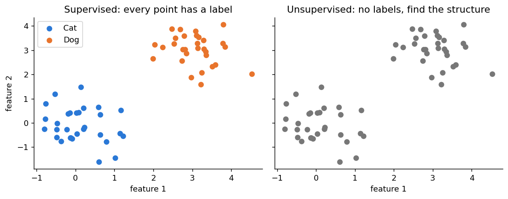
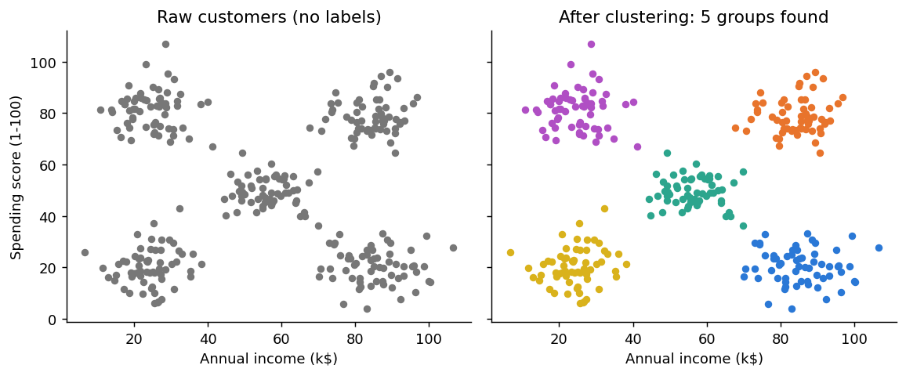

# 8.1 Unsupervised Learning and Clustering

**Topics in this file:** 1. What is Unsupervised Learning, 2. Supervised vs Unsupervised Learning, 3. Clustering

**Next:** [02_KMeans.md](02_KMeans.md)

---

## 1. What is Unsupervised Learning?

In **unsupervised learning**, the data has **no labels**. We give the model only the input features and ask it to find **hidden structure** by itself.

**Simple words mein:** Teacher ne answers nahi diye. Model ko khud dekhna hai ki data mein kaunsi cheezein ek jaisi hain.

Real examples:

| Problem | What the model finds |
|---|---|
| Customer data from a shop | Groups of customers who behave alike (customer segments) |
| News articles | Groups of articles about the same topic |
| A table with 100 columns | A smaller set of columns that carries most of the information |
| Bank transactions | Transactions that look very different from the rest (unusual behaviour) |

Unsupervised learning has two big families, and this module covers both:

| Family | Goal | In this module |
|---|---|---|
| **Clustering** | Put similar rows in the same group | K-Means, Hierarchical, DBSCAN (files 02 to 05) |
| **Dimensionality reduction** | Reduce the number of columns | PCA (files 06 and 07) |

---

## 2. Supervised vs Unsupervised Learning

You already know supervised learning (regression and classification). The difference is the **label**.



| | Supervised | Unsupervised |
|---|---|---|
| Data | Features **and** labels (the answer) | Features only |
| Goal | Predict the label for new data | Discover structure in the data |
| Example | "Is this email spam?" | "Which customers are similar?" |
| Typical tasks | Regression, classification | Clustering, dimensionality reduction |
| How we check it | Compare with the true answer (Module 7 metrics) | No true answer exists, so we use internal measures (file 03) |

The last row matters most. In Module 7 we could always compare predictions with the real labels. Here there is **no answer sheet**, so "how good is this clustering?" needs different tools, and part of the answer always depends on whether the result is *useful* for your goal.

---

## 3. Clustering

**Clustering** means splitting data into groups (called **clusters**) so that:

- points in the **same** cluster are **similar** to each other, and
- points in **different** clusters are **different** from each other.



### The dataset we use in files 02 to 04

A shop wants to understand its customers. For each customer we have two numbers: **annual income** (in thousand dollars) and **spending score** (1 to 100). The data below is synthetic, so we know it hides 5 groups, but the algorithms will not be told that.

```python
import numpy as np
import matplotlib.pyplot as plt
from sklearn.datasets import make_blobs

centers = [[25, 20], [25, 80], [55, 50], [85, 20], [85, 80]]
X, _ = make_blobs(n_samples=300, centers=centers, cluster_std=7, random_state=42)

print(X.shape)      # (300, 2): column 0 = income, column 1 = spending score

plt.scatter(X[:, 0], X[:, 1], s=18, c="gray")
plt.xlabel("Annual income (k$)")
plt.ylabel("Spending score (1-100)")
plt.show()
```

The `_` throws away the true group labels on purpose. That is what makes this an unsupervised problem.

### What clusters are used for

- **Customer segmentation:** different offers for different groups.
- **Grouping documents or images** that look alike.
- **Preprocessing:** summarise a large dataset by its cluster.
- **Spotting oddities:** points far from every cluster deserve a second look.

### Three main ways to cluster

Each has its own file. In file 05 you will find one table comparing all three.

| Style | Core idea | Algorithm | File |
|---|---|---|---|
| Centroid-based | Each cluster has a centre; points join the nearest centre | K-Means | 02 and 03 |
| Hierarchical | Merge the closest groups step by step, building a tree | Agglomerative clustering | 04 |
| Density-based | A cluster is a crowded region; sparse points are noise | DBSCAN | 05 |

### Things to keep in mind

- A cluster is **not** a "true class". It is just a group the algorithm found. A human decides what it means (for example "high income, low spending").
- Different algorithms, or different settings, can give different groups from the same data. There is often no single correct answer.
- Clustering depends on **distance**, so how you measure similarity (and whether you scale features) changes the result. This is explained in file 02.

---

## Practice

1. Which of these is unsupervised: (a) predicting house prices, (b) grouping shoppers by buying behaviour, (c) detecting spam emails?
2. Why can't we calculate "accuracy" for a clustering result the way we do for a classifier?
3. Name the two main families of unsupervised learning.

<details>
<summary>Answers</summary>

1. **(b)**. Only (b) has no labels to learn from.
2. There are no true labels to compare against, so accuracy has nothing to be measured against.
3. **Clustering** and **dimensionality reduction**.

</details>
