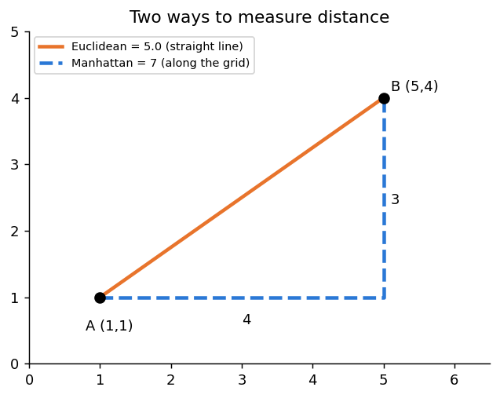
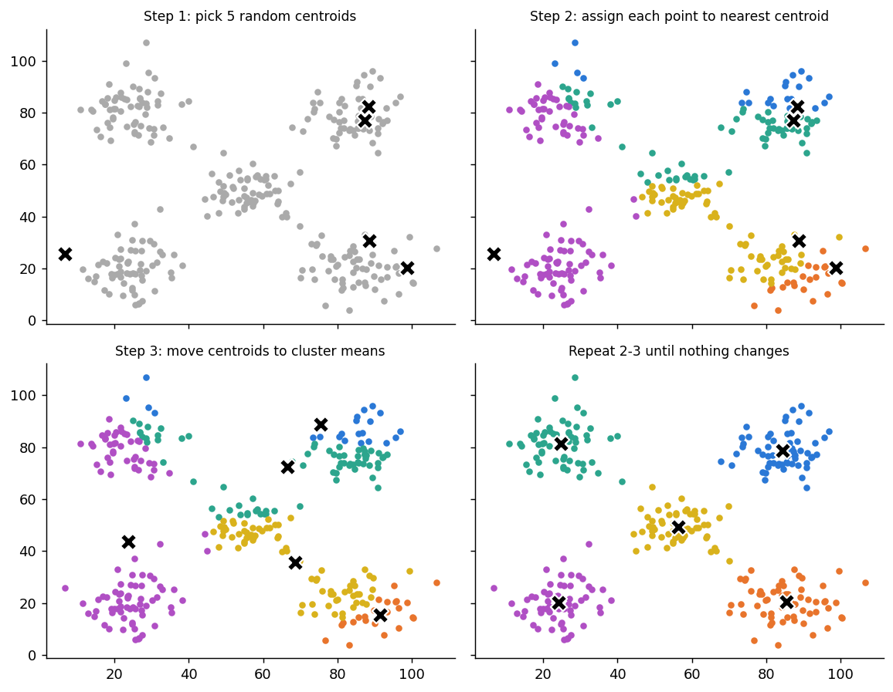

# 8.2 K-Means Clustering

**Topics in this file:** 4. K-Means, 6. Centroids, 7. Distance Calculation, 5. K-Means Algorithm

Centroids and distance come *before* the algorithm because the algorithm is built from them.

**Previous:** [01_Unsupervised_Learning_and_Clustering.md](01_Unsupervised_Learning_and_Clustering.md) | **Next:** [03_Choosing_K.md](03_Choosing_K.md)

---

## 4. What is K-Means?

**K-Means** splits data into **K clusters**. You choose K in advance. Each cluster is represented by one point at its centre, called a **centroid**, and every data point belongs to the cluster whose centroid is **nearest**.

**Simple words mein:** Pehle decide karo kitne groups chahiye (K). Phir har point us group mein jata hai jiska centre uske sabse paas ho.

Two small ideas make it work: what a centroid is, and what "nearest" means.

---

## 6. Centroids

A **centroid** is the **average position** of all the points in a cluster. You find it by averaging each feature separately.

Example: three customers in one cluster, given as (income, spending score):

```
(20, 30), (30, 50), (40, 70)

centroid income = (20 + 30 + 40) / 3 = 30
centroid score  = (30 + 50 + 70) / 3 = 50

centroid = (30, 50)
```

Notice that a centroid does **not have to be a real data point**. It is just the centre of the group. This is where the name "K-**Means**" comes from.

---

## 7. Distance Calculation

"Nearest" needs a way to measure distance. K-Means uses **Euclidean distance**, the straight-line distance you already know from geometry.

```
distance(A, B) = √( (x_A − x_B)² + (y_A − y_B)² )
```

With more features, you simply add more squared differences under the root.



Example with A = (1, 1) and B = (5, 4):

```
Euclidean = √( (5−1)² + (4−1)² ) = √(16 + 9) = 5
```

The picture also shows **Manhattan distance** (walk along the grid: 4 + 3 = 7). It is another valid way to measure distance, but standard K-Means uses Euclidean.

### Why feature scale matters

Distance adds up differences from all features. If one feature has much bigger numbers, it **dominates** the distance and the others are ignored.

Example: income in dollars (20,000 to 140,000) next to spending score (1 to 100). The score barely affects the distance. The fix is to put features on a similar scale first:

```python
from sklearn.preprocessing import StandardScaler
X_scaled = StandardScaler().fit_transform(X)   # mean 0, standard deviation 1 per column
```

Our customer data has two columns on similar 0 to 100 ranges, so we skip scaling here. On real data with mixed units, always check this first.

---

## 5. The K-Means Algorithm

The algorithm repeats two moves: **assign**, then **update**.

1. **Choose K.**
2. **Initialise:** pick K starting centroids (random points from the data).
3. **Assign:** give each point to its nearest centroid.
4. **Update:** move each centroid to the average of the points assigned to it.
5. **Repeat** steps 3 and 4 until the assignments stop changing (this is called **convergence**).



Look at the first panel: the starting centroids are badly placed (two in the top right, none in the top left). Even so, after a few rounds of assign and update, each centroid settles in the middle of a real group.

### A small worked example (K = 2)

Six customers, starting centroids C1 = (1, 1) and C2 = (8, 8):

| Point | Coordinates | Distance to C1 | Distance to C2 | Goes to |
|---|---|---|---|---|
| A | (1, 1) | 0.00 | 9.90 | C1 |
| B | (2, 2) | 1.41 | 8.49 | C1 |
| C | (4, 3) | 3.61 | 6.40 | C1 |
| D | (8, 8) | 9.90 | 0.00 | C2 |
| E | (9, 9) | 11.31 | 1.41 | C2 |
| F | (7, 9) | 10.00 | 1.41 | C2 |

**Update step:**

```
new C1 = mean of A, B, C = ((1+2+4)/3, (1+2+3)/3) = (2.33, 2.00)
new C2 = mean of D, E, F = ((8+9+7)/3, (8+9+9)/3) = (8.00, 8.67)
```

If we assign again with these new centroids, nobody changes cluster, so the algorithm has converged.

### What is K-Means trying to minimise? (Inertia)

Each round, the total distance of points to their centroids gets smaller. The quantity it shrinks is called **inertia** (also called WCSS, within-cluster sum of squares):

```
inertia = sum of (distance from each point to its own centroid)²
```

For the example above:

```
cluster 1: 4.67 + 2.00 = 6.67
cluster 2: 2.00 + 0.67 = 2.67
inertia = 9.33
```

**Lower inertia means tighter clusters.** We will use this number again in file 03 to choose K.

---

## K-Means in Python

Uses `X` from file 01.

```python
from sklearn.cluster import KMeans

kmeans = KMeans(n_clusters=5, n_init=10, random_state=42)
labels = kmeans.fit_predict(X)          # a cluster number (0 to 4) for each customer

print(kmeans.cluster_centers_.round(1)) # the 5 centroids
print("Inertia:", round(kmeans.inertia_))
```

You should see five centroids close to the five hidden centres, and an inertia of about 27,300.

What the pieces mean:

- `n_clusters=5` is K.
- `n_init=10` runs the whole algorithm 10 times from different random starts and keeps the best (lowest inertia), because a bad start can give a bad result.
- `random_state=42` makes the result repeatable.
- Scikit-learn uses the smarter **k-means++** start by default, which spreads the starting centroids apart.
- `labels` holds the cluster of each row. `cluster_centers_` holds the centroids.

Plot the result:

```python
plt.scatter(X[:, 0], X[:, 1], c=labels, cmap="tab10", s=18)
plt.scatter(kmeans.cluster_centers_[:, 0], kmeans.cluster_centers_[:, 1],
            c="black", marker="X", s=150)
plt.xlabel("Annual income (k$)")
plt.ylabel("Spending score (1-100)")
plt.show()
```

### Make the clusters meaningful

Numbers 0 to 4 mean nothing by themselves. Describe each cluster by its average:

```python
import pandas as pd

df = pd.DataFrame(X, columns=["income", "score"])
df["cluster"] = labels
print(df.groupby("cluster").mean().round(1))
```

Read the table like a shopkeeper: a cluster with low income and high score might be "enthusiastic spenders", and one with high income and low score "careful savers". This naming step is your job, not the algorithm's.

### Assign a new customer

```python
print(kmeans.predict([[60, 45]]))       # the cluster whose centroid is nearest
```

---

## Limitations of K-Means

- **You must choose K.** File 03 shows how.
- **The result can depend on the start.** `n_init` and k-means++ reduce this.
- **It finds round, similar-sized blobs.** Curved or oddly shaped clusters will be cut wrongly (file 05 shows a picture).
- **Outliers pull centroids** because the centroid is an average.
- **Features must be on comparable scales** (see section 7).

---

## Practice

1. What is the centroid of the points (2, 4), (4, 6) and (6, 8)?
2. What is the Euclidean distance between (0, 0) and (6, 8)?
3. In which order does K-Means repeat its two steps, and when does it stop?

<details>
<summary>Answers</summary>

1. ((2+4+6)/3, (4+6+8)/3) = **(4, 6)**.
2. √(6² + 8²) = √100 = **10**.
3. **Assign** every point to its nearest centroid, then **update** each centroid to the mean of its points. It stops when the assignments no longer change.

</details>
