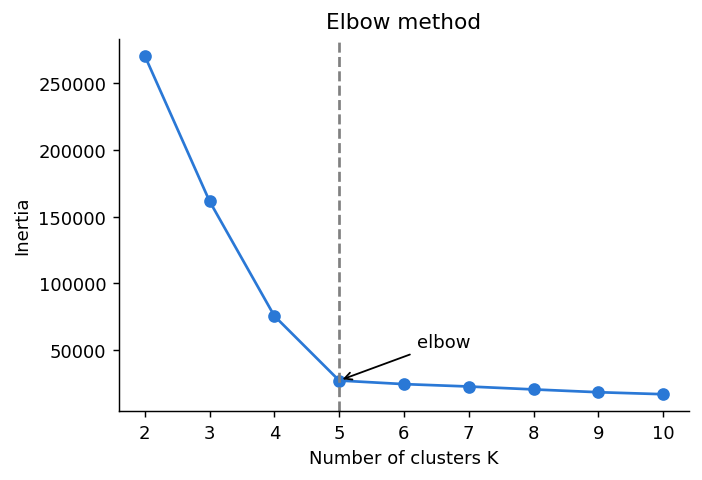
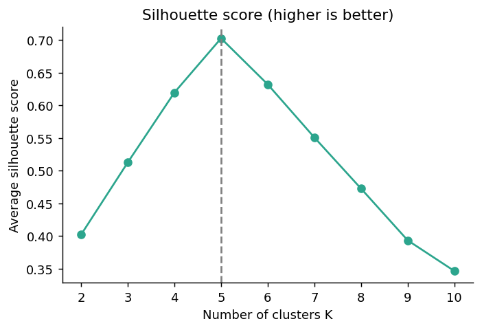

# 8.3 Choosing K

**Topics in this file:** 8. Choosing K, 9. Elbow Method, 10. Silhouette Score

**Previous:** [02_KMeans.md](02_KMeans.md) | **Next:** [04_Hierarchical_Clustering.md](04_Hierarchical_Clustering.md)

---

## 8. The problem: how many clusters?

K-Means needs K before it starts, but real data does not come with a "number of groups" label. We cannot just pick the K with the lowest inertia, because **inertia always goes down as K goes up**. With K equal to the number of points, every point is its own cluster and inertia is 0, which is useless.

So we need a K that balances two things: clusters should be **tight**, but there should not be **more clusters than the data supports**.

Two common tools:

| Tool | Question it answers |
|---|---|
| Elbow method | After which K does adding clusters stop helping much? |
| Silhouette score | For which K are points closest to their own cluster and far from the others? |

Domain knowledge also counts. If the shop can only run 3 marketing campaigns, K = 12 is not practical, whatever the numbers say.

First, fit K-Means for a range of K values once. Both methods use these fitted models (uses `X` and `KMeans` from files 01 and 02).

```python
k_values = range(2, 11)
models = {k: KMeans(n_clusters=k, n_init=10, random_state=42).fit(X) for k in k_values}
```

---

## 9. The Elbow Method

Plot **inertia** (defined in file 02) against K and look for the point where the curve bends, like an elbow. Before the bend, each extra cluster gives a big improvement. After it, the gain is small.

```python
inertias = [models[k].inertia_ for k in k_values]

plt.plot(list(k_values), inertias, "o-")
plt.xlabel("Number of clusters K")
plt.ylabel("Inertia")
plt.title("Elbow method")
plt.show()
```



Approximate values for our customer data:

| K | 2 | 3 | 4 | 5 | 6 | 7 |
|---|---|---|---|---|---|---|
| Inertia | 270,400 | 161,500 | 75,700 | 27,300 | 24,700 | 22,900 |

The inertia falls sharply until K = 5 (from 75,700 to 27,300), then barely changes. The elbow is at **K = 5**.

**Limitation:** real data often has a smooth curve with no clear elbow, and different people may point at different bends. That is why we cross-check with another method.

---

## 10. The Silhouette Score

The silhouette score asks, for **each point**: am I closer to my own cluster than to the nearest other cluster?

For one point *i*:

```
a = average distance from i to the other points in its own cluster
b = average distance from i to the points in the nearest other cluster

silhouette(i) = (b − a) / max(a, b)
```

Small worked example: a point has a = 2 and b = 8.

```
silhouette = (8 − 2) / 8 = 0.75
```

The point sits comfortably inside its cluster. Another point with a = 5 and b = 4 gives (4 − 5) / 5 = **−0.2**, which means it is probably in the wrong cluster.

The score always lies between **−1 and +1**:

| Value | Meaning |
|---|---|
| Close to +1 | Well inside its own cluster, far from the others |
| Around 0 | On the border between two clusters |
| Negative | Probably assigned to the wrong cluster |

The **average silhouette score** over all points summarises the whole clustering. As a rough rule of thumb, above about 0.7 is strong structure, 0.5 to 0.7 reasonable, and below 0.25 means little real structure.

```python
from sklearn.metrics import silhouette_score

sil_scores = [silhouette_score(X, models[k].labels_) for k in k_values]

plt.plot(list(k_values), sil_scores, "o-")
plt.xlabel("Number of clusters K")
plt.ylabel("Average silhouette score")
plt.show()

best_k = list(k_values)[int(np.argmax(sil_scores))]
print("Best K by silhouette:", best_k)
```



Approximate scores for our data:

| K | 2 | 3 | 4 | 5 | 6 | 7 |
|---|---|---|---|---|---|---|
| Silhouette | 0.40 | 0.51 | 0.62 | **0.70** | 0.63 | 0.55 |

Here the **highest score is at K = 5**, which agrees with the elbow. Unlike inertia, silhouette does not keep improving with K, so you read the **peak**.

---

## Elbow vs silhouette

| | Elbow method | Silhouette score |
|---|---|---|
| Uses | Inertia (tightness only) | Tightness **and** separation |
| You read | The bend in the curve | The highest point |
| Can be unclear? | Yes, there may be no obvious bend | Less often, but peaks can be flat |
| Cost | Cheap | Slower on big data (compares many point pairs) |

**A practical recipe:**

1. Plot both for a sensible range of K.
2. Look for a K that both methods support.
3. If they disagree, look at the clusters themselves (`groupby` averages from file 02) and ask which K is meaningful for your goal.

Both measures assume roundish clusters like K-Means produces. They can mislead for oddly shaped clusters (file 05).

---

## Practice

1. Why can't we choose K by picking the smallest inertia?
2. A point has a = 3 and b = 6. What is its silhouette value?
3. The elbow plot drops steeply until K = 4 and is almost flat after that. Which K does the elbow method suggest?

<details>
<summary>Answers</summary>

1. Inertia always decreases as K increases (it reaches 0 when every point is its own cluster), so the minimum is always the largest K.
2. (6 − 3) / max(3, 6) = 3 / 6 = **0.5**.
3. **K = 4**, the bend of the elbow.

</details>
