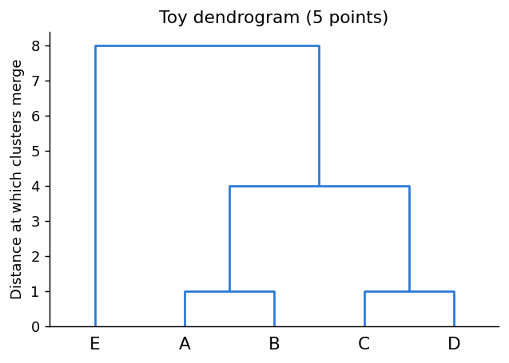
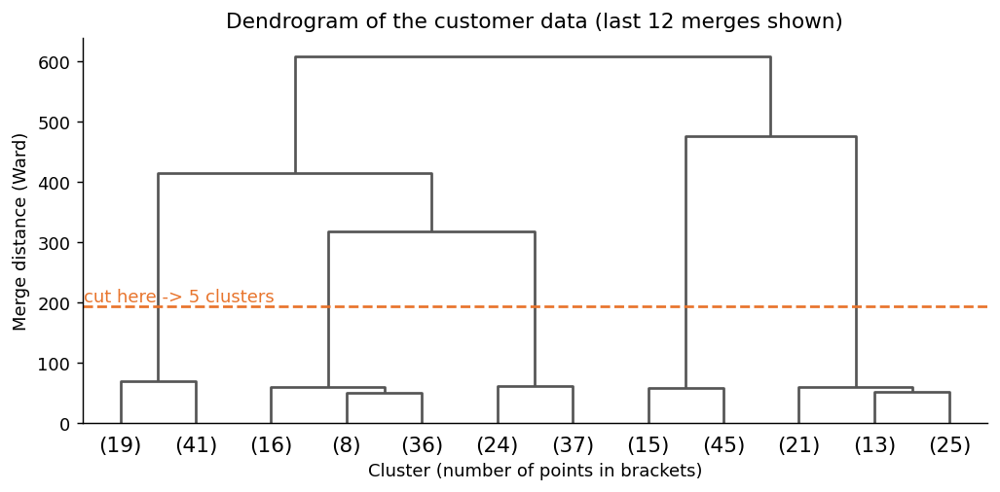

# 8.4 Hierarchical Clustering and the Dendrogram

**Topics in this file:** 11. Hierarchical Clustering, 12. Dendrogram

**Previous:** [03_Choosing_K.md](03_Choosing_K.md) | **Next:** [05_DBSCAN.md](05_DBSCAN.md)

---

## 11. Hierarchical Clustering

**Hierarchical clustering** builds a **tree of clusters**. You do not have to fix K in advance. You build the whole tree first and decide how many clusters you want afterwards.

The most common version is **agglomerative** (bottom-up):

1. Start with **every point as its own cluster**.
2. Find the **two closest clusters** and merge them.
3. Repeat step 2 until only **one cluster** remains.

(The opposite, *divisive* clustering, starts with one big cluster and splits it. It is rarely used, so we only cover agglomerative.)

**Simple words mein:** Sabse paas wale dost pehle jodte jao, phir un groups ko jodte jao, jab tak poori class ek group na ban jaye.

### How do we measure distance between two *clusters*?

Distance between two points is clear (file 02). Between two groups of points you need a rule. This rule is called the **linkage**:

| Linkage | Distance between two clusters is... | Behaviour |
|---|---|---|
| **Single** | the **smallest** distance between any two points, one from each cluster | Can form long chains |
| **Complete** | the **largest** distance between any two points, one from each | Compact clusters |
| **Average** | the **average** of all pairwise distances | A middle path |
| **Ward** | the merge that increases total within-cluster variance (inertia) the **least** | Compact, similar-sized clusters; the usual first choice for numeric data |

### A tiny example (single linkage)

Five points on a line: A = 1, B = 2, C = 6, D = 7, E = 15.

| Step | Merge | Distance at merge |
|---|---|---|
| 1 | A + B | 1 |
| 2 | C + D | 1 |
| 3 | {A,B} + {C,D} | 4 (closest pair is B = 2 and C = 6) |
| 4 | {A,B,C,D} + E | 8 (closest pair is D = 7 and E = 15) |

The merge distances (1, 1, 4, 8) are exactly the heights you will see on the dendrogram below.

---

## 12. The Dendrogram

A **dendrogram** is the picture of that merging tree.



How to read it:

- The **bottom** shows the individual points (leaves).
- The **height** of each horizontal bar is the distance at which two clusters were merged. Compare it with the table above: A+B and C+D merge at 1, then they join at 4, and E joins last at 8.
- **Short merges** mean "very similar". **Tall merges** mean "quite different".

### Choosing the number of clusters: cut the tree

Draw a **horizontal line** across the dendrogram. The number of vertical lines it crosses is the number of clusters.

- Cut at height 3 in the toy tree: you cross 3 lines, giving {A,B}, {C,D}, {E}.
- Cut at height 6: you cross 2 lines, giving {A,B,C,D}, {E}.

**Good rule:** cut where the vertical lines are **longest**, meaning a big jump in distance before the next merge. A big jump means you would be forcing together groups that are really far apart.

---

## Hierarchical clustering in Python

Uses `X` from file 01 and `labels` from the K-Means in file 02.

**Step 1: build the tree and draw the dendrogram.** With 300 points, a full dendrogram is unreadable, so we show only the last 12 merges.

```python
from scipy.cluster.hierarchy import linkage, dendrogram, fcluster

Z = linkage(X, method="ward")           # the whole merge history

plt.figure(figsize=(8, 4))
dendrogram(Z, truncate_mode="lastp", p=12)
plt.xlabel("Cluster (number of points in brackets)")
plt.ylabel("Merge distance")
plt.show()
```



The last four merges are very tall, with a big gap before them, so cutting just above the shorter merges gives **5 clusters**. This matches the K = 5 from file 03.

**Step 2: cut the tree to get labels.**

```python
labels_h = fcluster(Z, t=5, criterion="maxclust")    # ask for 5 clusters (labels are 1 to 5)
```

**The same thing with scikit-learn**, which is handy inside pipelines:

```python
from sklearn.cluster import AgglomerativeClustering

agg = AgglomerativeClustering(n_clusters=5, linkage="ward")
labels_agg = agg.fit_predict(X)             # labels are 0 to 4
```

**Do hierarchical and K-Means agree?** The adjusted Rand index compares two groupings (1.0 means identical groups, ignoring the label numbers):

```python
from sklearn.metrics import adjusted_rand_score
print(adjusted_rand_score(labels, labels_agg))
```

On this well-separated data the answer is about 0.98, which is reassuring: two different methods found almost the same 5 groups.

---

## When to use it, and its limits

| Strength | Limitation |
|---|---|
| No need to choose K before running | Slow and memory-hungry on large data (needs all pairwise distances), so it suits up to a few thousand points |
| The dendrogram shows structure at every level | A merge can never be undone, so an early mistake stays |
| Works with different linkages for different cluster shapes | Results change with the linkage choice |
| Good for small datasets and for understanding relationships | Sensitive to noise and outliers |

For **very large data**, K-Means is the usual choice. For **small data where the hierarchy itself is interesting** (for example, grouping species or documents), hierarchical clustering shines.

---

## Practice

1. In agglomerative clustering, what is the starting situation and what happens each step?
2. In a dendrogram, what does the height of a merge represent?
3. You cut a dendrogram with a horizontal line that crosses 4 vertical lines. How many clusters do you get?

<details>
<summary>Answers</summary>

1. Every point starts as its **own cluster**. Each step merges the **two closest clusters** until only one is left.
2. The **distance between the two clusters** at the moment they were merged.
3. **4 clusters**.

</details>
