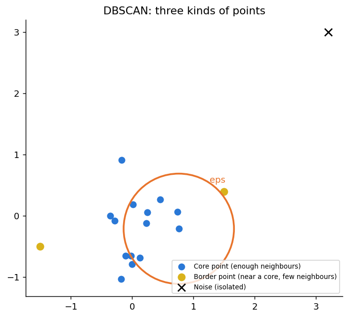
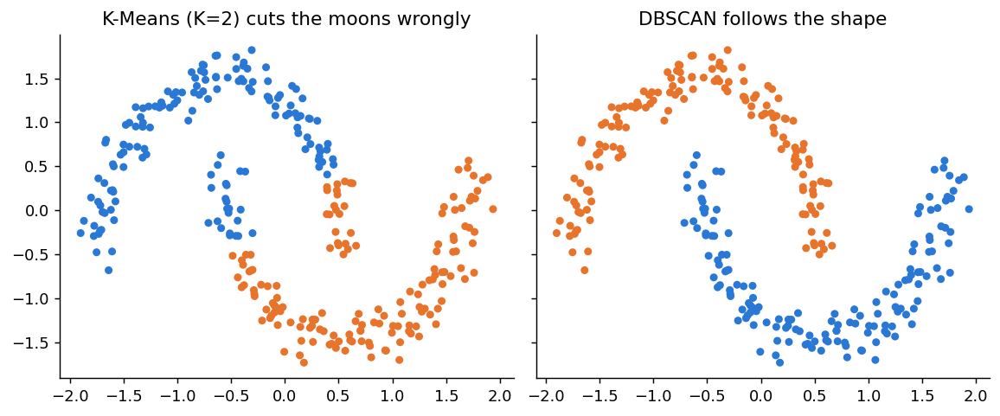
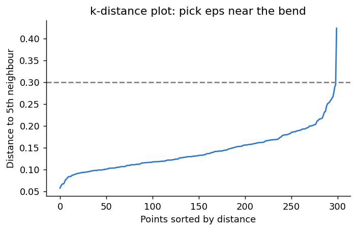

# 8.5 DBSCAN

**Topic in this file:** 13. DBSCAN (Density-Based Spatial Clustering of Applications with Noise)

**Previous:** [04_Hierarchical_Clustering.md](04_Hierarchical_Clustering.md) | **Next:** [06_Dimensionality_Reduction_and_PCA.md](06_Dimensionality_Reduction_and_PCA.md)

---

## 13. DBSCAN

K-Means and hierarchical clustering both struggle with clusters that are curved, and neither can say "this point belongs nowhere". **DBSCAN** handles both.

**Idea:** a cluster is a **crowded region** of points, separated from other crowded regions by **empty space**. Points sitting alone in empty space are labelled **noise**.

**Simple words mein:** Jahan bheed hai wahan cluster hai. Jo point akela khada hai, woh noise hai.

### The two settings

| Parameter | Meaning |
|---|---|
| `eps` (epsilon) | The radius of a point's neighbourhood: how close counts as "nearby" |
| `min_samples` | How many points (including the point itself) must be inside that radius for the area to count as crowded |

You do **not** give DBSCAN the number of clusters. It finds them.

### Three kinds of points



| Type | Rule |
|---|---|
| **Core point** | Has at least `min_samples` points within distance `eps` (counting itself) |
| **Border point** | Not a core point itself, but lies within `eps` of a core point |
| **Noise point** | Neither core nor border: isolated |

### The algorithm

1. Pick an unvisited point and count the points within `eps`.
2. If it is a **core point**, start a new cluster with it.
3. Add all its neighbours to the cluster. For each neighbour that is also a core point, add *its* neighbours too. The cluster keeps **growing** like a spreading stain.
4. When no more points can be added, the cluster is complete. Move on to another unvisited point.
5. Points that never join any cluster are **noise** (label `-1`).

---

## Why DBSCAN: the moons example

This is the case where K-Means fails. We use a new dataset, two interleaving half-circles:

```python
from sklearn.datasets import make_moons
from sklearn.preprocessing import StandardScaler
from sklearn.cluster import DBSCAN, KMeans

M, _ = make_moons(n_samples=300, noise=0.07, random_state=42)
M_scaled = StandardScaler().fit_transform(M)      # eps is a distance, so scale first (see file 02)

labels_km = KMeans(n_clusters=2, n_init=10, random_state=42).fit_predict(M_scaled)
labels_db = DBSCAN(eps=0.3, min_samples=5).fit_predict(M_scaled)
```



K-Means draws a straight line between two round-ish blobs, so it cuts both moons in half. DBSCAN follows the **shape** of the dense regions and recovers each moon exactly.

Read the result:

```python
n_clusters = len(set(labels_db)) - (1 if -1 in labels_db else 0)
n_noise = list(labels_db).count(-1)
print("Clusters:", n_clusters, " Noise points:", n_noise)    # 2 clusters, 0 noise here
```

- Label `-1` always means **noise**. We subtract it when counting clusters.
- `DBSCAN` has no `predict()` for new points and no centroids. It only labels the data it was fitted on.

---

## Choosing `eps` and `min_samples`

The result is **very sensitive to `eps`**. On the moons data:

| eps | Clusters found | Noise points | What happened |
|---|---|---|---|
| 0.05 | 0 | 300 | Too small: nothing counts as crowded |
| 0.1 | 18 | 182 | Too small: the moons shatter into fragments |
| **0.3** | **2** | **0** | Just right |
| 1.0 | 1 | 0 | Too big: both moons merge |

**Finding eps with a k-distance plot.** For each point, compute the distance to its k-th nearest neighbour (take k = `min_samples`), sort these distances, and plot them. Choose `eps` near the **bend** of the curve.

```python
import numpy as np
import matplotlib.pyplot as plt
from sklearn.neighbors import NearestNeighbors

dist, _ = NearestNeighbors(n_neighbors=5).fit(M_scaled).kneighbors(M_scaled)
plt.plot(np.sort(dist[:, -1]))        # distance to the 5th neighbour (the point counts as its own first)
plt.xlabel("Points sorted by distance")
plt.ylabel("Distance to 5th neighbour")
plt.show()
```



Most points have a small distance (flat part), and the few isolated points shoot up on the right. The bend is the natural boundary between "crowded" and "isolated".

**Rules of thumb for `min_samples`:** start around 4 or 5 for 2-D data, and use a larger value (for example twice the number of features) for bigger or noisier data. Higher values make DBSCAN stricter and produce more noise points.

---

## Strengths and limits

| Strength | Limitation |
|---|---|
| Finds clusters of **any shape** | Very sensitive to `eps` |
| **Detects noise and outliers** automatically | Struggles when clusters have **very different densities** (one `eps` cannot suit both) |
| No need to choose K | Needs feature scaling, and distances weaken in very high dimensions (see file 06) |
| Not pulled by outliers | Cannot label new points directly |

---

## Which clustering algorithm should I use?

This is the one comparison of all three clustering methods from this module.

| | K-Means | Hierarchical | DBSCAN |
|---|---|---|---|
| Must choose K first? | Yes | No (cut the tree later) | No (but must choose `eps` and `min_samples`) |
| Cluster shape | Round, similar size | Depends on linkage | Any shape |
| Handles noise/outliers | Poorly | Poorly | **Yes** (label -1) |
| Large datasets | **Fast, scales well** | Slow, memory-hungry | Moderate |
| Gives a hierarchy | No | **Yes** (dendrogram) | No |
| Predicts new points | **Yes** | No | No |
| Best when | Big data, round groups | Small data, structure matters | Odd shapes, noise present |

**Quick guide:** try K-Means first as a baseline. If clusters are curved or there are obvious outliers, try DBSCAN. If the data is small and you want to *see* how groups relate, use hierarchical clustering.

**A caution about checking quality.** The silhouette score from file 03 favours round clusters, so it can rate a correct DBSCAN result on the moons as *worse* than a wrong K-Means one. For odd shapes, trust a plot and your knowledge of the problem as well as the number.

---

## Practice

1. In DBSCAN, what is the difference between a core point and a border point?
2. What does the label `-1` mean?
3. You run DBSCAN and everything lands in one huge cluster. Should you try a smaller or larger `eps`?

<details>
<summary>Answers</summary>

1. A **core point** has at least `min_samples` points within `eps`. A **border point** does not, but lies within `eps` of a core point.
2. The point is **noise**: it does not belong to any cluster.
3. A **smaller** `eps`. The radius is so large that separate crowds are being joined.

</details>
