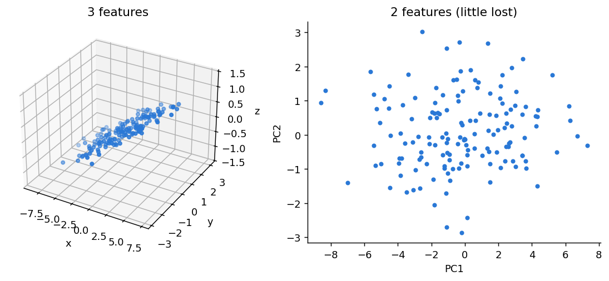
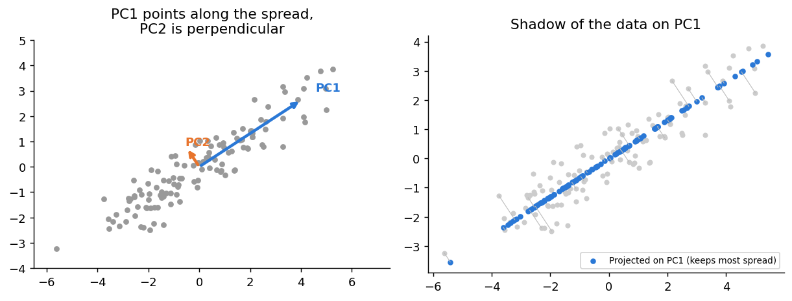
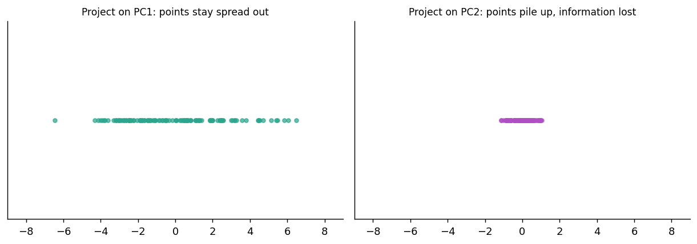

# 8.6 Dimensionality Reduction and PCA

**Topics in this file:** 14. Dimensionality Reduction, 15. PCA, 16. PCA Intuition

The order inside PCA is: what it is (15), the picture that makes it obvious (16), and a short maths box at the end. Code is in the next file.

**Previous:** [05_DBSCAN.md](05_DBSCAN.md) | **Next:** [07_PCA_in_Python.md](07_PCA_in_Python.md)

---

## 14. Dimensionality Reduction

Every feature (column) is one **dimension**. A dataset with 50 features is a 50-dimensional dataset. **Dimensionality reduction** means turning it into a dataset with **fewer features that still carry most of the useful information**.

**Simple words mein:** Bahut saare columns ko kam columns mein compress karna, bina zyada information khoye. Jaise 4K photo ko chhota karna jab tak photo pehchaani jaye.



In the picture, the data in 3-D is almost flat, so a 2-D view loses very little.

### Why do it?

| Reason | Explanation |
|---|---|
| **Visualisation** | We can only plot 2 or 3 dimensions. 13 features need squeezing to see them |
| **Speed** | Fewer features mean faster training and less memory |
| **Remove redundancy** | Features such as height in cm and height in inches repeat the same information |
| **Reduce noise** | Tiny, unimportant variations can be dropped |
| **The curse of dimensionality** | With many dimensions, points become spread out and distances lose meaning, which hurts algorithms like K-Means and DBSCAN |

### Two ways to reduce columns

| Approach | What it does | Example |
|---|---|---|
| **Feature selection** | **Keeps** some of the original columns and drops the rest | Drop columns that carry no information |
| **Feature extraction** | **Builds new columns** by combining the old ones | **PCA** |

The rest of this file is about PCA, the most widely used extraction method. (There are other methods, such as t-SNE and UMAP for visualisation, but they are outside this module.)

---

## 15. PCA (Principal Component Analysis)

**PCA** finds new axes, called **principal components (PCs)**, that capture as much of the data's **variation** (spread) as possible. You then keep only the first few.

Key properties:

- Each principal component is a **mixture** (weighted combination) of the original features.
- The components are **ordered**: PC1 captures the most variation, PC2 the next most, and so on.
- The components are **perpendicular** to each other, so they carry **no repeated information**.
- If you start with *p* features you get *p* components, but you keep only the first *k* (for example 2 or 3).

### The recipe, in plain words

1. **Scale** the features (so no feature dominates just because of its units).
2. Find the **direction** in which the data is most spread out. That is PC1.
3. Find the next direction, perpendicular to the first, with the most remaining spread. That is PC2. Continue.
4. Keep the first *k* directions.
5. **Project** every data point onto these directions. The coordinates along them are the new, smaller dataset.

### How much did we keep? Explained variance

Each component comes with its **explained variance ratio**: the share of the total spread it captures.

```
explained variance ratio of PC_i = variance along PC_i / total variance
```

If PC1 has 0.36 and PC2 has 0.19, then two components together keep 36% + 19% = 55% of the total variation. Adding up the ratios of the components you keep tells you how much information survives.

---

## 16. PCA Intuition

### The shadow idea

Imagine a 3-D object and a torch. The **shadow** on the wall is a 2-D version of it. Turn the object, and the shadow changes: from some angles it looks like a thin line (very little is visible), from others it looks like the full shape.

PCA looks for the **best angle to cast the shadow**, the one that shows the most spread.



- **Left:** the data is stretched along a diagonal. **PC1** points along that stretch. **PC2** is perpendicular and covers the much smaller spread across it.
- **Right:** each point is dropped straight onto PC1 (the blue dots). The picture is now one-dimensional, yet the points are still nicely spread out, so most of the structure survives.

### Why does "spread" mean "information"?

A feature that has the **same value for every row** tells you nothing, since it cannot tell any two rows apart. A direction where points are very **spread out** separates them well.



- Projecting on **PC1** keeps the points spread out, so they are still distinguishable.
- Projecting on **PC2** squeezes them into a narrow pile, so many different points now look almost the same. Information is lost.

### A real-life example

Height and weight of people are strongly related. Instead of two columns, you could describe each person by one new "**size**" value that mixes both. That is what PC1 would be. The small remaining difference (for example "heavy for their height") would be PC2.

**Important:** a principal component is a *new* feature, a blend of the old ones. PC1 is not "height", and it is not "weight". That is why PCs can be harder to explain than original features.

### The maths in one box (optional)

You do not need this to use PCA, but it shows what the computer does.

```
1. Standardise the features.
2. Covariance matrix   C = (1 / (n − 1)) × Xᵀ X
3. Solve               C v = λ v
      v (eigenvector)  = the direction of a principal component
      λ (eigenvalue)   = the variance along that direction
4. Sort by λ, largest first. Keep the top k eigenvectors as columns of W.
5. New data            Z = X · W
```

Explained variance ratio of component *i* = λ_i divided by the sum of all the λ values, which is the formula you saw above. In practice, scikit-learn computes the same thing with a related method (SVD), which is faster and more stable.

---

## Strengths and limits of PCA

| Strength | Limitation |
|---|---|
| Simple, fast, well understood | Only finds **linear** structure (straight directions) |
| Removes redundancy between correlated features | Components are mixtures, so they are **hard to interpret** |
| Great for visualising high-dimensional data | **Needs scaled features**, or large-unit features dominate |
| Often speeds up later models | Keeps *variance*, which is not always what matters for your task |

---

## Practice

1. What is the difference between feature selection and feature extraction? Which one is PCA?
2. PC1 explains 60% of the variance and PC2 explains 25%. How much do the two keep together?
3. Why must the features be scaled before PCA?
4. Is PC1 the same thing as the first original feature?

<details>
<summary>Answers</summary>

1. Selection **keeps** some original columns. Extraction **creates new** columns from combinations of the old ones. PCA is **feature extraction**.
2. 60% + 25% = **85%** of the total variance.
3. PCA looks for the directions with the most variance. A feature with huge numbers (large units) would have huge variance and would dominate the components, regardless of how important it really is.
4. **No.** PC1 is a new feature: a weighted mixture of all the original features, pointing in the direction of greatest spread.

</details>
