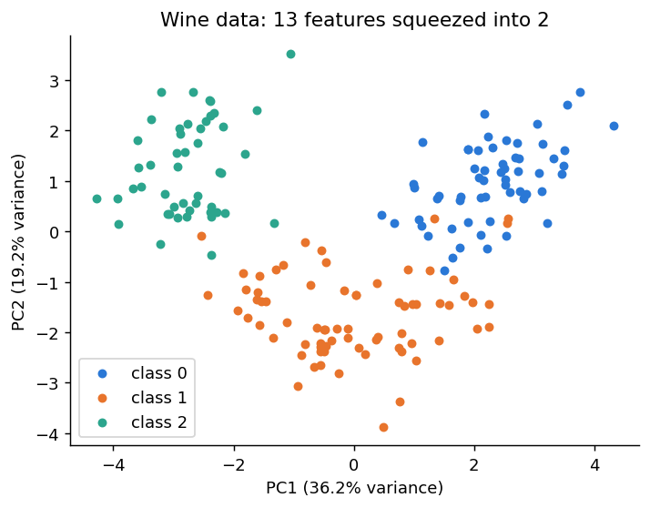
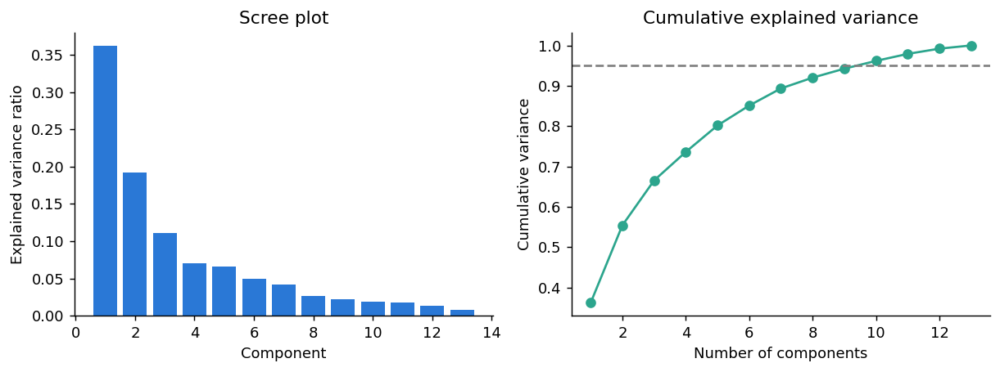

# 8.7 PCA in Python

**Topic in this file:** 17. PCA in Python

The theory (what PCs are, explained variance, why scaling) was covered in file 06. Here we only apply it.

**Previous:** [06_Dimensionality_Reduction_and_PCA.md](06_Dimensionality_Reduction_and_PCA.md)

---

## The dataset: wine chemistry

A new dataset: 178 wines, each described by **13 chemical measurements** (alcohol, flavanoids, proline and so on). The wines come from 3 grape varieties. We do have these variety labels, but PCA will **never see them**. We use them later only to colour the plot and see whether PCA kept useful structure.

```python
import numpy as np
import pandas as pd
import matplotlib.pyplot as plt
from sklearn.datasets import load_wine
from sklearn.preprocessing import StandardScaler
from sklearn.decomposition import PCA

wine = load_wine()
X_w, y_w = wine.data, wine.target
print(X_w.shape)                     # (178, 13)
```

## Step 1: scale the features

The columns are on very different scales: `proline` has a standard deviation of about 314, while most other columns are below 4. Without scaling, proline would swamp everything.

Proof: PCA on the **unscaled** data says PC1 alone explains 99.8% of the variance. That is not insight, it is just proline's big numbers.

```python
print(PCA(n_components=2).fit(X_w).explained_variance_ratio_.round(3))   # [0.998 0.002]

X_scaled = StandardScaler().fit_transform(X_w)
```

## Step 2: fit PCA with 2 components

```python
pca = PCA(n_components=2)
X_pca = pca.fit_transform(X_scaled)

print(X_pca.shape)                              # (178, 2): 13 columns became 2
print(pca.explained_variance_ratio_.round(3))   # [0.362 0.192]
print(pca.explained_variance_ratio_.sum())      # about 0.554
```

- `fit_transform` learns the components **and** gives the new coordinates.
- PC1 keeps 36.2% of the variation, PC2 keeps 19.2%. Together they keep about **55%**.

## Step 3: plot the result

```python
for i in range(3):
    plt.scatter(X_pca[y_w == i, 0], X_pca[y_w == i, 1], label=f"class {i}")
plt.xlabel("PC1")
plt.ylabel("PC2")
plt.legend()
plt.show()
```



Even though PCA never saw the labels and kept only 55% of the variation, the three grape varieties form three fairly separate groups. This is why PCA is such a popular tool for **looking at** high-dimensional data.

## Step 4: how many components should I keep?

Fit PCA with **all** components and look at the cumulative explained variance.

```python
pca_full = PCA().fit(X_scaled)
cum_var = np.cumsum(pca_full.explained_variance_ratio_)

n_95 = int(np.argmax(cum_var >= 0.95)) + 1
print("Components needed for 95% variance:", n_95)     # 10
```



- **Left (scree plot):** the variance of each component, which falls quickly at first. A bend suggests where the useful components end.
- **Right:** the running total. The dashed line is 95%.

You can also let scikit-learn choose for you:

```python
pca_95 = PCA(n_components=0.95).fit(X_scaled)      # keep enough components for 95%
print(pca_95.n_components_)                        # 10
```

**Honest reading:** this dataset is not very compressible. Keeping 95% of the information still needs 10 of the 13 components. Choose the number according to your **purpose**:

| Purpose | Typical choice |
|---|---|
| Plotting | 2 or 3 components |
| Feeding another model | Enough components for roughly 90 to 95% of the variance (or whatever validation shows works) |
| Noise removal | Keep the strong components, drop the weak tail |

## Step 5: what is each component made of? (loadings)

`pca.components_` holds the weights of each original feature in each component. These weights are called **loadings**.

```python
loadings = pd.DataFrame(pca.components_, columns=wine.feature_names, index=["PC1", "PC2"]).T.round(2)
print(loadings.reindex(loadings["PC1"].abs().sort_values(ascending=False).index).head(4))
```

You will see that PC1 is mainly built from `flavanoids` (0.42), `total_phenols` (0.39) and `od280/od315_of_diluted_wines` (0.38). So PC1 is roughly "how phenol-rich the wine is". PC2 leans on `color_intensity` (0.53) and `alcohol` (0.48).

The **size** of a loading shows how much that feature contributes. The **sign** is arbitrary: running PCA again might flip all signs of a component, and that is fine.

## Optional: PCA by hand (checking the maths box from file 06)

```python
cov = np.cov(X_scaled, rowvar=False)
eigenvalues = np.linalg.eigh(cov)[0][::-1]          # eigh returns small to large, so reverse
print((eigenvalues / eigenvalues.sum())[:2].round(3))    # [0.362 0.192]
```

The same ratios as scikit-learn's. Nothing magical is happening.

## Using PCA before clustering

PCA and clustering work well together: reduce first, then cluster. Using a `Pipeline` also keeps scaling and PCA in one object.

```python
from sklearn.pipeline import make_pipeline
from sklearn.cluster import KMeans
from sklearn.metrics import adjusted_rand_score

reducer = make_pipeline(StandardScaler(), PCA(n_components=2))
X_2d = reducer.fit_transform(X_w)

clusters = KMeans(n_clusters=3, n_init=10, random_state=42).fit_predict(X_2d)
print(adjusted_rand_score(y_w, clusters))       # about 0.90
```

`adjusted_rand_score` (file 04) compares the clusters with the true varieties. We only use the true labels here to **judge** the result, which is possible because this teaching dataset happens to have them. K-Means on all 13 scaled features scores about 0.90 too, so squeezing to 2 components lost almost nothing for this task.

## How much did we lose? (reconstruction)

`inverse_transform` maps the 2 components back to 13 features. The difference from the original is the information PCA threw away.

```python
X_back = pca.inverse_transform(X_pca)
print(((X_scaled - X_back) ** 2).mean().round(3))     # about 0.446 (0 would mean nothing lost)
```

---

## Common mistakes

- **Forgetting to scale.** The most common error (see Step 1).
- **Fitting PCA on all data before a train/test split.** Fit it on the **training** data only, then use `transform` on the test data. This is the same data-leakage idea from Module 7, and a `Pipeline` handles it for you.
- **Treating a PC as an original feature.** It is a blend. Use the loadings to describe it.
- **Assuming PCA always helps a model.** It keeps variance, which is not always the information your task needs. Check with validation.
- **Expecting PCA to find curved structure.** It is linear only.

---

## Practice

1. After scaling, you run `PCA(n_components=0.90)`. What does the `0.90` mean?
2. PCA on a dataset gives explained variance ratios of 0.50, 0.30, 0.10, 0.06, 0.04. How many components do you need to keep at least 90%?
3. Which method do you use to turn the new coordinates back into an approximation of the original features?

<details>
<summary>Answers</summary>

1. Keep **as many components as needed to explain at least 90%** of the total variance.
2. 0.50 + 0.30 + 0.10 = 0.90, so **3 components**.
3. `pca.inverse_transform(...)`.

</details>

---

# Module 8 Recap

| Idea | One-line summary |
|---|---|
| Unsupervised learning | Learn structure from data that has no labels |
| Clustering | Group similar rows. Cluster meaning is decided by humans |
| K-Means | Choose K, then repeat *assign* and *update* until stable. Minimises inertia |
| Choosing K | Elbow (bend in inertia) and silhouette (highest peak). Add domain knowledge |
| Hierarchical | Merge the closest clusters step by step. Read the dendrogram and cut it |
| DBSCAN | Crowded regions are clusters, isolated points are noise. Sensitive to `eps` |
| Dimensionality reduction | Fewer columns, most of the information kept |
| PCA | New perpendicular axes ordered by variance. Scale first, keep the top few |

**Pairing rule of thumb:** scale your data, reduce it with PCA if it has many columns, then cluster, and always interpret the clusters with a plot and a summary table.
