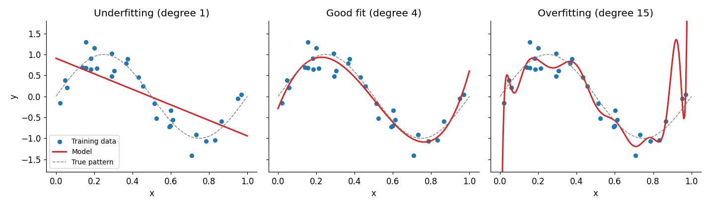
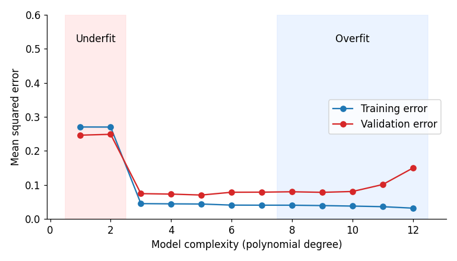

# Lesson 1: Underfitting and Overfitting

## Core idea

A model's job is not to memorize the training data. Its job is to **predict correctly on new, unseen data**. This ability is called *generalization*.

- **Underfitting:** the model is too simple to capture the real pattern in the data. Performance is poor on both training and test data.
- **Overfitting:** the model is so complex that it learns the noise (random fluctuations) along with the pattern. It does very well on training data and poorly on test data.

**Analogy:** Think of exam preparation. An underfit student barely studied the syllabus. An overfit student memorized the answers to last year's papers, so new questions throw them off. A good student understood the concepts.

## Visual intuition

We took 30 noisy points from a sine-wave pattern and fitted three polynomial models:



- **Degree 1** (a straight line): cannot follow the curve, so it underfits.
- **Degree 4:** follows the pattern and ignores the noise, so it is a good fit.
- **Degree 15:** strange wiggles to touch every point, and wild swings at the edges, so it overfits.

## What happens as complexity increases



- As complexity grows, **training error keeps falling** (the model has more flexibility).
- **Validation error** first falls, then *starts rising* after a certain point. That point is where overfitting begins.

Actual numbers (MSE) from this experiment:

| Degree | Training MSE | Validation MSE | Diagnosis |
|---|---|---|---|
| 1 | 0.270 | 0.246 | Underfit (both high) |
| 4 | 0.044 | 0.073 | Good fit |
| 12 | 0.032 | 0.150 | Overfit (large gap) |

## How to diagnose: compare train and test scores

| Training score | Test score | Meaning |
|---|---|---|
| Low | Low | Underfitting |
| High | Low (large gap) | Overfitting |
| High | High (small gap) | Good generalization |

This gap check is the most basic tool in this module. Lesson 3 (cross validation) shows how to measure it reliably.

## Code: a Decision Tree demo

A tree's `max_depth` controls its complexity. The deeper the tree, the more flexible the model.

```python
import pandas as pd
from sklearn.datasets import load_breast_cancer
from sklearn.model_selection import train_test_split
from sklearn.tree import DecisionTreeClassifier

X, y = load_breast_cancer(return_X_y=True, as_frame=True)
X_train, X_test, y_train, y_test = train_test_split(
    X, y, test_size=0.2, stratify=y, random_state=42
)

for depth in [1, 3, None]:
    model = DecisionTreeClassifier(max_depth=depth, random_state=42)
    model.fit(X_train, y_train)
    print(depth, round(model.score(X_train, y_train), 3), round(model.score(X_test, y_test), 3))
```

**Output** (depth, train accuracy, test accuracy):

```
1     0.923  0.921
3     0.976  0.939
None  1.0    0.912
```

**Interpretation:**

- `max_depth=None`: training accuracy is **1.0** (it memorized the training data) but test accuracy is only 0.912. This is overfitting.
- `max_depth=3`: training 0.976, test **0.939**. The best balance.
- `max_depth=1`: a single split. Both scores are lower. This is mild underfitting (the gap is small on this dataset because even one feature is quite informative, so underfitting is not dramatic here).

Note: this is the result of a single train/test split. On a small test set (114 samples), a 1 to 2% difference can be luck. That is why we learn cross validation in Lesson 3.

## Causes and fixes (overview)

| | Underfitting | Overfitting |
|---|---|---|
| **Common causes** | Model too simple, too few features, too much regularization, too little training | Model too complex, too little data, too many features, noisy data |
| **Fixes** | A more complex model, better features, less regularization, more training | More data, a simpler model, regularization (Lesson 5), feature selection (Lesson 6), cross validation (Lesson 3), early stopping |

Each fix is covered in detail in later lessons. For now, just keep this map in mind.

## Common mistakes

- Judging a model as "good" by training accuracy alone.
- Tuning repeatedly on the test set (this indirectly overfits the test set; details in Lessons 4 and 8).
- Believing that overfitting is only a deep-learning problem. It also happens in decision trees, KNN (with small K), polynomial regression, and more.

## Recap

- Underfitting = high error everywhere. Overfitting = low train error, high test error.
- The diagnostic tool: the gap between train and validation scores.
- Next question: *why do these two problems happen?* → Lesson 2 (Bias and Variance).
