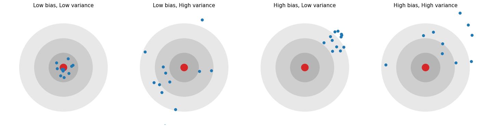
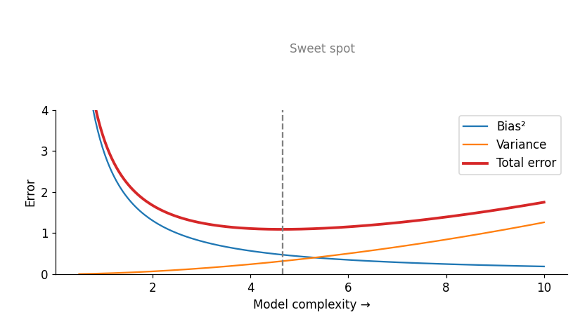

# Lesson 2: Bias, Variance and the Bias-Variance Tradeoff

Lesson 1 showed *what* happens (underfitting and overfitting). Now we look at *why*. The answer is **bias** and **variance**.

## Bias

**Bias** is a model's *systematic error*. The model makes such strong (and wrong) assumptions about the pattern that even with plenty of data it cannot reach the right answer.

- Example: fitting a straight line to curved data. Whether you give it 30 points or 300,000, a line cannot become a curve.
- **High bias → underfitting.**

## Variance

**Variance** measures how much the model's predictions *change* when the training data changes. If a slightly different training sample produces a very different model, variance is high.

- Example: a degree-15 polynomial. Move one point and the whole curve changes.
- **High variance → overfitting.**

## Dartboard analogy

The bullseye is the correct answer. Each blue dot is the prediction of a model trained on a different training sample.



| | Low variance | High variance |
|---|---|---|
| **Low bias** | All dots near the bullseye, tightly grouped | Scattered around the bullseye |
| **High bias** | Tightly grouped, but away from the bullseye | Away from the bullseye and scattered (the worst case) |

## The total error formula

A model's expected squared error at a new point can be split into three parts:

$$\text{Expected Error} = \text{Bias}^2 + \text{Variance} + \text{Irreducible Error}$$

- **Bias²:** error from the model's assumptions.
- **Variance:** error from sensitivity to the particular training sample.
- **Irreducible error:** the noise in the data itself. No model can remove it.

## Measure it yourself

Idea: on the same sine-wave problem, create 200 different training sets, train a model each time, and check whether the predictions are correct on average (bias) and how much they fluctuate (variance).

```python
import numpy as np
from sklearn.preprocessing import PolynomialFeatures
from sklearn.linear_model import LinearRegression
from sklearn.pipeline import make_pipeline

def true_f(x): return np.sin(2 * np.pi * x)

x_test = np.linspace(0.05, 0.95, 50).reshape(-1, 1)
rng = np.random.RandomState(0)

for degree in [1, 4, 9]:
    preds = []
    for _ in range(200):                                   # 200 different training sets
        x = rng.uniform(0, 1, 30).reshape(-1, 1)
        y = true_f(x).ravel() + rng.normal(0, 0.25, 30)
        model = make_pipeline(PolynomialFeatures(degree), LinearRegression()).fit(x, y)
        preds.append(model.predict(x_test))
    preds = np.array(preds)
    bias2 = np.mean((preds.mean(axis=0) - true_f(x_test).ravel()) ** 2)
    variance = np.mean(preds.var(axis=0))
    print(f"degree={degree}  bias^2={bias2:.3f}  variance={variance:.3f}")
```

**Output:**

```
degree=1  bias^2=0.156  variance=0.016
degree=4  bias^2=0.003  variance=0.014
degree=9  bias^2=0.010  variance=3.628
```

**Interpretation:**

- **Degree 1:** large bias² (0.156), small variance. Underfitting.
- **Degree 4:** both small. The sweet spot.
- **Degree 9:** bias is almost zero, but variance explodes (3.628). The model changes with the noise in every sample. Overfitting.

(Exact numbers depend on the random seed, but the pattern always looks like this.)

## The tradeoff

Increasing complexity lowers bias but raises variance. Both cannot be minimized at once, which is why it is called a **tradeoff**.



- Left side: simple model → high bias, low variance.
- Right side: complex model → low bias, high variance.
- **Total error** forms a U-shape. The goal is the bottom of that U.

This is the same picture as the train/validation error curve in Lesson 1. Now we know the two forces working behind that curve.

## Practical cheat-sheet

| Symptom | Problem | What to try |
|---|---|---|
| Train error high, test error high | High bias | A more complex model, better features, less regularization |
| Train error low, test error high | High variance | More data, a simpler model, more regularization, feature selection |
| Both low, small gap | Balanced | Stop, the model is fine |

**Note:** more data mostly reduces *variance*. Giving more data to a high-bias model does not help much.

## Common mistakes

- Confusing "bias" with bias in ML fairness (social bias). Here bias is a statistical concept.
- Assuming the most complex model is always the best.
- Treating irreducible error as the model's fault. Sometimes the data itself sets the limit.

## Recap

- Bias = systematic error (underfitting). Variance = sensitivity to the sample (overfitting).
- Error = Bias² + Variance + Noise.
- Next: to find the sweet spot of this tradeoff reliably, we need good measurement → **Lesson 3 (Cross Validation)**.
