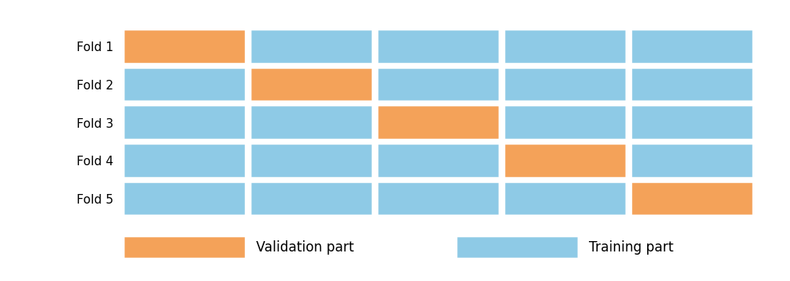
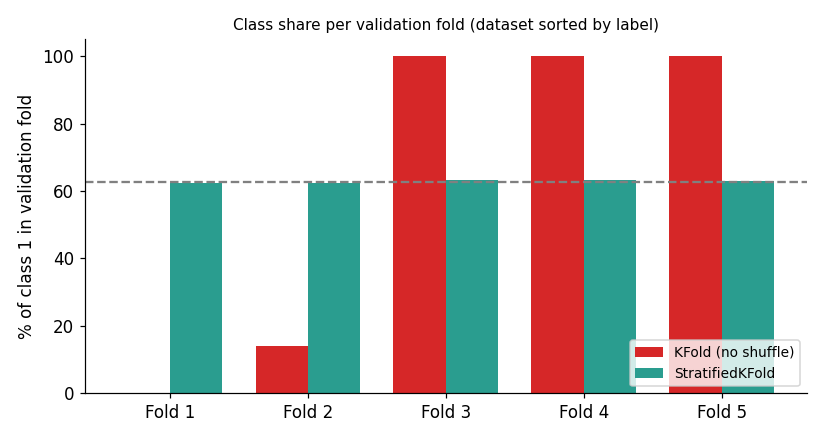

# Lesson 3: Cross Validation, K-Fold and Stratified K-Fold

## The problem: a single split is not reliable

So far we split the data into train/test just once. If the test set is small or the split is lucky or unlucky, the score changes. In the breast cancer dataset the test set had only 114 rows, and a difference of just 2 rows moves the score.

**Cross Validation (CV)** solves this: split the data several different ways, train and evaluate the model each time, and average the scores.

## K-Fold Cross Validation

Steps (for K = 5):

1. Split the data into 5 equal parts (**folds**).
2. Use fold 1 as validation, train on the other 4 → score 1.
3. Use fold 2 as validation, train on the other 4 → score 2.
4. ... continue until the fifth fold.
5. Final result = the **mean of the 5 scores** (and the standard deviation shows stability).



Every row is in validation exactly once and in training (K − 1) times, so all the data gets used.

**How to choose K?** K = 5 or 10 are the standard choices. A smaller K means less computation but slightly more bias in the estimate. A larger K costs more computation but gives more stable scores. For most work, 5 or 10 is enough.

## Code

```python
from sklearn.datasets import load_breast_cancer
from sklearn.tree import DecisionTreeClassifier
from sklearn.model_selection import cross_val_score, KFold

X, y = load_breast_cancer(return_X_y=True, as_frame=True)
model = DecisionTreeClassifier(max_depth=3, random_state=42)

scores = cross_val_score(model, X, y, cv=5)
print(scores.round(3))
print("Mean:", scores.mean().round(3), "Std:", scores.std().round(3))
```

**Output:**

```
[0.912 0.895 0.939 0.956 0.894]
Mean: 0.919 Std: 0.025
```

**Interpretation:** A single split gave 0.939 (Lesson 1), but across 5 folds the score ranges from 0.894 to 0.956. The mean, 0.919, is the realistic estimate. `std = 0.025` tells us how much performance changes from split to split.

### KFold with shuffling

If the data is stored in some order (for example sorted by date or by class), folds without shuffling can be biased.

```python
kf = KFold(n_splits=5, shuffle=True, random_state=42)
scores = cross_val_score(model, X, y, cv=kf)
print(scores.round(3), scores.mean().round(3))
```

```
[0.947 0.956 0.912 0.921 0.938] 0.935
```

Notice that the mean changed from 0.919 to 0.935 just because the folds were formed differently. This shows that on a small dataset even the CV score has some noise, so always read scores as `mean ± std`.

## Stratified K-Fold

**Problem:** Plain KFold forms folds randomly (or in order). If classes are imbalanced or the data is sorted, a fold may end up with no examples of one class.

**Stratified K-Fold** keeps the **class proportions in every fold the same as in the original data**. If 63% of the full data is class 1, each fold will have about 63% class 1.

Worst-case demo: we sorted the breast cancer labels (all class 0 first, then class 1):



| Fold | Plain KFold (no shuffle) | StratifiedKFold |
|---|---|---|
| 1 | 0% class 1 | 62.3% |
| 2 | 14.0% | 62.3% |
| 3 | 100% | 63.2% |
| 4 | 100% | 63.2% |
| 5 | 100% | 62.8% |

With plain KFold some folds contain only one class, so the model can neither learn nor be evaluated properly. Stratified folds stay representative.

### Code

```python
from sklearn.model_selection import StratifiedKFold

skf = StratifiedKFold(n_splits=5, shuffle=True, random_state=42)
scores = cross_val_score(model, X, y, cv=skf)
print(scores.round(3), scores.mean().round(3))

for train_idx, val_idx in skf.split(X, y):
    print(len(train_idx), len(val_idx), round(y.iloc[val_idx].mean(), 3))
    break
```

**Output:**

```
[0.921 0.886 0.947 0.93  0.938] 0.924
455 114 0.623
```

The first fold has 455 training rows and 114 validation rows, and the share of class 1 in validation is 0.623 (close to the original proportion).

**Good to know:** in scikit-learn, `cross_val_score(model, X, y, cv=5)` already uses **stratified** K-Fold by default for classifiers (without shuffling), and plain KFold for regressors. Writing it explicitly is still better practice because you control `shuffle` and `random_state`.

## Measuring more than one metric

When accuracy is not enough (it will not be, for imbalanced data in Lesson 7), use `cross_validate`:

```python
from sklearn.model_selection import cross_validate

cv = cross_validate(model, X, y, cv=skf, scoring=["accuracy", "recall", "f1"])
print({k: v.mean().round(3) for k, v in cv.items() if k.startswith("test_")})
```

```
{'test_accuracy': 0.924, 'test_recall': 0.947, 'test_f1': 0.94}
```

## Which one to use

| Situation | Splitter |
|---|---|
| Regression, balanced data | `KFold(shuffle=True)` |
| Classification (especially imbalanced) | `StratifiedKFold(shuffle=True)` |
| Time-series data | `TimeSeriesSplit` (future data must never be used to predict the past) |

## Common mistakes

- **Treating the CV score as the final model's score.** CV only gives an estimate. The final model is trained on the whole training data.
- **Doing preprocessing (scaling, feature selection) on the full data before CV.** This is data leakage; the full explanation is in **Lesson 8**. The safe way is to put preprocessing inside a Pipeline (shown in Lesson 4).
- Using random KFold on time-series data.
- Looking only at the mean and ignoring the standard deviation.

## Recap

- CV = average over several splits, which is more reliable than a single split.
- Stratified K-Fold is the default choice for classification.
- Next: now that we can measure a model reliably, we improve the model's *settings* → **Lesson 4 (Hyperparameter Tuning)**.
