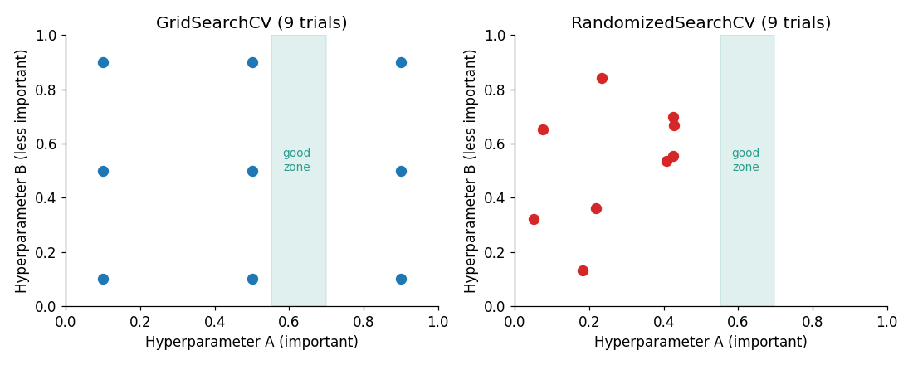

# Lesson 4: Hyperparameters, Tuning, GridSearchCV and RandomizedSearchCV

## Hyperparameters vs parameters

| | Parameters | Hyperparameters |
|---|---|---|
| Who sets them | The model **learns them itself** during training | **We set them** before training |
| Examples | Coefficients of linear regression, split thresholds of a tree | A tree's `max_depth`, KNN's `n_neighbors`, SVM's `C` and `gamma`, a Random Forest's `n_estimators` |
| How we get them | From data, via optimization | By experimenting (tuning) |

**Analogy:** In cooking, the final taste is like the "parameters" (it develops during cooking), while the flame level and cooking time are the "hyperparameters" that you decide in advance.

Recall from Lessons 1 and 2: hyperparameters such as `max_depth` control **model complexity**, so they are the knobs of the bias-variance tradeoff.

## Hyperparameter tuning

**Tuning** means trying different combinations of hyperparameters and choosing the one with the best **validation performance** (measured with cross validation, Lesson 3).

Key rule: **never use the test set for tuning.** The test set is used only once, at the very end.

```
Data → [ Train (tuning + CV happen here) | Test (only at the end) ]
```

## GridSearchCV: try every combination

You supply a **grid** of values, and it evaluates every combination with CV.

We will tune an SVM (`C`, `gamma`). SVMs perform poorly without scaling, so we use a `Pipeline`. Inside a pipeline, the scaler is fitted only on the training part of each CV fold, so there is no leakage risk (details in Lesson 8).

```python
from sklearn.datasets import load_breast_cancer
from sklearn.model_selection import train_test_split, GridSearchCV
from sklearn.pipeline import Pipeline
from sklearn.preprocessing import StandardScaler
from sklearn.svm import SVC

X, y = load_breast_cancer(return_X_y=True, as_frame=True)
X_train, X_test, y_train, y_test = train_test_split(
    X, y, test_size=0.2, stratify=y, random_state=42
)

pipe = Pipeline([("scaler", StandardScaler()), ("svm", SVC())])

param_grid = {
    "svm__C":     [0.1, 1, 10, 100],
    "svm__gamma": [0.001, 0.01, 0.1, 1],
}

grid = GridSearchCV(pipe, param_grid, cv=5, scoring="accuracy")
grid.fit(X_train, y_train)

print("Best params  :", grid.best_params_)
print("Best CV score:", round(grid.best_score_, 3))
print("Test score   :", round(grid.score(X_test, y_test), 3))
print("Combinations tried:", len(grid.cv_results_["params"]))
```

**Output:**

```
Best params  : {'svm__C': 10, 'svm__gamma': 0.01}
Best CV score: 0.98
Test score   : 0.982
Combinations tried: 16
```

**What happened:**

- The double underscore in `svm__C` means "parameter `C` of the pipeline step named `svm`".
- 4 × 4 = **16 combinations**, each with 5 folds → **80 model fits**.
- `grid.best_score_` is the **CV score** of the best combination (during tuning).
- `GridSearchCV` has `refit=True` by default: it retrains the final model on the whole training set with the best parameters. That is why `grid.score(X_test, y_test)` works directly, and the final model is available as `grid.best_estimator_`.

**Limitation:** combinations multiply. 5 hyperparameters with 10 values each give 100,000 combinations. For large search spaces, use Randomized Search.

## RandomizedSearchCV: sample random combinations

Instead of trying every combination, you give distributions and only `n_iter` random combinations are tried.



**Why random search works:** in most problems only 1 or 2 hyperparameters really matter. In a 3×3 grid, the important parameter gets only **3 distinct values**. With 9 random trials it gets **9 distinct values**, so there is a better chance of landing in the "good zone".

```python
from scipy.stats import loguniform
from sklearn.model_selection import RandomizedSearchCV

param_dist = {
    "svm__C":     loguniform(1e-2, 1e3),
    "svm__gamma": loguniform(1e-4, 1e1),
}

rand = RandomizedSearchCV(pipe, param_dist, n_iter=20, cv=5, random_state=42)
rand.fit(X_train, y_train)

print("Best params  :", {k: round(v, 4) for k, v in rand.best_params_.items()})
print("Best CV score:", round(rand.best_score_, 3))
print("Test score   :", round(rand.score(X_test, y_test), 3))
```

**Output:**

```
Best params  : {'svm__C': 11.4621, 'svm__gamma': 0.0005}
Best CV score: 0.976
Test score   : 0.965
```

**Notes:**

- We use `loguniform` because parameters like `C` and `gamma` act multiplicatively (the step from 0.01 to 0.1 matters as much as the step from 10 to 100). With uniform sampling, 99% of samples would land near the large values.
- `n_iter=20` means only 20 combinations (100 fits). You control the compute budget.

## Grid vs Random: when to use which

| | GridSearchCV | RandomizedSearchCV |
|---|---|---|
| Search | Every combination | Random sample |
| Cost | Grows rapidly with combinations | Fixed by `n_iter` |
| Best for | 1 to 3 hyperparameters, a small grid | Many hyperparameters, continuous ranges |
| Guarantee | Finds the best point inside the grid | Finding the best can involve luck |

**Practical workflow:** first explore a wide range with Randomized search, then refine around the best region with a small Grid search.

## An honest observation

On this dataset, even the **default SVC** (no tuning, with scaling) gets a test score of **0.982**, so tuning added nothing to test accuracy here, and the Random search score of 0.965 looks lower. Three lessons:

1. Tuning does not help much on every dataset. Strong defaults plus a small, easy dataset means limited gain.
2. On a 114-row test set, a difference of 1 to 2 rows (0.982 vs 0.965 is 2 rows) can be noise.
3. To compare models, look at the CV score, not a single test number.

## Common mistakes

- **Tuning on the test set**, which makes the test score optimistic.
- Keeping preprocessing outside the Pipeline (leakage; Lesson 8).
- A range on the wrong scale (trying 1, 2, 3, 4 for `C` when 0.01 to 1000 matters).
- Building a very fine grid on a small dataset (the noise in CV scores can be larger than the differences in the grid).
- Tuning on accuracy alone when the data is imbalanced (use `scoring="f1"` or `"recall"`; Lesson 7).

## Recap

- The model learns parameters; we set hyperparameters.
- `GridSearchCV` is exhaustive; `RandomizedSearchCV` is sampled and suited to large spaces.
- Tune with CV, and use the test set only at the end.
- Next: a hyperparameter that directly controls overfitting → **Lesson 5 (Regularization)**.
