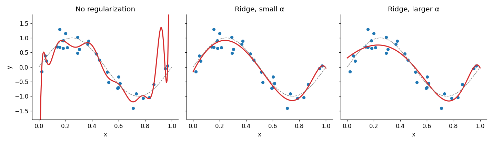
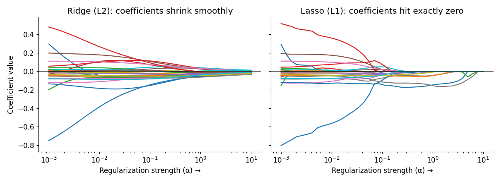

# Lesson 5: Regularization

## Core idea

In overfitting, a model's coefficients (weights) become very large because the model builds extreme curves to fit the noise. **Regularization** adds a *penalty for large weights* during training. The result is a simpler, smoother model with lower variance (Lesson 2).

**Analogy:** Tell a student, "Write short and direct answers, not long rambling ones." This reduces over-explaining (memorizing noise).

Normal training only minimizes the **loss**. Regularized training minimizes:

$$\text{Total Cost} = \text{Loss (fit to data)} + \lambda \times \text{Penalty (size of weights)}$$

- **Loss:** how well the model fits the data.
- **Penalty:** how large the weights are.
- **λ (lambda):** how strong the penalty is. In scikit-learn this is called `alpha` (Ridge/Lasso). Logistic Regression and SVM use `C`, which is the **inverse** (smaller C = stronger regularization).

λ is a hyperparameter, so it is tuned using the methods from Lesson 4.

## L2 regularization (Ridge)

Penalty = the **sum of squared weights**: $\lambda \sum w_j^2$

- Makes weights **smaller but not exactly zero**.
- With correlated features, it shares the weight among them.
- A good default when most features are somewhat useful.

## L1 regularization (Lasso)

Penalty = the **sum of absolute weights**: $\lambda \sum |w_j|$

- Pushes some weights to **exactly zero**, which gives automatic **feature selection** (we revisit this in Lesson 6 as an embedded method).
- Useful when you suspect many features are irrelevant.

| | Ridge (L2) | Lasso (L1) |
|---|---|---|
| Penalty | Σw² | Σ\|w\| |
| Weights | Small, non-zero | Some exactly 0 |
| Feature selection | No | Yes |
| Correlated features | Shares the weight | Often keeps just one |

(Combining both gives **Elastic Net**: `ElasticNet(alpha, l1_ratio)`.)

## Visual: Ridge on the overfit curve

The same degree-15 polynomial from Lesson 1, now with different `alpha` values:



As alpha increases, the curve becomes smoother. With too much alpha the model starts to underfit, so regularization strength is a **tradeoff** (the same bias-variance idea from Lesson 2).

## Shrinkage of weights



In Ridge, coefficients move gradually toward zero. In Lasso, many coefficients get "stuck" at exactly zero. (The alpha scales of the two plots differ so that the shapes are comparable. Look only at the pattern.)

## Code 1: Ridge and Lasso (regression, diabetes dataset)

**Important:** regularization penalizes the size of weights, so features must be on the **same scale**. Apply `StandardScaler` first.

```python
import pandas as pd
from sklearn.datasets import load_diabetes
from sklearn.preprocessing import StandardScaler
from sklearn.linear_model import LinearRegression, Ridge, Lasso

X, y = load_diabetes(return_X_y=True, as_frame=True)
X_s = pd.DataFrame(StandardScaler().fit_transform(X), columns=X.columns)

models = {
    "Plain":        LinearRegression(),
    "Ridge a=10":   Ridge(alpha=10),
    "Lasso a=1":    Lasso(alpha=1),
    "Lasso a=5":    Lasso(alpha=5),
}
coefs = {name: m.fit(X_s, y).coef_.round(1) for name, m in models.items()}
print(pd.DataFrame(coefs, index=X.columns))
```

**Output:**

```
     Plain  Ridge a=10  Lasso a=1  Lasso a=5
age   -0.5        -0.3       -0.0        0.0
sex  -11.4       -10.9       -9.3       -2.2
bmi   24.7        24.6       24.8       24.2
bp    15.4        15.1       14.1       10.3
s1   -37.7       -11.3       -4.8       -0.0
s2    22.7         1.8       -0.0       -0.0
s3     4.8        -6.6      -10.6       -7.0
s4     8.4         5.6        0.0        0.0
s5    35.7        25.3       24.4       21.2
s6     3.2         3.5        2.6        0.0
```

**Interpretation:**

- `s1` and `s2` (blood-serum measurements) are correlated with each other, so in plain regression their weights are large and in opposite directions (−37.7 and +22.7). This is a sign of instability. Ridge shrinks both considerably (−11.3 and 1.8).
- Lasso with `alpha=5` sets `age`, `s1`, `s2`, `s4` and `s6` to **exactly 0**, keeping only `sex`, `bmi`, `bp`, `s3` and `s5`. This is automatic feature selection.
- `bmi` and `s5` stay large in every model, so they are the most stable, important features.

## Code 2: `C` in Logistic Regression (classification)

Here `C` = 1/λ. **Smaller C = stronger regularization.**

```python
from sklearn.datasets import load_breast_cancer
from sklearn.model_selection import train_test_split
from sklearn.pipeline import make_pipeline
from sklearn.linear_model import LogisticRegression

X, y = load_breast_cancer(return_X_y=True, as_frame=True)
X_train, X_test, y_train, y_test = train_test_split(
    X, y, test_size=0.2, stratify=y, random_state=42
)

for C in [0.001, 0.01, 0.1, 1, 100, 10000]:
    m = make_pipeline(StandardScaler(), LogisticRegression(C=C, max_iter=5000))
    m.fit(X_train, y_train)
    print(f"C={C:<7} train={m.score(X_train, y_train):.3f}  test={m.score(X_test, y_test):.3f}")
```

**Output:**

```
C=0.001   train=0.888  test=0.930
C=0.01    train=0.956  test=0.947
C=0.1     train=0.987  test=0.974
C=1       train=0.989  test=0.982
C=100     train=0.993  test=0.947
C=10000   train=1.000  test=0.930
```

**Interpretation:**

- `C=0.001` (very strong regularization): both scores are low → **underfitting**.
- `C=1`: the best test score (0.982) → the sweet spot.
- `C=10000` (almost no regularization): train 1.0 but test 0.930 → **overfitting**.

This is the real-life version of the U-curve from Lesson 1, with `C` as the complexity knob. To find the best `C`, use `GridSearchCV` (Lesson 4).

## Other forms of regularization (just know the names)

- In tree models: `max_depth`, `min_samples_leaf`, pruning.
- In neural networks: dropout, weight decay, early stopping.

The principle is the same: limit the model's flexibility.

## Common mistakes

- Forgetting to scale. Features with large scales get penalized differently and the result is wrong.
- Confusing the direction of `C` and `alpha` (higher C = less regularization, higher alpha = more regularization).
- Assuming Lasso is always best. With correlated features, Lasso picks one at random. For stable results, try Ridge or Elastic Net.
- Tuning regularization strength on the test set.

## Recap

- Regularization = loss + a penalty on weights. It lowers variance and slightly raises bias.
- Ridge (L2) shrinks weights; Lasso (L1) zeroes some of them.
- Always scale, and tune the strength with CV.
- Next: reducing complexity by removing features ourselves → **Lesson 6 (Feature Selection)**.
