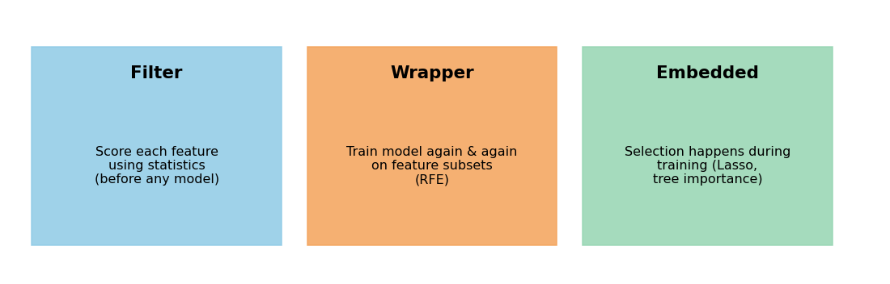
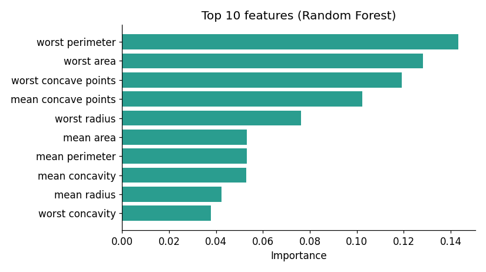

# Lesson 6: Feature Selection

## Core idea

Not every feature is useful to a model. Irrelevant or redundant features:

- add noise → **overfitting** (high variance),
- slow down training,
- make the model harder to interpret.

**Feature selection** means choosing only a useful subset of the original features. (This differs from **feature extraction** such as PCA in Module 8: PCA *creates* new features, while selection *keeps* some of the original ones, so each feature retains its original meaning.)

Regularization (Lesson 5) also reduces complexity by shrinking weights. Feature selection does it by removing features. Lasso does both at once.

## Three families



| Method | Idea | Speed | Model-dependent? |
|---|---|---|---|
| **Filter** | Score each feature with statistics and keep the top ones | Fast | No |
| **Wrapper** | Train the model again and again on different feature subsets | Slow | Yes |
| **Embedded** | Selection happens during training itself | Medium | Yes |

## 1. Filter methods

**VarianceThreshold:** a feature whose values are almost constant tells us nothing. Remove it.

**SelectKBest:** compute a statistical score between each feature and the target (for classification, `f_classif` = ANOVA F-test) and keep the top K.

```python
import pandas as pd
from sklearn.datasets import load_breast_cancer
from sklearn.model_selection import train_test_split
from sklearn.feature_selection import SelectKBest, f_classif, VarianceThreshold

X, y = load_breast_cancer(return_X_y=True, as_frame=True)
X_train, X_test, y_train, y_test = train_test_split(
    X, y, test_size=0.2, stratify=y, random_state=42
)

print("Features left after removing zero-variance:", VarianceThreshold(0.0).fit(X_train).get_support().sum())

skb = SelectKBest(f_classif, k=5).fit(X_train, y_train)
print(list(X.columns[skb.get_support()]))
```

**Output:**

```
Features left after removing zero-variance: 30
['mean perimeter', 'mean concave points', 'worst radius', 'worst perimeter', 'worst concave points']
```

- This dataset has no constant features, so all 30 remain.
- **Limitation of filters:** each feature is judged *on its own*. `mean perimeter`, `worst radius` and `worst perimeter` all measure almost the same thing (size), so they are redundant, yet the filter picks all three.
- Always fit selection on **training data only** (`fit(X_train, y_train)`). Why? See Lesson 8.

## 2. Wrapper method: RFE (Recursive Feature Elimination)

Steps: train a model → remove the weakest feature → train again → repeat until K features remain.

```python
from sklearn.preprocessing import StandardScaler
from sklearn.linear_model import LogisticRegression
from sklearn.feature_selection import RFE

scaler = StandardScaler().fit(X_train)
rfe = RFE(LogisticRegression(max_iter=5000), n_features_to_select=5)
rfe.fit(scaler.transform(X_train), y_train)
print(list(X.columns[rfe.support_]))
```

**Output:**

```
['radius error', 'worst radius', 'worst texture', 'worst area', 'worst concave points']
```

This is a completely different set from the filter result. RFE looks at feature **combinations**, so redundant features get dropped. The cost: the model is trained many times, so it is slow on large datasets.

## 3. Embedded methods

Selection happens inside the model.

- **Lasso / L1 (Lesson 5):** zero weight = feature removed.
- **Tree-based importance:** a Random Forest reports which features were most useful in its splits.

```python
from sklearn.ensemble import RandomForestClassifier
from sklearn.feature_selection import SelectFromModel

sfm = SelectFromModel(RandomForestClassifier(200, random_state=42), threshold="median")
sfm.fit(X_train, y_train)
print(sfm.get_support().sum(), "features kept (importance above the median)")
```

**Output:**

```
15 features kept (importance above the median)
```



The importance chart shows which features matter most to the model. Note that tree importance also splits credit among correlated features.

## Does selection always improve the score?

No. An honest check, with selection inside a pipeline (leakage-safe, Lesson 8) and CV:

```python
from sklearn.pipeline import make_pipeline
from sklearn.model_selection import cross_val_score

all_30 = make_pipeline(StandardScaler(), LogisticRegression(max_iter=5000))
top_10 = make_pipeline(StandardScaler(), SelectKBest(f_classif, k=10),
                       LogisticRegression(max_iter=5000))

print("All 30 features:", cross_val_score(all_30, X, y, cv=5).mean().round(3))
print("Top 10 features:", cross_val_score(top_10, X, y, cv=5).mean().round(3))
```

**Output:**

```
All 30 features: 0.981
Top 10 features: 0.951
```

Here, removing features **lowered** accuracy, because the dataset is small and Logistic Regression is already regularized. Feature selection helps most when:

- the number of features is very large compared with the number of samples (for example 10,000 genes and 100 patients),
- the model has little regularization (KNN, unregularized trees),
- speed or interpretability matters.

So treat selection like a hyperparameter: tune `k` with CV (put `SelectKBest__k` in the `GridSearchCV` grid, as in Lesson 4).

## Which method when

| Situation | Try |
|---|---|
| Very many features, need a quick baseline | Filter (VarianceThreshold, SelectKBest) |
| Small or medium data, want the best subset | Wrapper (RFE) |
| The model is already Lasso or tree-based | Embedded |

## Common mistakes

- **Fitting selection on the full data and then running CV.** This is the most common leakage; Lesson 8 shows it with numbers.
- Trusting only a correlation or filter score and ignoring redundancy.
- Ignoring domain knowledge. Sometimes a "weak" feature is essential from the domain's point of view.
- Reading feature importance as "causation". It only shows usefulness to the model.

## Recap

- Selection = keeping useful features. Filter (fast), wrapper (accurate, slow), embedded (inside training).
- Always fit inside the pipeline or on training data only.
- Next: another big problem, when the target classes are very skewed → **Lesson 7 (Imbalanced Data)**.
