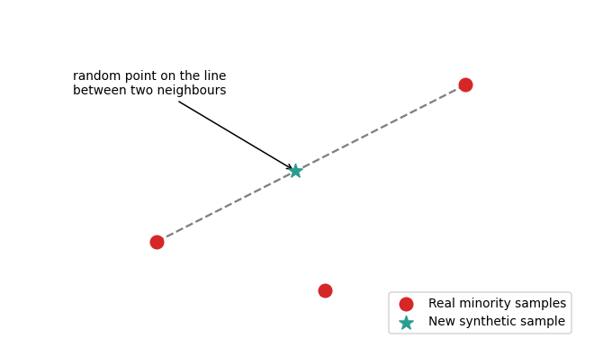
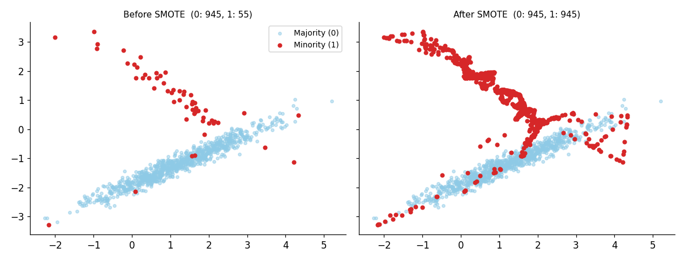

# Lesson 7: Handling Imbalanced Data, Class Weights and SMOTE

## The problem: imbalanced data

When one class is far more frequent than another, the data is **imbalanced**. Real examples: fraud detection (0.1% fraud), disease screening, machine failure, spam.

The core difficulty: a model can get high accuracy just by always predicting the "majority class", while never catching the thing we actually care about (fraud, disease).

## The accuracy trap

The dataset for this lesson: 5,000 samples with only **3% positives** (synthetic, 10 features). After a stratified split:

```python
import numpy as np
from sklearn.datasets import make_classification
from sklearn.model_selection import train_test_split
from sklearn.linear_model import LogisticRegression
from sklearn.metrics import accuracy_score, recall_score, f1_score

X, y = make_classification(n_samples=5000, n_features=10, n_informative=5,
                           weights=[0.97, 0.03], flip_y=0.02, class_sep=0.8,
                           random_state=42)
X_train, X_test, y_train, y_test = train_test_split(
    X, y, stratify=y, test_size=0.2, random_state=42
)
print(np.bincount(y_train), np.bincount(y_test))

def report(model, name):
    p = model.predict(X_test)
    print(f"{name:<10} acc={accuracy_score(y_test, p):.3f}  "
          f"recall={recall_score(y_test, p):.3f}  f1={f1_score(y_test, p):.3f}")

plain = LogisticRegression(max_iter=2000).fit(X_train, y_train)
report(plain, "plain")
```

**Output:**

```
[3838  162] [960  40]
plain      acc=0.960  recall=0.000  f1=0.000
```

**Interpretation:** Accuracy looks like **96%**, but **recall = 0**: the model caught none of the 40 positive cases. In the test set 960 of 1000 rows (96%) are class 0, so "predict 0 for everything" also gives 96% accuracy. That is essentially what the model is doing.

**Rule:** never trust accuracy on imbalanced data. The metrics (precision, recall, F1, confusion matrix) were covered in Module 7; here we simply apply them: look at **recall** and **F1** for the positive class. As in Lesson 4, use `scoring="f1"` or `"recall"` when tuning, and use **StratifiedKFold** from Lesson 3 so that every fold contains the minority class.

## Strategies: overview

| Level | Technique | Idea |
|---|---|---|
| Algorithm | **Class weights** | Make mistakes on the minority class more costly |
| Data | **Oversampling (SMOTE)** | Create new synthetic minority samples |
| Data | Undersampling | Remove some majority samples (risk of losing information) |
| Prediction | Threshold tuning | Choose a lower threshold than 0.5 |

We cover Class Weights and SMOTE in detail.

## Class weights

**Idea:** leave the data unchanged and give the minority class a higher weight in the loss function. The model gets a large penalty for getting minority samples wrong, so it can no longer ignore them.

The formula for `class_weight="balanced"`:

$$w_c = \frac{n_{samples}}{n_{classes} \times n_c}$$

Here $n_c$ is the number of samples in class $c$. The training set has 4000 rows (class 0: 3838, class 1: 162), so:

- $w_0 = 4000 / (2 \times 3838) = 0.521$
- $w_1 = 4000 / (2 \times 162) = 12.35$

So one minority mistake counts about as much as 24 majority mistakes.

```python
from sklearn.utils.class_weight import compute_class_weight

print(compute_class_weight("balanced", classes=np.array([0, 1]), y=y_train))

balanced = LogisticRegression(max_iter=2000, class_weight="balanced").fit(X_train, y_train)
custom   = LogisticRegression(max_iter=2000, class_weight={0: 1, 1: 10}).fit(X_train, y_train)
report(balanced, "balanced")
report(custom,   "1:10")
```

**Output:**

```
[ 0.52110474 12.34567901]
balanced   acc=0.681  recall=0.675  f1=0.145
1:10       acc=0.908  recall=0.350  f1=0.233
```

**Interpretation:**

- `balanced`: recall goes from 0 to **0.675** (27 of 40 positives caught), but accuracy drops from 0.960 to 0.681 because the model now wrongly flags many negatives as positive (false positives).
- A custom weight `{0:1, 1:10}` gives a middle path: recall 0.35 and F1 0.233 (a better F1 than balanced).
- So the weight is a **hyperparameter** (Lesson 4) that you should tune according to business cost: is missing a fraud case more expensive, or a false alarm?

This dataset was deliberately given a weak signal (as real fraud data often has), so precision stays low. Class weights buy recall at the cost of precision; there is no free lunch.

Most scikit-learn models have `class_weight` (LogisticRegression, SVC, RandomForest, DecisionTree). KNN does not.

## SMOTE (Synthetic Minority Over-sampling Technique)

**Simple oversampling** copy-pastes minority rows, so the model memorizes those exact rows (overfitting). **SMOTE** creates new, *synthetic* rows:

1. Pick a minority point.
2. Find its K nearest minority neighbours (default K=5).
3. Pick one neighbour at random and create a **random point on the line between the two**. That is the new sample.



The effect on 2D data:



SMOTE lives in the `imbalanced-learn` library (`pip install imbalanced-learn`):

```python
from imblearn.over_sampling import SMOTE

X_res, y_res = SMOTE(random_state=42).fit_resample(X_train, y_train)
print(np.bincount(y_res))

smote_model = LogisticRegression(max_iter=2000).fit(X_res, y_res)
report(smote_model, "smote")
```

**Output:**

```
[3838 3838]
smote      acc=0.684  recall=0.675  f1=0.146
```

**Interpretation:** The classes are now balanced at 3838:3838. On this dataset the result is almost the same as `class_weight="balanced"` (for logistic regression the two approaches work in a similar way). Very often class weights are as good as SMOTE and much simpler, so try class weights first.

### The biggest SMOTE mistake

**Never apply SMOTE to the test set (or to the full data before CV).** The test set must look like the real, imbalanced world. In CV, if synthetic points in the training fold are built from points that also appear in the validation fold, the score is falsely inflated (leakage; details in Lesson 8).

The correct way is `imblearn.pipeline.Pipeline`, which runs SMOTE on **only the training part** of each fold:

```python
from imblearn.pipeline import Pipeline as ImbPipeline
from sklearn.model_selection import StratifiedKFold, cross_validate

pipe = ImbPipeline([
    ("smote", SMOTE(random_state=42)),
    ("clf",   LogisticRegression(max_iter=2000)),
])
skf = StratifiedKFold(n_splits=5, shuffle=True, random_state=42)
cv = cross_validate(pipe, X_train, y_train, cv=skf, scoring=["recall", "f1"])
print({k: v.mean().round(3) for k, v in cv.items() if k.startswith("test_")})
```

**Output:**

```
{'test_recall': 0.673, 'test_f1': 0.147}
```

(`sklearn.pipeline.Pipeline` does not support resamplers such as SMOTE, so we use the `imblearn` Pipeline.)

## Class weights vs SMOTE

| | Class weights | SMOTE |
|---|---|---|
| Changes the data? | No | Yes (synthetic rows) |
| Speed | Fast | Training data becomes larger |
| Simplicity | One parameter | Extra library + pipeline |
| Risk | Precision drops | Noisy samples when classes overlap |
| Try first? | Yes | If class weights are not enough |

## Common mistakes

- Being happy with the accuracy number.
- Resampling (SMOTE/undersampling) on the full data before the split or CV.
- Balancing the test set. The test set should keep the original distribution.
- Assuming balancing is always necessary. Sometimes just changing the **threshold** and choosing the right metric (PR-AUC, recall at a fixed precision) is enough.
- Applying SMOTE to heavily overlapping classes; synthetic points land among the majority samples.

## Recap

- With imbalance, accuracy misleads; look at recall and F1.
- Class weights = make the minority heavier in the loss; SMOTE = synthetic minority rows.
- Resample only on training folds, inside an `imblearn` Pipeline.
- Next: we have repeatedly said "don't do this on the full data, use a pipeline". The full reason → **Lesson 8 (Data Leakage Prevention)**.
