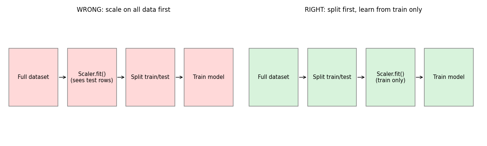

# Lesson 8: Data Leakage Prevention

## Core idea

**Data leakage** means the model gets, during training, information that **will not be available at real prediction time**. The result: a great score in evaluation, but failure in production.

**Analogy:** The question paper leaked before the exam. The marks are great, but they tell you nothing about whether you studied.

This is the most dangerous mistake because the code runs, no error appears, and the score looks *good*. That is why the goal of this lesson is prevention; detecting it afterwards is hard.

In Lesson 1 we saw that overfitting means good on training, bad on test. With leakage, **even the test score is falsely good**, so the overfitting never shows.

## Types of leakage

| Type | What happens | Example |
|---|---|---|
| **Train-test contamination** | Preprocessing on the full data before the split | Scaling, imputation or feature selection on all data, then splitting |
| **Target leakage** | A feature contains information about the target itself | Predicting loan default while keeping a `collections_status` feature |
| **Time leakage** | Future data is used to predict the past | A random split on time-series data |
| **Duplicates / group leakage** | The same entity appears in both train and test | One patient's 5 scans, some in train and some in test |

## Type 1: Split before preprocessing



**Rule:** split first, then fit (means, standard deviations, selected features, SMOTE) on **training data only**, and only `transform` the test/validation data.

If you call `StandardScaler().fit()` on the full data, the test rows' mean and standard deviation leak into training. For scaling this leakage is small, but with feature selection it can be **huge**.

## Dramatic demo: "predicting" random noise

Data: 100 rows, 1,000 features, all **pure random noise**, and a random 0/1 target. No model can beat 50% accuracy here. Let us see what leakage does:

```python
import numpy as np
from sklearn.feature_selection import SelectKBest, f_classif
from sklearn.linear_model import LogisticRegression
from sklearn.model_selection import cross_val_score
from sklearn.pipeline import make_pipeline

rng = np.random.RandomState(0)
X = rng.randn(100, 1000)            # pure noise
y = rng.randint(0, 2, 100)          # random labels

# WRONG: feature selection on the full data, then CV
X_sel = SelectKBest(f_classif, k=20).fit_transform(X, y)
print("Leaky  :", cross_val_score(LogisticRegression(max_iter=2000), X_sel, y, cv=5).mean().round(3))

# RIGHT: selection inside the pipeline, fitted on each fold's training part
pipe = make_pipeline(SelectKBest(f_classif, k=20), LogisticRegression(max_iter=2000))
print("Correct:", cross_val_score(pipe, X, y, cv=5).mean().round(3))
```

**Output:**

```
Leaky  : 0.83
Correct: 0.49
```

**Interpretation:**

- **Leaky = 0.83:** 83% accuracy on noise! Feature selection saw the whole data (with labels) and picked the 20 features that happened to match the target *in this specific random sample*. The validation folds' labels had already influenced the selection.
- **Correct = 0.49:** the honest result, a coin flip. This is the truth, because the data contains no signal at all.

This is the numerical proof of the "common mistake" in Lesson 6.

## Pipeline: your strongest protection

For every step inside a `Pipeline` (scaler, selector, SMOTE, model), cross validation fits it on **only the training part of that fold**. That is why Pipelines were used in Lessons 4, 6 and 7.

A standard safe template:

```python
from sklearn.preprocessing import StandardScaler
from sklearn.pipeline import Pipeline
from sklearn.model_selection import train_test_split, GridSearchCV, StratifiedKFold

X_train, X_test, y_train, y_test = train_test_split(
    X_full, y_full, stratify=y_full, test_size=0.2, random_state=42
)

pipe = Pipeline([
    ("scaler",  StandardScaler()),
    ("select",  SelectKBest(f_classif)),
    ("model",   LogisticRegression(max_iter=5000)),
])

grid = GridSearchCV(
    pipe,
    {"select__k": [5, 10, 20], "model__C": [0.1, 1, 10]},
    cv=StratifiedKFold(5, shuffle=True, random_state=42),
)
grid.fit(X_train, y_train)                  # everything on training data only
final_score = grid.score(X_test, y_test)    # test set: only once
```

(`X_full` and `y_full` stand for your own dataset. For an imbalanced case, add SMOTE after `StandardScaler` in an `imblearn` Pipeline, as in Lesson 7.)

## Type 2: Target leakage

A feature that is created *after* the target, or is a proxy for the target.

- Predicting hospital readmission while keeping a "discharge_summary_written" feature.
- Predicting churn while keeping a "cancellation_reason" column.

**How to catch it:**

- For each feature ask: *"Will I have this value at prediction time?"*
- If a single feature gives near-perfect accuracy (99%+), be suspicious.
- A single feature that dominates feature importance is also a red flag.

## Type 3: Time leakage

In time-dependent data (stocks, sales, sensors), random shuffling puts future rows into training.

- Split **by time**: older data for training, newer data for testing.
- For CV, use `TimeSeriesSplit` (see the table in Lesson 3).

## Type 4: Duplicates and group leakage

- If the same row or the same entity (patient, user, product) is in both train and test, the model gives "memorized" answers.
- Remove duplicates before splitting.
- Group-wise split: `GroupKFold` or `GroupShuffleSplit`, so that each group is entirely in train **or** in test.

## "Peeking" at the test set is also leakage

If you keep changing the model or hyperparameters after looking at the test score, and then check the test score again, the test set indirectly becomes part of training. That is why Lesson 4 has the rule: tune with CV, and use the test set **only once**. For more rigor, use a separate **validation set** or nested CV.

## Leakage prevention checklist

1. Split first (or split by time), then fit anything.
2. Scaling, imputation, encoding, feature selection and SMOTE all go inside a `Pipeline`.
3. For every feature ask: will it be available at prediction time?
4. For time data, use a time-aware split; for entity data, a group-aware split.
5. Remove duplicates before splitting.
6. Do not use the test set for tuning; evaluate on it once at the end.
7. If a result feels "too good to be true", look for leakage first and celebrate later.

## Common mistakes

- Calling `fit_transform` on the whole `X` and then splitting.
- Target/mean encoding done outside the folds.
- Calling `.fit()` on the test set (only `.transform()` is correct).
- Using the mean of the full data for imputation.
- Assuming "high score means a good model".

## Module 9 summary

| Lesson | In one line |
|---|---|
| 1 | Underfit = bad on both; overfit = good on train, bad on test |
| 2 | The bias (underfit) and variance (overfit) tradeoff |
| 3 | Cross validation gives a reliable score; use Stratified for classification |
| 4 | Tune hyperparameters with CV (Grid / Random) |
| 5 | Regularization = a penalty on large weights (Ridge, Lasso) |
| 6 | Feature selection = keep only useful features, inside a pipeline |
| 7 | With imbalance, don't trust accuracy; use class weights / SMOTE |
| 8 | Prevent leakage: split first, always use a Pipeline |
