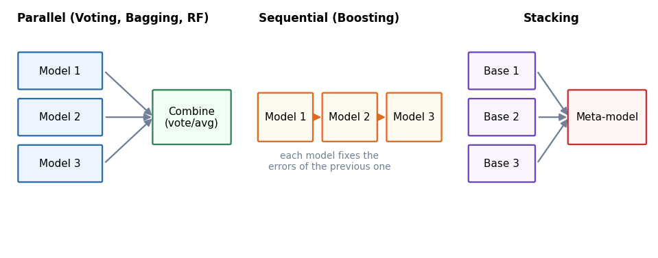
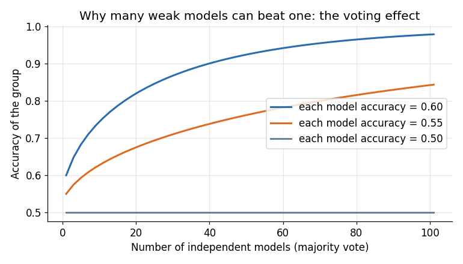
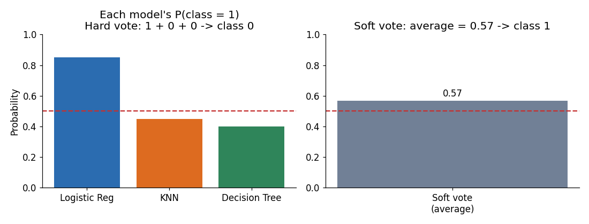

# Module 10 — Ensemble Learning

## File 1: Ensemble Basics and Voting

Covers: **1. What is Ensemble Learning, 2. Why Ensemble Models, 3. Voting**

---

## Module Roadmap

This module is split into 5 files. Each concept is taught fully in one place only; later files just refer back to it.

| File | Topics | Main idea |
|------|--------|-----------|
| 01 (this file) | What, Why, Voting | Combine models; simplest way to combine |
| 02 | Bagging, Random Forest | Train models in parallel on different data samples |
| 03 | Boosting, AdaBoost, Gradient Boosting | Train models one after another, each fixing the previous errors |
| 04 | XGBoost, Stacking | A fast boosting library; learning how to combine |
| 05 | RF vs Gradient Boosting, Comparison | Which one to use, and when |

**One dataset is used through the whole module:** the built-in breast cancer dataset from scikit-learn (569 patients, 30 numeric features, target = malignant or benign). The setup code is written once below and reused in later files.

---

## 1. What is Ensemble Learning?

**Ensemble learning** means combining the predictions of several models to get one final prediction. Each individual model is called a **base learner** (or base model).

**Intuition:** Suppose you ask one friend for movie advice. He may be wrong. If you ask 10 friends and follow the majority, you are usually safer. The same idea works for machine learning models.

There are three main ways to build an ensemble:



| Family | How models are built | Examples | Main benefit |
|--------|---------------------|----------|--------------|
| Parallel | Independently, at the same time | Voting, Bagging, Random Forest | Reduces **variance** |
| Sequential | One after another, each fixes the earlier errors | AdaBoost, Gradient Boosting, XGBoost | Reduces **bias** |
| Stacking | A final model learns how to combine the others | StackingClassifier | Learns the best combination |

> Bias and variance were explained in Module 9. Quick reminder: **variance** = model changes a lot when training data changes (overfitting). **Bias** = model is too simple to capture the pattern (underfitting).

---

## 2. Why Ensemble Models?

A single model has weaknesses: a deep decision tree overfits, a shallow one underfits, a linear model cannot capture curves. Ensembles reduce these problems.

### The voting effect (why it works)

Imagine each model is correct 60% of the time, and the models make **independent** mistakes. If we take a majority vote, the group becomes more accurate as we add models:



- With accuracy 0.60 per model, 101 independent models voting give roughly 98% accuracy.
- With accuracy 0.50 (random guessing), voting gives nothing. Models must be **better than random**.

### Two conditions for an ensemble to work

1. **Each model must be at least better than random guessing.**
2. **Models must make different mistakes (diversity).** If all models are copies of each other, voting changes nothing.

Different ensemble methods create diversity in different ways: different algorithms (Voting), different data samples (Bagging), different features (Random Forest), or different weights on mistakes (Boosting).

### Practical benefits and costs

| Benefit | Cost |
|---------|------|
| Usually more accurate and more stable | Slower to train and predict |
| Less overfitting (bagging) or less underfitting (boosting) | Harder to explain than one tree |
| Works well on tabular data | More memory, more hyperparameters |

**Common mistake:** assuming an ensemble always wins. We will see below that it does not.

---

## 3. Voting

**Voting** is the simplest ensemble: train several *different* algorithms on the *same* data and combine their predictions.

### Hard voting vs soft voting

- **Hard voting:** each model votes for a class; the class with the most votes wins.
- **Soft voting:** average the predicted **probabilities** of all models; pick the class with the highest average. Models must support `predict_proba`.



In the example above, only Logistic Regression is confident for class 1. Hard voting gives 1 vote vs 2 votes, so class 0 wins. Soft voting averages the probabilities (0.85, 0.45, 0.40 gives 0.57), so class 1 wins. **Soft voting uses confidence, hard voting ignores it.** Soft voting is usually better when probabilities are well calibrated.

### Setup code (reused in all later files)

```python
import warnings; warnings.filterwarnings("ignore")
import numpy as np
from sklearn.datasets import load_breast_cancer
from sklearn.model_selection import train_test_split, cross_val_score
from sklearn.preprocessing import StandardScaler
from sklearn.pipeline import make_pipeline
from sklearn.linear_model import LogisticRegression
from sklearn.neighbors import KNeighborsClassifier
from sklearn.tree import DecisionTreeClassifier
from sklearn.ensemble import VotingClassifier

X, y = load_breast_cancer(return_X_y=True)
X_train, X_test, y_train, y_test = train_test_split(
    X, y, test_size=0.2, stratify=y, random_state=42
)

# Three different base models
lr  = make_pipeline(StandardScaler(), LogisticRegression(max_iter=1000))
knn = make_pipeline(StandardScaler(), KNeighborsClassifier())
dt  = DecisionTreeClassifier(random_state=42)
```

`StandardScaler` is put inside a pipeline because Logistic Regression and KNN need scaled features, while trees do not.

### Building the voting ensembles

```python
estimators = [("lr", lr), ("knn", knn), ("dt", dt)]

hard = VotingClassifier(estimators, voting="hard")
soft = VotingClassifier(estimators, voting="soft")

models = {"Decision Tree": dt, "Logistic Regression": lr, "KNN": knn,
          "Voting (hard)": hard, "Voting (soft)": soft}

for name, model in models.items():
    cv = cross_val_score(model, X_train, y_train, cv=5).mean()
    model.fit(X_train, y_train)
    print(f"{name:20s} CV = {cv:.4f}   Test = {model.score(X_test, y_test):.4f}")
```

### Output (from our run)

| Model | 5-fold CV accuracy | Test accuracy |
|-------|-------------------|---------------|
| Decision Tree | 0.9099 | 0.9123 |
| Logistic Regression | 0.9802 | 0.9825 |
| KNN | 0.9670 | 0.9561 |
| Voting (hard) | 0.9758 | 0.9825 |
| Voting (soft) | 0.9648 | 0.9649 |

### How to interpret this result

- Voting is **much better than the weakest model** (Decision Tree, 0.91), so the ensemble protects us from a bad model.
- But voting is **not better than the best single model** (Logistic Regression, 0.98). This is a realistic outcome. This dataset is almost linearly separable, so Logistic Regression is already excellent, and the weak tree pulls the average down.
- The test set has only 114 patients, so one patient is about 0.9% accuracy. Differences of 1 to 2 patients are noise. Always trust cross-validation more than a single test score.

### Practical tips

- Combine models that are **different in nature** (linear + distance-based + tree). That gives diversity.
- Do not add a clearly weak model just to have more models.
- `VotingClassifier(..., weights=[2, 1, 1])` lets you give more weight to a stronger model.
- For regression, use `VotingRegressor`, which averages the predictions.

---

## Recap

- Ensemble = many models, one prediction. Needs models that are better than random **and** different from each other.
- Three families: parallel, sequential, stacking.
- Voting combines different algorithms; soft voting uses probabilities and is usually preferred.
- An ensemble protects against weak models but does not guarantee beating the best single model.

**Next:** File 02 — Bagging and Random Forest (diversity through data sampling).
