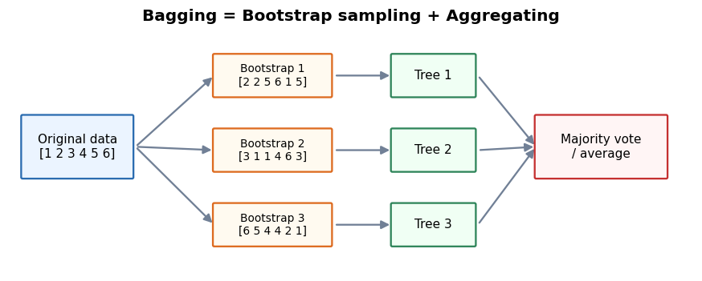
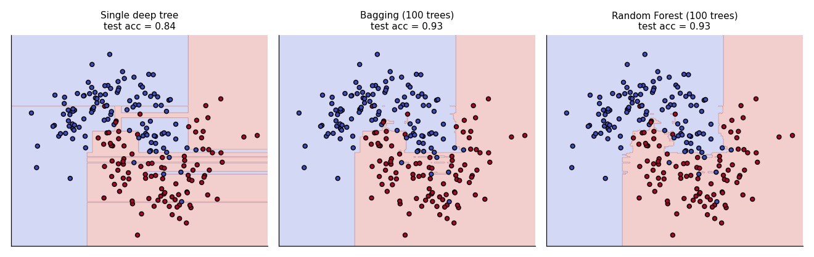
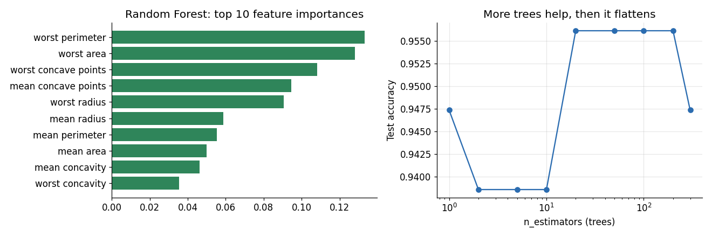

# Module 10 — Ensemble Learning

## File 2: Bagging and Random Forest

Covers: **4. Bagging, 5. Random Forest**

Uses the dataset and train/test split from File 01 (`X_train, X_test, y_train, y_test`).

---

## 4. Bagging

### Core idea

**Bagging** = **B**ootstrap **Agg**regat**ing**. Train many copies of the *same* algorithm, each on a *different random sample* of the training data, then combine them (majority vote for classification, average for regression).

In Voting (File 01), diversity came from different algorithms. In Bagging, diversity comes from **different data**.

### Intuition

A deep decision tree memorises its training data. If the data changes slightly, the tree changes a lot. That is **high variance**. If we train 100 such trees on slightly different data and average them, their individual random errors cancel out, but their good predictions stay.

### How it works



1. **Bootstrap sampling:** from N training rows, draw N rows **with replacement**. Some rows appear twice or more, some do not appear at all.
2. Train one model on each bootstrap sample.
3. **Aggregate:** vote (classification) or average (regression).

### Out-of-bag (OOB) samples

With bootstrap sampling, each sample leaves out about **36.8%** of the rows (the chance a row is never picked is about (1 - 1/N)^N, which approaches 1/e). Those unused rows are called **out-of-bag samples**. We can use them as a free validation set for that tree, so no separate validation split is needed.

### What bagging does and does not fix

| Fixes | Does not fix |
|-------|--------------|
| High variance (overfitting) | High bias (underfitting) |

So bagging works best with **low-bias, high-variance** base models, like fully grown decision trees. Bagging a very simple model (like a stump) does not help much.

### Code

```python
from sklearn.ensemble import BaggingClassifier
from sklearn.tree import DecisionTreeClassifier
from sklearn.model_selection import cross_val_score

bag = BaggingClassifier(
    estimator=DecisionTreeClassifier(),   # base model
    n_estimators=100,                     # number of trees
    bootstrap=True,                       # sample with replacement
    oob_score=True,                       # evaluate on out-of-bag rows
    random_state=42,
)
bag.fit(X_train, y_train)

print("OOB score :", round(bag.oob_score_, 4))
print("Test score:", round(bag.score(X_test, y_test), 4))
```

> Older tutorials use `base_estimator=`. In current scikit-learn the parameter is `estimator=`.

### Visual effect on a non-linear problem

The picture below uses a small two-moons dataset (only for drawing). The single deep tree has a jagged, overfitted boundary. Bagging smooths it.



Test accuracy on this toy data: single tree **0.84**, bagging **0.93**, random forest **0.93**.

### Results on our breast cancer data

| Model | 5-fold CV | Test |
|-------|-----------|------|
| Single Decision Tree | 0.9099 | 0.9123 |
| Bagging (100 trees) | 0.9516 | 0.9386 |

Bagging clearly improves a single tree (about +4 points in CV), because we reduced its variance. It is still below Logistic Regression (0.98) on this almost-linear dataset.

### Common mistakes

- Using a high-bias base model and expecting bagging to fix it.
- Forgetting that bagging is slower (100 models) and less interpretable than one tree.

---

## 5. Random Forest

### Core idea

**Random Forest = Bagging of decision trees + random feature selection at every split.**

Bagging alone has a weakness: if one feature is very strong, almost every tree picks it at the top, so the trees look alike and their errors stay correlated. Averaging correlated models helps less.

Random Forest adds a second source of randomness: **at each split, a tree may only look at a random subset of features.** This forces the trees to be different (decorrelated), so averaging works better.

| | Bagging of trees | Random Forest |
|---|------------------|---------------|
| Rows | Bootstrap sample | Bootstrap sample |
| Features at each split | All features | Random subset (`max_features`) |
| Tree diversity | Medium | High |

### Important hyperparameters

| Parameter | Meaning | Typical advice |
|-----------|---------|----------------|
| `n_estimators` | Number of trees | 100 to 500; more is rarely harmful, only slower |
| `max_features` | Features tried per split | Default `"sqrt"` for classification |
| `max_depth` | Maximum depth of each tree | Limit it if the forest overfits |
| `min_samples_leaf` | Minimum rows in a leaf | Increase to smooth the model |
| `oob_score` | Use OOB rows to estimate accuracy | Handy quick check |
| `n_jobs=-1` | Use all CPU cores | Trees are independent, so this scales well |

### Code

```python
from sklearn.ensemble import RandomForestClassifier

rf = RandomForestClassifier(
    n_estimators=200,
    oob_score=True,
    n_jobs=-1,
    random_state=42,
)
rf.fit(X_train, y_train)

print("OOB score :", round(rf.oob_score_, 4))              # 0.9604
print("Test score:", round(rf.score(X_test, y_test), 4))   # 0.9561
print("CV score  :", round(cross_val_score(rf, X_train, y_train, cv=5).mean(), 4))  # 0.9604
```

The OOB score (0.9604) matches the CV score (0.9604) without any extra validation split, which is why OOB is useful.

### Feature importance

Random Forest can tell which features were most useful (based on how much each feature reduced impurity across all trees).

```python
import pandas as pd
from sklearn.datasets import load_breast_cancer

names = load_breast_cancer().feature_names
imp = pd.Series(rf.feature_importances_, index=names).sort_values(ascending=False)
print(imp.head(10))
```



- **Left:** the top features. In our run they are worst perimeter, worst area, worst concave points, mean concave points and worst radius, which are tumour size and shape measurements, so the ranking makes medical sense.
- **Right:** test accuracy as trees are added. It rises fast and then flattens, so after a point more trees only cost time.

> **Caution:** impurity-based importance favours features with many unique values and splits importance among correlated features. For more reliable ranking use `sklearn.inspection.permutation_importance`.

### Results

| Model | 5-fold CV | Test |
|-------|-----------|------|
| Decision Tree | 0.9099 | 0.9123 |
| Bagging | 0.9516 | 0.9386 |
| Random Forest (200 trees) | 0.9604 | 0.9561 |

Each step improves: tree, then bagging, then random forest.

### Strengths and limitations

| Strengths | Limitations |
|-----------|-------------|
| Strong default model, little tuning needed | Large models (many deep trees) use memory |
| No scaling needed | Slower prediction than a single tree |
| Handles non-linear patterns and mixed features | Cannot extrapolate beyond training range (regression) |
| Gives OOB estimate and feature importance | Less accurate than tuned boosting on many problems |

---

## Recap

- **Bagging:** same model on bootstrap samples, then vote or average. Reduces variance. OOB rows give a free validation score.
- **Random Forest:** bagging plus random feature subsets per split, which makes trees less correlated and the ensemble stronger.
- Both train trees **in parallel and independently**. File 03 does the opposite: trees are trained **one after another**.

**Next:** File 03 — Boosting, AdaBoost and Gradient Boosting.
