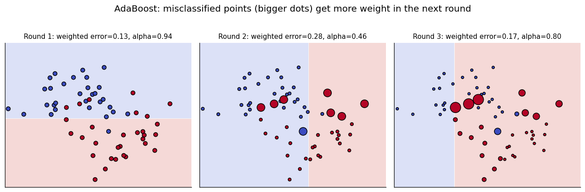
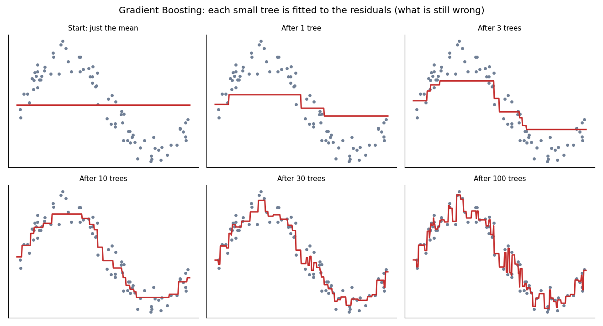

# Module 10 — Ensemble Learning

## File 3: Boosting, AdaBoost and Gradient Boosting

Covers: **6. Boosting, 7. AdaBoost, 8. Gradient Boosting**

Uses the dataset and split from File 01.

---

## 6. Boosting

### Core idea

**Boosting** builds models **one after another**. Each new model focuses on what the previous models got wrong. Many *weak learners* (slightly better than random, usually very small trees) are added together to form one *strong learner*.

### Bagging vs Boosting

| | Bagging / Random Forest (File 02) | Boosting |
|---|-----------------------------------|----------|
| Training | Parallel, independent | Sequential, each depends on the last |
| Base model | Deep trees (low bias, high variance) | Shallow trees (high bias, low variance) |
| Main goal | Reduce variance | Reduce bias |
| Overfitting risk | Low | Higher, needs care |
| Speed | Easy to parallelise | Harder to parallelise |

### Intuition

Think of a student preparing for an exam. After each mock test, they do not re-study everything. They study the questions they got wrong. After many rounds, the weak areas disappear. Boosting does this automatically.

### The general recipe

1. Start with a simple model.
2. Find where it makes mistakes.
3. Train the next model to fix those mistakes.
4. Add it to the ensemble (with a small step size, the **learning rate**).
5. Repeat for `n_estimators` rounds.

The two big boosting families differ only in **how "mistakes" are represented**:

- **AdaBoost:** mistakes are represented by **higher sample weights**.
- **Gradient Boosting:** mistakes are represented by **residuals** (the remaining error).

---

## 7. AdaBoost

### Core idea

**AdaBoost** (Adaptive Boosting) trains a sequence of weak learners, usually **decision stumps** (trees with depth 1, a single split). After each round it **increases the weight of the misclassified samples**, so the next stump pays more attention to them. Each stump also gets a **say** (alpha) in the final vote, depending on how accurate it is.



In the picture, bigger dots are higher-weight samples. Round 1 makes some mistakes; those points grow in round 2; the new stump handles them but makes different mistakes, and so on.

### Algorithm

1. Give every sample equal weight: w_i = 1/N.
2. For each round t:
   - Train a weak learner on the **weighted** data.
   - Compute its weighted error: ε = sum of weights of misclassified samples.
   - Compute its say: **α = ½ · ln((1 − ε) / ε)**
   - Update weights: **w_i ← w_i · exp(−α · y_i · h(x_i))**, then normalise so weights sum to 1. (Labels y_i and predictions h(x_i) are +1 or −1, so the exponent is negative for correct samples and positive for wrong ones.)
3. Final prediction = sign of the weighted vote: **Σ α_t · h_t(x)**.

Symbols: ε = error of this learner, α = its voting power, w_i = weight of sample i.

### Worked example

10 samples, all start with weight 0.1. A stump misclassifies exactly 1 of them.

- ε = 0.1
- α = ½ · ln(0.9 / 0.1) = ½ · ln 9 ≈ **1.10** (a strong, trusted learner)
- Misclassified sample: 0.1 · e^(+1.10) = 0.1 · 3 = **0.30**
- Each correct sample: 0.1 · e^(−1.10) = 0.1 / 3 ≈ **0.033**
- Total = 0.30 + 9 · 0.033 = 0.60, so normalise (divide by 0.6): misclassified = **0.50**, each correct ≈ **0.056**

After one round, the single hard sample holds **50% of the total weight**, so the next stump is forced to deal with it.

Edge cases: if ε = 0.5 (random guess), then α = 0, so the learner gets no say. If ε > 0.5, α is negative (the learner is worse than random).

### Code

```python
from sklearn.ensemble import AdaBoostClassifier
from sklearn.model_selection import cross_val_score

ada = AdaBoostClassifier(
    n_estimators=200,      # number of stumps (default base learner is a depth-1 tree)
    learning_rate=1.0,     # shrinks each stump's contribution
    random_state=42,
)
ada.fit(X_train, y_train)

print("CV  :", round(cross_val_score(ada, X_train, y_train, cv=5).mean(), 4))  # 0.9714
print("Test:", round(ada.score(X_test, y_test), 4))                            # 0.9649
```

### Interpretation and common mistakes

- AdaBoost gets **0.9714 CV**, better than Random Forest (0.9604) and bagging (0.9516) on this dataset. Stumps are enough here because the data is nearly linear.
- **Sensitive to noisy labels and outliers.** Wrongly labelled samples keep getting heavier weights, and the model keeps trying to fit them.
- Lower `learning_rate` with more `n_estimators` is usually more stable.

---

## 8. Gradient Boosting

### Core idea

**Gradient Boosting** also adds models sequentially, but instead of re-weighting samples, each new tree is trained to predict the **residuals** (the errors that remain) of the current ensemble. Adding that prediction moves the ensemble closer to the truth.

> "Gradient" means: the residual is the negative gradient of the loss function. For squared error, gradient descent in function space is the same as "fit the residuals". Other losses (like log loss for classification) give different residual-like targets, but the recipe stays the same.

### Intuition

You throw a dart and miss by 10 cm to the left. Your next throw corrects part of that error. After many small corrections you reach the target. Each tree is a small correction.

### Algorithm (regression with squared error)

1. Start with a constant prediction: F₀ = mean of y.
2. For each round m = 1 ... M:
   - Residuals: r = y − F_{m−1}(x)
   - Fit a small tree h_m to the residuals.
   - Update: **F_m(x) = F_{m−1}(x) + η · h_m(x)**, where η is the learning rate.
3. Final model = F₀ + η · (h₁ + h₂ + ... + h_M)

### Worked example

Targets y = [10, 20, 30].

- F₀ = mean = 20 for all rows, so residuals = [−10, 0, +10]
- Suppose tree h₁ predicts the residuals perfectly. With η = 0.1: F₁ = [20 − 1, 20, 20 + 1] = [19, 20, 21]
- New residuals = [−9, 0, +9]. The errors shrank by 10%.
- Each round removes about 10% of what remains, so we need many rounds. That is why a **small learning rate needs more trees**, but it generalises better.

### See it work



The fit starts as a flat line (the mean) and gradually bends to follow the sine-shaped data as small trees are added. At 100 trees it follows the curve closely; if we kept going, it would start fitting noise (overfitting).

### Code

```python
from sklearn.ensemble import GradientBoostingClassifier

gb = GradientBoostingClassifier(
    n_estimators=200,
    learning_rate=0.1,
    max_depth=3,          # small trees = weak learners
    subsample=1.0,        # <1.0 gives "stochastic gradient boosting"
    random_state=42,
)
gb.fit(X_train, y_train)

print("CV  :", round(cross_val_score(gb, X_train, y_train, cv=5).mean(), 4))  # 0.9648
print("Test:", round(gb.score(X_test, y_test), 4))                            # 0.9561
```

### Key hyperparameters

| Parameter | Effect | Practical advice |
|-----------|--------|------------------|
| `n_estimators` | Number of trees | Too many overfits; use early stopping or CV |
| `learning_rate` | Step size per tree | Small (0.01 to 0.1); trade off with `n_estimators` |
| `max_depth` | Tree complexity | 3 to 5 is a good start |
| `subsample` | Fraction of rows per tree | 0.5 to 0.8 adds randomness and reduces overfitting |
| `min_samples_leaf` | Minimum rows per leaf | Increase to regularise |

### AdaBoost vs Gradient Boosting (quick difference)

| | AdaBoost | Gradient Boosting |
|---|----------|-------------------|
| What is corrected | Re-weight misclassified samples | Fit residuals / gradient of the loss |
| Base learner | Usually stumps | Small trees (depth 3 to 5) |
| Loss function | Exponential loss (fixed) | Any differentiable loss |
| Flexibility | Lower | Higher (regression, ranking, custom losses) |

### Common mistakes

- Using a high learning rate (like 1.0) with many deep trees, which overfits quickly.
- Not checking validation performance while adding trees.
- Expecting a speed advantage: scikit-learn's `GradientBoostingClassifier` is slow because it is sequential. Faster libraries (XGBoost and others) are covered next.

---

## Recap

- **Boosting** = sequential weak learners, each focusing on previous errors. Reduces bias.
- **AdaBoost** = re-weights samples, each stump votes with weight α.
- **Gradient Boosting** = each tree fits the residuals, added with a learning rate.

**Next:** File 04 — XGBoost (the optimised, regularised version of gradient boosting) and Stacking.
