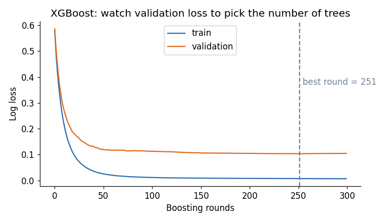
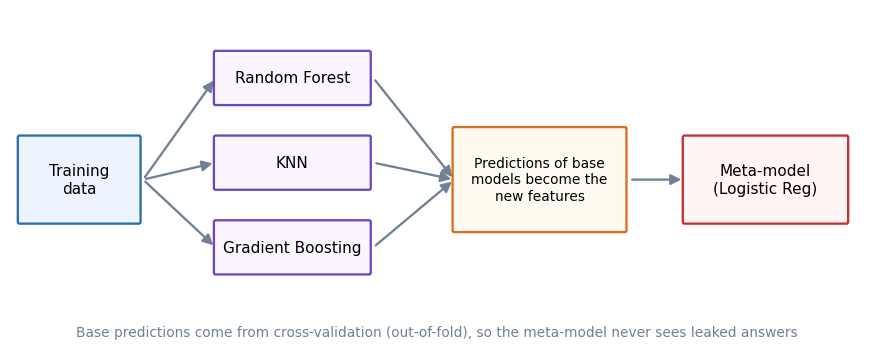

# Module 10 — Ensemble Learning

## File 4: XGBoost and Stacking

Covers: **9. XGBoost, 10. Stacking**

Uses the dataset and split from File 01.

---

## 9. XGBoost

### Core idea

**XGBoost** (eXtreme Gradient Boosting) is a fast, heavily engineered version of gradient boosting (File 03). The core recipe is the same: add trees one after another, each correcting the current errors. XGBoost improves it in three areas: **accuracy** (regularisation, better split maths), **speed** (efficient algorithms, parallel work) and **practicality** (missing values, early stopping).

### What is new compared to plain Gradient Boosting

| Feature | What it does | Why it matters |
|---------|--------------|----------------|
| **Regularised objective** | Penalises complex trees | Less overfitting |
| **Second-order information** | Uses gradient *and* curvature (Hessian) to choose splits and leaf values | More accurate steps, faster convergence |
| **Built-in missing value handling** | Learns the best direction for NaN at each split | No imputation needed |
| **Column and row subsampling** | `colsample_bytree`, `subsample` | Adds randomness, like Random Forest |
| **Fast split finding** | Histogram / approximate methods, multi-threaded | Much faster on large data |
| **Early stopping** | Stops when validation loss stops improving | Picks the number of trees automatically |

### The objective (idea first, formula second)

Idea: at every step, minimise *prediction error + a penalty for tree complexity*.

**Obj = Σ loss(y_i, ŷ_i) + Σ Ω(f_k)**, where **Ω(f) = γ·T + ½·λ·Σ w_j²**

- T = number of leaves, w_j = leaf scores.
- **γ (gamma):** cost of adding one more leaf. A split is made only if it improves the loss by more than γ.
- **λ (lambda):** L2 penalty on leaf scores, which shrinks them and makes the model smoother.

For a leaf, the best score is **w\* = − G / (H + λ)**, where G = sum of gradients and H = sum of Hessians of the samples in that leaf. Notice how λ in the denominator shrinks the leaf value. You do not need to compute this by hand, but it explains why increasing `reg_lambda` makes the model more conservative.

### Code

```python
from xgboost import XGBClassifier
from sklearn.model_selection import cross_val_score

xgb = XGBClassifier(
    n_estimators=200,
    learning_rate=0.1,
    max_depth=3,
    eval_metric="logloss",
    random_state=42,
)
xgb.fit(X_train, y_train)

print("CV  :", round(cross_val_score(xgb, X_train, y_train, cv=5).mean(), 4))  # 0.9758
print("Test:", round(xgb.score(X_test, y_test), 4))                            # 0.9474
```

XGBoost has the same scikit-learn style API (`fit`, `predict`, `score`), so it works with `cross_val_score`, `GridSearchCV` and pipelines from Modules 8 and 9. Install with `pip install xgboost`.

### Key hyperparameters

| Parameter | Meaning | Typical range |
|-----------|---------|---------------|
| `n_estimators` | Number of trees | Large (500 to 2000) together with early stopping |
| `learning_rate` | Step size | 0.01 to 0.3 |
| `max_depth` | Tree depth | 3 to 8 |
| `subsample` | Row fraction per tree | 0.6 to 1.0 |
| `colsample_bytree` | Feature fraction per tree | 0.6 to 1.0 |
| `reg_lambda`, `reg_alpha` | L2 and L1 penalties on leaf scores | Increase to reduce overfitting |
| `gamma` | Minimum loss improvement needed to split | 0 to 5 |
| `min_child_weight` | Minimum Hessian sum in a leaf | Increase for noisy data |

### Early stopping

Instead of guessing `n_estimators`, set it high and let XGBoost stop when validation loss stops improving.

```python
from sklearn.model_selection import train_test_split

# keep a validation set inside the training data (never use the test set for this)
X_t, X_val, y_t, y_val = train_test_split(
    X_train, y_train, test_size=0.25, stratify=y_train, random_state=1
)

xgb_es = XGBClassifier(
    n_estimators=1000,
    learning_rate=0.05,
    max_depth=3,
    subsample=0.8,
    colsample_bytree=0.8,
    early_stopping_rounds=20,     # stop if no improvement for 20 rounds
    eval_metric="logloss",
    random_state=42,
)
xgb_es.fit(X_t, y_t, eval_set=[(X_val, y_val)], verbose=False)

print("Best round:", xgb_es.best_iteration)                  # 188 in our run
print("Test      :", round(xgb_es.score(X_test, y_test), 4))  # 0.9474
```

The curve below shows why: training loss keeps falling forever, while validation loss flattens. Training beyond that point only memorises the training data.



### Interpretation

- XGBoost reached **0.9758 CV**, tied with the best voting model and above Gradient Boosting (0.9648). Its test score (0.9474) is lower, which is only about 1 to 2 patients out of 114, so it is noise. This is exactly why we compare models by cross-validation.
- On this small, almost-linear dataset, XGBoost's advantage is limited. Its strength shows on **larger tabular datasets with complex interactions and missing values**.
- Training took about 0.5 seconds versus about 3.9 seconds for scikit-learn's Gradient Boosting (5-fold CV plus final fit), so XGBoost is clearly faster.

### Common mistakes

- Tuning on the test set instead of a validation set.
- Using early stopping with the same data used for the final test.
- Very deep trees plus a high learning rate, which overfits.
- Forgetting that feature scaling is **not** needed for tree models.

---

## 10. Stacking

### Core idea

**Stacking** (stacked generalisation) trains several different **base models**, then trains a **meta-model** (final estimator) that learns how to best combine their predictions.

Compare with Voting (File 01): voting uses a fixed rule (majority or average). Stacking **learns** the rule. For example, the meta-model may learn "trust the Random Forest more when KNN disagrees".



### How it works

1. Train base models (for example Random Forest, KNN, Gradient Boosting).
2. Get each base model's predictions for the training data. To avoid leakage, these must be **out-of-fold predictions**: for each fold, the base model predicts rows it was *not* trained on. scikit-learn does this when you set `cv=5`.
3. Use those predictions as **new features** and train the meta-model on them (usually something simple like Logistic Regression).
4. At prediction time: base models predict, then the meta-model combines.

**Why out-of-fold?** If base models predicted rows they had already seen, their predictions would look unrealistically perfect, and the meta-model would learn to over-trust them. This is the same data leakage problem from Module 9.

### Code

```python
from sklearn.ensemble import StackingClassifier, RandomForestClassifier, GradientBoostingClassifier
from sklearn.linear_model import LogisticRegression

stack = StackingClassifier(
    estimators=[
        ("rf",  RandomForestClassifier(n_estimators=200, random_state=42)),
        ("knn", knn),                                           # scaled KNN from File 01
        ("gb",  GradientBoostingClassifier(random_state=42)),
    ],
    final_estimator=LogisticRegression(max_iter=1000),   # meta-model: keep it simple
    cv=5,                                                # out-of-fold predictions
)
stack.fit(X_train, y_train)

print("CV  :", round(cross_val_score(stack, X_train, y_train, cv=5).mean(), 4))  # 0.9670
print("Test:", round(stack.score(X_test, y_test), 4))                            # 0.9561
```

Useful options: `passthrough=True` also gives the original features to the meta-model; `stack_method="predict_proba"` passes probabilities instead of class labels (the default `"auto"` already does this when possible).

### Interpretation

| Model | CV | Test | Time (s) |
|-------|-----|------|----------|
| Voting (soft) | 0.9648 | 0.9649 | 0.08 |
| Stacking | 0.9670 | 0.9561 | 18.7 |

Stacking is only marginally better in CV than soft voting here, but it costs about **200 times more training time**, because every base model is trained 5 extra times for out-of-fold predictions (and `cross_val_score` repeats this for each of its folds). That is a realistic outcome on a small clean dataset.

### When stacking is worth it

- Base models are **very different** (linear, tree-based, distance-based), so each captures something unique.
- You need the last small improvement, as in competitions.
- Training time and complexity are acceptable.

### Common mistakes

- Using a complex meta-model, which overfits the base predictions.
- Using base models that are too similar (little to learn from).
- Training the meta-model on in-sample predictions (leakage).
- Using stacking where a single tuned model would be simpler and nearly as good.

---

## Recap

- **XGBoost** = gradient boosting plus regularisation, second-order optimisation, missing value handling, speed and early stopping.
- **Stacking** = a meta-model learns to combine base models, trained on out-of-fold predictions.

**Next:** File 05 — Random Forest vs Gradient Boosting, and the final comparison of all ensemble models.
