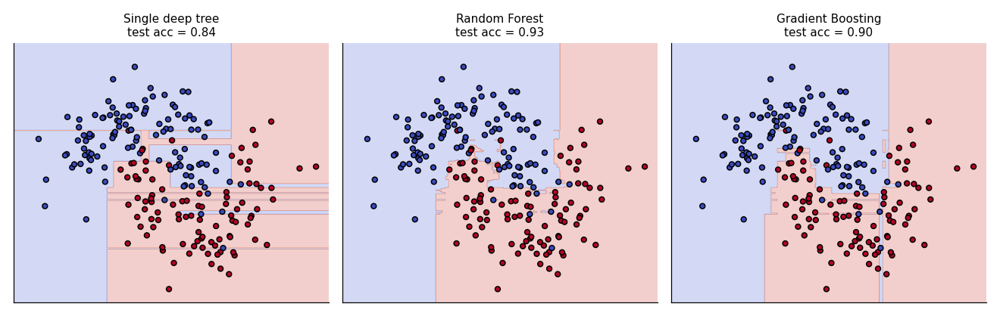
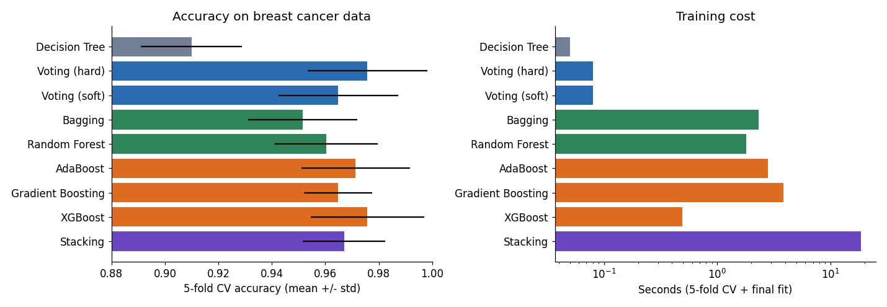

# Module 10 — Ensemble Learning

## File 5: Comparisons and Model Selection

Covers: **11. Random Forest vs Gradient Boosting, 12. Ensemble Model Comparison**

This file only compares. It adds no new algorithm. Definitions are in Files 01 to 04.

---

## 11. Random Forest vs Gradient Boosting

Both use many decision trees, so they are often confused. The difference is **how the trees are built and combined**.

| | Random Forest | Gradient Boosting (and XGBoost) |
|---|---------------|-------------------------------|
| Ensemble type | Bagging (parallel) | Boosting (sequential) |
| Tree depth | Deep, fully grown trees | Shallow trees (depth 3 to 6) |
| Each tree learns from | A random sample of data and features | The errors of all previous trees |
| Combining | Average or majority vote (equal say) | Sum of small corrections |
| Main error reduced | Variance | Bias (and some variance with regularisation) |
| Overfitting risk | Low; more trees rarely hurt | Higher; too many trees overfit |
| Tuning effort | Low; good defaults | Higher; learning rate, trees and depth interact |
| Training speed | Parallel, fast | Sequential (XGBoost makes it fast) |
| Sensitivity to noisy labels | Robust | More sensitive |
| Typical accuracy ceiling | Very good | Often the best on tabular data after tuning |

### Seeing the difference

On the toy two-moons data: single tree 0.84, Random Forest 0.93, Gradient Boosting 0.90. Both improve a lot over one tree. Gradient Boosting is not automatically better; with noisy data (this toy set has noise 0.3) boosting can chase noise, while Random Forest averages it out.

### Quick rule of thumb

- **Choose Random Forest** when you want a strong baseline fast, have noisy data, or have little time to tune.
- **Choose Gradient Boosting / XGBoost** when you need maximum accuracy, can spend time tuning, and have a clean validation setup.

---

## 12. Ensemble Model Comparison

### Results on the breast cancer dataset

All models use the same split and settings from earlier files. CV = 5-fold cross-validation on the training set.

| Model | Family | CV accuracy (mean ± std) | Test accuracy | Time (s)* |
|-------|--------|--------------------------|---------------|-----------|
| Decision Tree (single) | Baseline | 0.9099 ± 0.019 | 0.9123 | 0.05 |
| Logistic Regression (single) | Baseline | 0.9802 ± 0.013 | 0.9825 | 0.04 |
| Voting (hard) | Voting | 0.9758 ± 0.022 | 0.9825 | 0.08 |
| Voting (soft) | Voting | 0.9648 ± 0.022 | 0.9649 | 0.08 |
| Bagging | Parallel | 0.9516 ± 0.020 | 0.9386 | 2.3 |
| Random Forest | Parallel | 0.9604 ± 0.019 | 0.9561 | 1.8 |
| AdaBoost | Boosting | 0.9714 ± 0.020 | 0.9649 | 2.8 |
| Gradient Boosting | Boosting | 0.9648 ± 0.013 | 0.9561 | 3.9 |
| XGBoost | Boosting | 0.9758 ± 0.021 | 0.9474 | 0.5 |
| Stacking | Stacking | 0.9670 ± 0.016 | 0.9561 | 18.7 |

\*Time covers 5-fold CV plus the final fit, so it is only a rough relative cost. It will differ on your machine.

### How to read these results honestly

1. **Every ensemble beats the single Decision Tree** (0.91). That is the clearest, most reliable benefit.
2. **The differences between the ensembles are small.** The CV standard deviation is about 0.02, which is larger than most gaps in the table. With 455 training rows and 114 test rows, we cannot claim that XGBoost is better than Random Forest here.
3. **Logistic Regression, a simple model, is as good as or better than every ensemble.** This dataset is almost linearly separable. Ensembles shine when the pattern is non-linear and complex (as in the two-moons toy data). Always keep a simple baseline.
4. **Cost matters.** Stacking took roughly 5 to 40 times longer than the boosting models (18.7 s vs 0.5 to 3.9 s) for no real gain.

### Summary of all ensemble methods

| Method | Diversity comes from | Reduces | Strength | Weakness |
|--------|----------------------|---------|----------|----------|
| Voting | Different algorithms | Variance | Simple, quick | Fixed rule; needs diverse, good models |
| Bagging | Bootstrap samples | Variance | Stabilises high-variance models | Does nothing for bias |
| Random Forest | Bootstrap + random features | Variance | Strong default, robust | Large model, slower prediction |
| AdaBoost | Re-weighted samples | Bias | Simple, works with stumps | Sensitive to noise and outliers |
| Gradient Boosting | Fitting residuals | Bias | Flexible, accurate | Slow, needs tuning |
| XGBoost | Same, with regularisation | Bias and variance | Fast, accurate, handles NaN | Many hyperparameters |
| Stacking | Different algorithms + learned combiner | Both | Can squeeze out extra accuracy | Slow, complex, leakage risk |

### Which one should I use? (decision guide)

1. **Start with a simple baseline** (Logistic Regression or one decision tree).
2. **Try Random Forest** with default settings. Quick, strong, robust.
3. **Try XGBoost** (or another gradient boosting library) with early stopping. Tune the learning rate, depth and subsampling.
4. **Use Voting** if you already have several decent but different models and want a quick, stable gain.
5. **Use Stacking** only for the last bit of accuracy, when training time is not a problem.
6. **Pick the winner using cross-validation, not a single test score**, and prefer the simpler model if scores are within noise.

### Common mistakes in comparing models

- Declaring a winner from a 0.5% difference on a small test set.
- Comparing models with different data splits or preprocessing.
- Ignoring training time, prediction time and explainability.
- Forgetting a simple baseline.

---

## Module 10 Summary

| Question | Answer |
|----------|--------|
| What is an ensemble? | Several models combined into one prediction |
| Why does it work? | Models that are better than random and make different mistakes cancel each other's errors |
| Parallel methods | Voting, Bagging, Random Forest (reduce variance) |
| Sequential methods | AdaBoost, Gradient Boosting, XGBoost (reduce bias) |
| Learned combination | Stacking |
| Best default for tabular data | Random Forest for speed and safety; XGBoost for top accuracy |

**Next module:** continue with the next topic list whenever you are ready.
