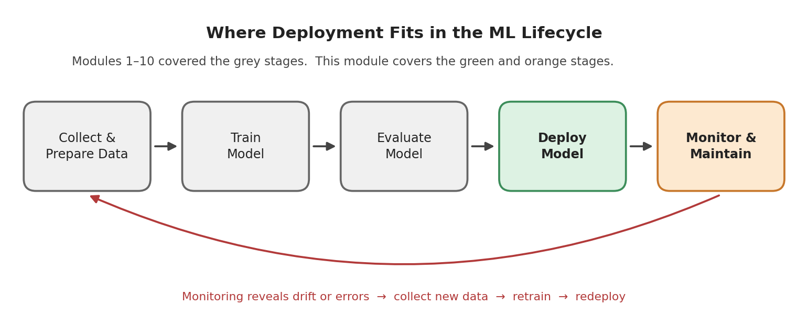
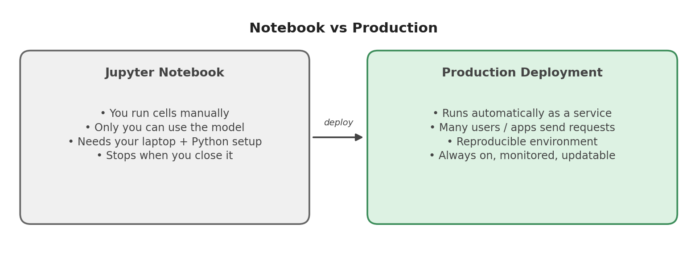
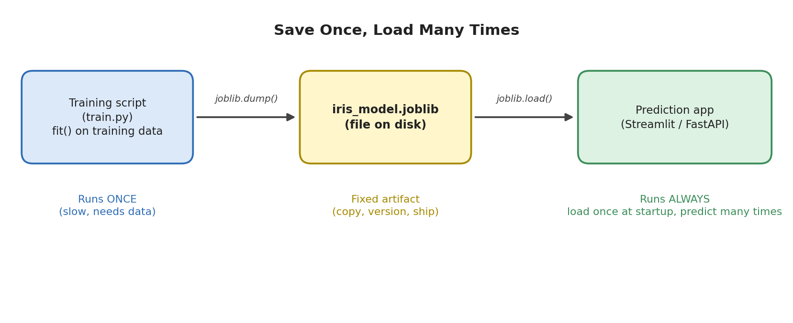
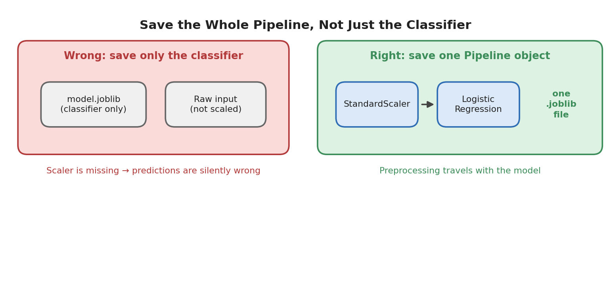

# Module 11: Model Deployment

## Part 1 of 7: What Is Deployment, Saving Models, joblib, Loading Models

**Topics covered in this file:** 1. What is Model Deployment, 2. Saving ML Models, 3. `joblib`, 4. Loading Models

---

## Module Roadmap

The 14 topics are grouped into 7 files. Each concept is explained fully in one place; later files only refer back to it.

| File | Topics | What you will be able to do afterwards |
|---|---|---|
| **01** (this file) | What is deployment, saving models, `joblib`, loading models | Turn a trained model into a file and load it back safely |
| 02 | Building a prediction application, Streamlit | Wrap the model in clean code and give it a web interface |
| 03 | FastAPI ML API, connecting a frontend | Serve predictions over HTTP and call them from a web page |
| 04 | Requirements file, virtual environment | Reproduce your Python setup on any machine |
| 05 | Docker basics | Package the whole service into a container |
| 06 | Deployment concepts | Choose how and where to run the service |
| 07 | Model versioning, basic ML monitoring | Manage model updates and detect when a model goes bad |

### Running example for the whole module

We use the **Iris** dataset with a small scikit-learn pipeline. Iris is deliberately simple: the focus of this module is **everything that happens after training**, not modelling. The same steps work for any scikit-learn model.

The project folder we will build step by step:

```text
iris-deployment/
├── train.py            # Part 1: trains and saves the model
├── predictor.py        # Part 2: loading + prediction logic
├── app.py              # Part 2: Streamlit interface
├── main.py             # Part 3: FastAPI service
├── index.html          # Part 3: simple web frontend
├── requirements.txt    # Part 4
├── Dockerfile          # Part 5
└── models/             # saved model files
```

Tested with Python 3.12, scikit-learn 1.8.0, pandas 3.0, joblib 1.5. Version numbers will matter later in this module.

---

## 1. What Is Model Deployment?

### Core idea

**Model deployment** is the process of making a trained model available so that real users or other software can send it new data and receive predictions, reliably and repeatedly.

Until now, your models lived inside a Jupyter notebook. Evaluation (Module 7) told you the model is good. Deployment is what turns "a good model on my laptop" into "a working product".



### Intuition

A notebook is like cooking at home: you cook once, for yourself, when you feel like it. Deployment is opening a restaurant: customers arrive at any time, they do not know how the kitchen works, and the food must come out the same every time.



### Training vs inference

Two words you will see throughout this module:

| | Training | Inference (prediction) |
|---|---|---|
| Runs | Once (or occasionally) | Continuously, for every request |
| Input | Large labelled dataset | One or a few new rows, **no labels** |
| Speed matters? | Not much | Yes, users are waiting |
| Output | A fitted model | A prediction |

Deployment is almost entirely about **inference**. The model is trained once, then used many times.

### What a deployed ML system is made of

| Component | Meaning | Where we cover it |
|---|---|---|
| Model artifact | The saved, trained model file | Part 1 (this file) |
| Inference code | Code that turns raw input into a prediction | Part 2 |
| Interface | How users reach the model (web page, API) | Parts 2 and 3 |
| Environment | Python version and libraries it needs | Part 4 |
| Packaging | Bundling code + environment together | Part 5 |
| Infrastructure | Where and how it runs | Part 6 |
| Management | Versions and health checks | Part 7 |

### The training script

This is the only training code in the module. Every later file reuses its output (`models/iris_model.joblib`).

```python
# train.py
from pathlib import Path

import joblib
from sklearn.datasets import load_iris
from sklearn.linear_model import LogisticRegression
from sklearn.metrics import accuracy_score
from sklearn.model_selection import train_test_split
from sklearn.pipeline import Pipeline
from sklearn.preprocessing import StandardScaler

iris = load_iris(as_frame=True)
X, y = iris.data, iris.target

X_train, X_test, y_train, y_test = train_test_split(
    X, y, test_size=0.2, stratify=y, random_state=42
)

model = Pipeline([
    ("scaler", StandardScaler()),
    ("clf", LogisticRegression(max_iter=200)),
])
model.fit(X_train, y_train)

print("Test accuracy:", round(accuracy_score(y_test, model.predict(X_test)), 3))

Path("models").mkdir(exist_ok=True)
joblib.dump(model, "models/iris_model.joblib")
print("Saved models/iris_model.joblib")
```

Run it with `python train.py`. Expected output:

```text
Test accuracy: 0.933
Saved models/iris_model.joblib
```

Points worth noticing:

- `as_frame=True` keeps the column names (`sepal length (cm)`, ...). The pipeline remembers them, and this becomes useful when loading (section 4).
- The **scaler and the classifier are in one `Pipeline`**. Section 2 explains why this matters for deployment.
- 0.933 means 28 of 30 test rows were correct. Real results are rarely perfect; do not expect 100%.
- The last two lines (`mkdir` and `joblib.dump`) are the new deployment step. The rest is ordinary training from earlier modules.

---

## 2. Saving ML Models

### Core idea

**Saving a model** (also called **serialization**) means converting the fitted Python object, with all its learned parameters, into bytes stored in a file. Later, another program can read the file and rebuild the identical object without any retraining.

### Why we need it

- Training can take minutes, hours, or days. A deployed service cannot retrain every time it starts.
- The training code, data, and compute may not exist on the production machine.
- The file is a fixed **artifact**: you can copy it, back it up, and (Part 7) version it.



### What exactly should be saved?

Save the **entire pipeline**, not only the final classifier.



Our classifier was trained on **scaled** values. If you save only the `LogisticRegression` and feed it raw measurements at prediction time, it will not crash. It will simply return wrong answers. This is one of the most common silent deployment bugs. When preprocessing lives inside a `Pipeline`, it is saved and loaded together with the model, so training and prediction always match.

### Common ways to save a model

| Format | Typical use | Notes |
|---|---|---|
| `pickle` | Any Python object | Python standard library; the basis of `joblib` |
| `joblib` | scikit-learn models | Recommended by scikit-learn; good with large NumPy arrays |
| ONNX | Run models outside Python, or in optimized runtimes | Needs a conversion step |
| Framework formats | Keras `.keras`, PyTorch `state_dict`, XGBoost `save_model` | Use these for deep learning and boosting libraries when you want their official format |

In this module we use `joblib`, because everything we deploy is a scikit-learn pipeline.

### Saving with `pickle` (for comparison)

```python
import pickle

with open("models/iris_model.pkl", "wb") as f:
    pickle.dump(model, f)

with open("models/iris_model.pkl", "rb") as f:
    same_model = pickle.load(f)
```

`"wb"` and `"rb"` mean write-binary and read-binary. The file is not human-readable text. `joblib` follows the same dump/load idea with a shorter interface, covered next.

### Extra information worth saving

A model file alone does not say which columns it expects, which library version created it, or how good it was. For now, our `predictor.py` (Part 2) stores the feature names and class names in code. Part 7 adds a metadata file saved next to every model version.

---

## 3. `joblib`

### Core idea

`joblib` is a Python library (installed automatically with scikit-learn) for saving and loading Python objects, especially objects containing large NumPy arrays, which is exactly what fitted ML models are.

### The two functions you need

```python
import joblib

joblib.dump(model, "models/iris_model.joblib")   # save
model = joblib.load("models/iris_model.joblib")  # load
```

By convention the file extension is `.joblib`. The extension is only a label; `joblib` does not enforce it.

### Compression

```python
joblib.dump(model, "models/iris_model.joblib", compress=3)
```

`compress` takes values from 0 (none) to 9 (maximum). Higher values give smaller files but slower saving and loading. A value around 3 is a sensible default.

Measured on a `RandomForestClassifier` with 500 trees trained on Iris:

| Method | File size |
|---|---|
| `pickle.dump` | about 880 KB |
| `joblib.dump` | about 927 KB |
| `joblib.dump(..., compress=3)` | about 129 KB |

Two honest observations from these numbers. First, `joblib` is **not automatically smaller** than `pickle`; for small models the sizes are similar. Second, compression makes a large difference for tree ensembles, so it is worth using when the file must be shipped or stored. The real advantage of `joblib` appears with very large NumPy arrays, which it can store efficiently and even memory-map (`joblib.load(path, mmap_mode="r")`, only for uncompressed files).

### Two warnings that apply to `pickle` and `joblib`

**1. Never load a file from a source you do not trust.** Both formats can execute arbitrary code while loading. A malicious `.joblib` file can run commands on your machine. Only load files you created or received from a trusted source.

**2. Load with the same library versions used for saving.** A model saved with scikit-learn 1.8.0 may behave unpredictably, or fail to load, under another version. scikit-learn usually raises an `InconsistentVersionWarning`. Treat it as an error in production. Part 4 (requirements file) is the solution to this problem.

---

## 4. Loading Models

### Core idea

Loading rebuilds the saved object in memory so you can call `predict()` and `predict_proba()` exactly as you did after training.

### Loading and inspecting

```python
import joblib
import pandas as pd

model = joblib.load("models/iris_model.joblib")

print(type(model).__name__)
print(model.feature_names_in_)

sample = pd.DataFrame([[5.1, 3.5, 1.4, 0.2]], columns=list(model.feature_names_in_))
print(model.predict(sample), model.predict_proba(sample).round(3))
```

Output:

```text
Pipeline
['sepal length (cm)' 'sepal width (cm)' 'petal length (cm)'
 'petal width (cm)']
[0] [[0.981 0.019 0.   ]]
```

- `feature_names_in_` is stored inside the model. It tells you the exact columns and **order** the model expects.
- `predict` returns class index `0` (setosa); `predict_proba` gives the probability of each class. A deployed app usually reports both the label and the confidence.
- The model returns numbers (`0, 1, 2`). Converting them to names (`setosa`, ...) is the job of the inference code in Part 2.

### Sanity check after saving

Always confirm that the saved file behaves like the original:

```python
# right after training, in the same script or notebook
reloaded = joblib.load("models/iris_model.joblib")
assert (reloaded.predict(X_test) == model.predict(X_test)).all()
```

If this passes, the file is a faithful copy.

### Load once, predict many times

Loading reads a file from disk and rebuilds objects, which is slow compared with a single prediction.

| Pattern | Result |
|---|---|
| Load the model **inside** the prediction function | Every request pays the loading cost |
| Load the model **once** when the application starts | Each request only pays for `predict()` |

Parts 2 and 3 apply this rule in Streamlit (with caching) and in FastAPI (at startup).

### Common loading errors

| Symptom | Likely cause | Fix |
|---|---|---|
| `FileNotFoundError` | The path is relative to wherever you ran the command, not to your script | Build the path from the script location: `Path(__file__).parent / "models" / ...` |
| `InconsistentVersionWarning` | Loading under a different scikit-learn version | Install the version used for training (Part 4) |
| `AttributeError` / `ModuleNotFoundError` when loading | The model contains your own class or function, and that code is not importable | Keep custom code in a module that is available at load time, or stick to built-in scikit-learn components |
| `ValueError: The feature names should match...` | Input columns differ in name or **order** from training | Build the input DataFrame with `model.feature_names_in_` |

The last row deserves emphasis. When we passed the correct values with columns in a different order, scikit-learn raised an error instead of silently producing wrong output. This protection only exists when you pass a **DataFrame with column names**. If you pass a plain list or NumPy array, a swapped order would go undetected. That is why our inference code always builds a named DataFrame.

---

## Recap

- Deployment makes a trained model usable by others; training happens once, inference happens constantly.
- Save the whole `Pipeline` so preprocessing travels with the model.
- `joblib.dump()` and `joblib.load()` are all you need for scikit-learn models; use `compress` for smaller files; never load untrusted files.
- Load the model once, not per prediction, and match library versions between saving and loading.

**Next (Part 2):** we turn the loaded model into clean prediction code and give it a web interface with Streamlit.
