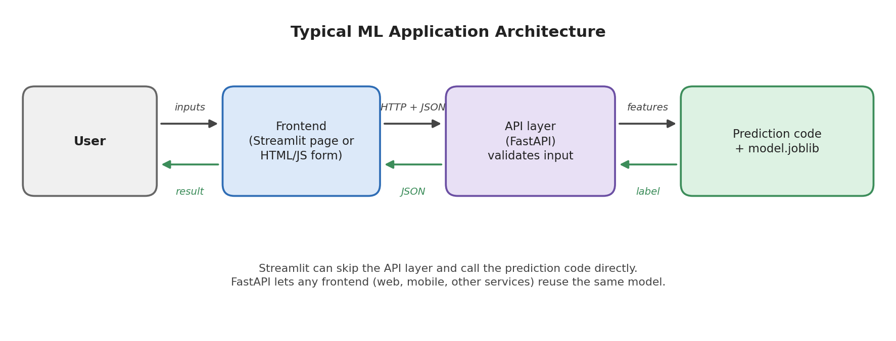
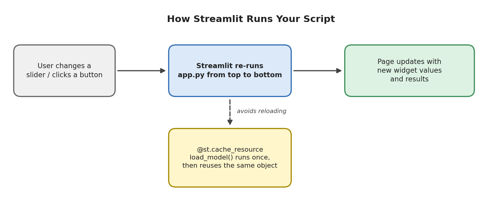

# Module 11: Model Deployment

## Part 2 of 7: Building a Prediction Application and Streamlit

**Topics covered in this file:** 5. Building Prediction Application, 6. Streamlit ML Application

**Starting point:** `models/iris_model.joblib` created by `train.py` in Part 1.

---

## 5. Building a Prediction Application

### Core idea

A **prediction application** is everything that sits between a user's raw input and the model's answer:

1. receive input
2. check the input is sensible
3. arrange it exactly the way the model expects
4. call the model
5. convert the result into something a human or program can use

The model file only does step 4. The remaining steps are ordinary code you must write.

### Intuition: separate the "brain" from the "face"

Think of the application in two layers:

- **Prediction logic** (the brain): loads the model, builds the input, returns a result. It knows nothing about web pages.
- **Interface** (the face): a Streamlit page, a FastAPI endpoint, a command line. It only collects input and shows output.

If the logic is mixed into the interface, you must rewrite it every time you change the interface. If it is separate, Streamlit (this part) and FastAPI (Part 3) will both call the same function.



### The prediction module

```python
# predictor.py
from pathlib import Path

import joblib
import pandas as pd

MODEL_PATH = Path(__file__).parent / "models" / "iris_model.joblib"

FEATURES = [
    "sepal length (cm)",
    "sepal width (cm)",
    "petal length (cm)",
    "petal width (cm)",
]
CLASS_NAMES = ["setosa", "versicolor", "virginica"]


def load_model(path=MODEL_PATH):
    return joblib.load(path)


def predict_species(model, sepal_length, sepal_width, petal_length, petal_width):
    row = pd.DataFrame(
        [[sepal_length, sepal_width, petal_length, petal_width]],
        columns=FEATURES,
    )
    probs = model.predict_proba(row)[0]
    best = int(probs.argmax())
    return {
        "species": CLASS_NAMES[best],
        "confidence": round(float(probs[best]), 4),
        "probabilities": {n: round(float(p), 4) for n, p in zip(CLASS_NAMES, probs)},
    }


if __name__ == "__main__":
    model = load_model()
    print(predict_species(model, 5.1, 3.5, 1.4, 0.2))
```

Run `python predictor.py`:

```text
{'species': 'setosa', 'confidence': 0.9808, 'probabilities': {'setosa': 0.9808, 'versicolor': 0.0192, 'virginica': 0.0}}
```

### Design decisions explained

| Decision | Reason |
|---|---|
| `Path(__file__).parent / "models" / ...` | The path works no matter which folder you launch the program from (the `FileNotFoundError` from Part 1) |
| `load_model()` is a separate function | The *caller* decides when to load, so the model can be loaded once and reused (Part 1: load once, predict many times) |
| `predict_species(model, ...)` receives the model as an argument | Easy to test and to reuse; no hidden global state |
| Input is wrapped in a DataFrame with `FEATURES` | Same column names and order as training; scikit-learn will raise an error if they ever differ |
| `int(...)`, `float(...)`, `round(...)` | The model returns NumPy types such as `np.int64`, which cannot be converted to JSON. Converting to plain Python types now prevents errors in Part 3 |
| Returns the label **and** the probabilities | A prediction without a confidence is hard to trust; users can also see how close the second choice was |
| `if __name__ == "__main__":` block | A quick manual test that does not run when other files import the module |

### Common mistakes

- Loading the model inside `predict_species`, so the file is read on every call.
- Using a different feature order in the app than in training (a named DataFrame guards against this).
- Returning raw NumPy values and discovering the JSON error only after building the API.
- Skipping input checks. This module checks inputs at the interface (widget limits in Streamlit, validation rules in FastAPI), so `predict_species` stays simple.

---

## 6. Streamlit ML Application

### Core idea

**Streamlit** is a Python library that turns a script into an interactive web application. You write only Python: no HTML, CSS, or JavaScript. It is popular for ML demos, dashboards, and internal tools.

### Installing and running

```bash
pip install streamlit
streamlit run app.py
```

Streamlit starts a local server and opens `http://localhost:8501` in your browser. Use `streamlit run`, not `python app.py`; running it with plain Python does not start the web server.

### The application

```python
# app.py
import pandas as pd
import streamlit as st

from predictor import load_model, predict_species


@st.cache_resource
def get_model():
    return load_model()


model = get_model()

st.title("Iris Species Predictor")
st.write("Enter the flower measurements and click Predict.")

col1, col2 = st.columns(2)
with col1:
    sepal_length = st.number_input("Sepal length (cm)", 0.1, 10.0, 5.8, 0.1)
    sepal_width = st.number_input("Sepal width (cm)", 0.1, 10.0, 3.0, 0.1)
with col2:
    petal_length = st.number_input("Petal length (cm)", 0.1, 10.0, 4.3, 0.1)
    petal_width = st.number_input("Petal width (cm)", 0.1, 10.0, 1.3, 0.1)

if st.button("Predict"):
    result = predict_species(model, sepal_length, sepal_width, petal_length, petal_width)
    st.success(f"Predicted species: {result['species']}")
    st.metric("Confidence", f"{result['confidence']:.1%}")
    st.bar_chart(pd.Series(result["probabilities"], name="probability"))
```

With the default values the app predicts **versicolor** with about 87% confidence and draws a bar chart of the three class probabilities.

Notice how short the file is. All model-related work is one call to `predict_species`, written in section 5.

### How Streamlit works: the rerun model

This is the most important idea to understand in Streamlit.



**Every time the user interacts with a widget, Streamlit re-runs the whole script from top to bottom.** Widgets simply return their current values on each run. `st.button("Predict")` returns `True` only during the run triggered by the click, which is why the prediction code sits inside `if st.button(...)`.

Consequence: anything expensive at the top of the script would repeat on every click, including loading the model.

### Caching the model

`@st.cache_resource` tells Streamlit to run `get_model()` once and reuse the returned object on every rerun and for every user session.

| Decorator | Use it for |
|---|---|
| `st.cache_resource` | Objects you want to share and not copy: models, database connections |
| `st.cache_data` | Data that is returned as a value: a loaded DataFrame, results of a computation |

Without caching, the model would be loaded again after every slider or button interaction.

### Widgets and layout used above

| Element | Purpose |
|---|---|
| `st.title`, `st.write` | Headings and text |
| `st.columns(2)` | Place widgets side by side |
| `st.number_input(label, min, max, default, step)` | Numeric input with built-in limits. This is our first layer of input validation: users cannot enter negative sizes |
| `st.button` | Triggers the prediction |
| `st.success`, `st.metric`, `st.bar_chart` | Display results |

Other useful inputs: `st.slider`, `st.selectbox` (for categorical features), `st.file_uploader` (for batch prediction from a CSV).

### Interpreting the result

The probability bars matter as much as the predicted label. A prediction of 87% versicolor with the rest mostly virginica tells the user that the flower lies near the boundary between two species. Showing only the label would hide that uncertainty.

### Common mistakes

| Mistake | Effect |
|---|---|
| Loading the model without `cache_resource` | Slow app, reloads on every interaction |
| Running `python app.py` | Warnings and no web page |
| Expecting a result to stay after another widget changes | The button is `True` only for one run. To keep results, store them in `st.session_state` (not needed in this simple app) |
| Putting side effects at the top level (writing a file, sending a request) | They run again on every rerun |
| Relative model path | Breaks when launched from another folder; `predictor.py` already prevents this |

### When to use Streamlit

Good for demos, prototypes, internal tools, and showing results to non-technical people. It is **not** designed to be called by other programs (a mobile app, another service). For that you need an API, which is the topic of Part 3.

---

## Recap

- Keep prediction logic (`predictor.py`) separate from the interface so it can be reused.
- Return plain Python types and build inputs as named DataFrames.
- Streamlit re-runs the script on every interaction; cache the model with `@st.cache_resource`.
- Streamlit is the fastest way to a human-facing ML app, but other programs need an API.

**Next (Part 3):** FastAPI exposes the same `predict_species` function over HTTP, and a plain HTML page will call it.
