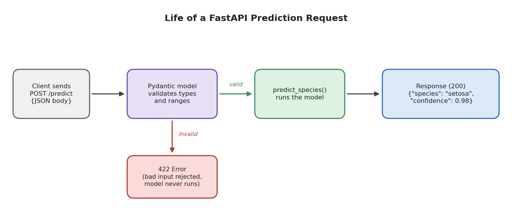
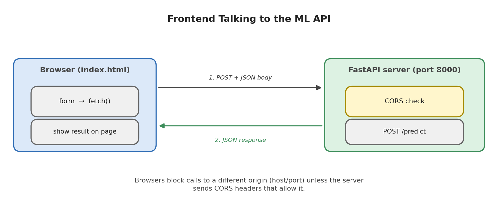

# Module 11: Model Deployment

## Part 3 of 7: FastAPI ML API and Connecting a Frontend

**Topics covered in this file:** 7. FastAPI ML API, 8. Connecting Frontend to ML API

**Reused from earlier parts:** `predictor.py` (`load_model`, `predict_species`) from Part 2.

---

## 7. FastAPI ML API

### Core idea

An **API** (Application Programming Interface) is a way for one program to talk to another. A **web API** does this over HTTP: a client sends a request to a URL, and the server sends back a response, usually in **JSON** format.

**FastAPI** is a Python framework for building web APIs. It is fast, checks incoming data automatically, and generates interactive documentation for free.

### Why an API when we already have Streamlit?

Streamlit builds a page for humans. An API builds a service for **programs**: a website, a mobile app, another backend, a scheduled script. One model API can serve all of them at the same time.

### Basic vocabulary

| Term | Meaning | Example here |
|---|---|---|
| Endpoint | A URL path that does one job | `/predict`, `/health` |
| HTTP method | The kind of action | `GET` reads, `POST` sends data to process |
| Request body | Data sent by the client | Four flower measurements |
| JSON | Text format for structured data | `{"sepal_length": 5.1, ...}` |
| Status code | Outcome of the request | `200` success, `422` invalid input, `500` server error |

Prediction uses `POST` because the client sends data in the request body.

### Installing

```bash
pip install fastapi uvicorn
```

`uvicorn` is the server program that actually runs a FastAPI application and listens for requests.

### The API

```python
# main.py
from fastapi import FastAPI
from pydantic import BaseModel, Field

from predictor import load_model, predict_species

app = FastAPI(title="Iris Species API", version="1.0.0")

model = load_model()  # loaded once, when the server starts


class IrisInput(BaseModel):
    sepal_length: float = Field(..., gt=0, le=10)
    sepal_width: float = Field(..., gt=0, le=10)
    petal_length: float = Field(..., gt=0, le=10)
    petal_width: float = Field(..., gt=0, le=10)


class IrisOutput(BaseModel):
    species: str
    confidence: float
    probabilities: dict[str, float]


@app.get("/health")
def health():
    return {"status": "ok"}


@app.post("/predict", response_model=IrisOutput)
def predict(data: IrisInput):
    return predict_species(model, **data.model_dump())
```

### Understanding each part

- **`app = FastAPI(...)`** creates the application object. `uvicorn` will look for it by name.
- **`model = load_model()`** runs once at import time, when the server starts. Every request reuses the same model (the "load once" rule from Part 1).
- **`IrisInput`** is a **Pydantic model**. It describes the exact shape of the request: four numbers. `Field(..., gt=0, le=10)` means *required*, *greater than 0*, *at most 10*. FastAPI validates every request against this description **before** your function runs.
- **`IrisOutput`** with `response_model` defines the shape of the response. It documents the API and filters anything not listed.
- **`@app.get("/health")`** is a tiny endpoint that only answers "I am alive". Hosting platforms and Docker (Part 5) use endpoints like this to check that the service is running.
- **`data.model_dump()`** turns the validated input into a dictionary; `**` unpacks it into the keyword arguments of `predict_species`. The prediction logic is exactly what we wrote in Part 2.
- The functions use plain `def`, not `async def`. Model prediction is CPU work; with `def`, FastAPI runs it in a worker thread so the server can keep accepting other requests.

### Running the API

```bash
uvicorn main:app --reload
```

- `main:app` means "the object named `app` inside `main.py`".
- `--reload` restarts the server when you edit code. Use it during development only.

The server listens on `http://127.0.0.1:8000`.

### Automatic documentation

Open `http://127.0.0.1:8000/docs`. FastAPI generates an interactive page (Swagger UI) from your code. You can read the expected input, fill in values, click **Execute**, and see the real response, without writing any client code. Share this page with whoever will use your API.

### Calling the API



**With curl:**

```bash
curl -X POST http://127.0.0.1:8000/predict \
  -H "Content-Type: application/json" \
  -d '{"sepal_length": 6.3, "sepal_width": 2.9, "petal_length": 5.6, "petal_width": 1.8}'
```

Response:

```json
{"species":"virginica","confidence":0.814,"probabilities":{"setosa":0.0005,"versicolor":0.1855,"virginica":0.814}}
```

**With Python:**

```python
import requests

payload = {"sepal_length": 6.3, "sepal_width": 2.9, "petal_length": 5.6, "petal_width": 1.8}
response = requests.post("http://127.0.0.1:8000/predict", json=payload, timeout=5)
print(response.status_code, response.json())
```

### What happens with bad input

Send `"sepal_length": -1` and the model is never called. FastAPI answers with status `422`:

```json
{"detail": [{"type": "greater_than", "loc": ["body", "sepal_length"], "msg": "Input should be greater than 0", "input": -1, "ctx": {"gt": 0.0}}]}
```

A missing field produces `"msg": "Field required"`, and a non-numeric value such as `"abc"` produces a message saying it cannot be parsed as a number. The error says which field is wrong and why, so the client can show a useful message.

Validation matters more than it first appears. A model will happily produce a number for any input, including nonsense. Rejecting impossible values at the boundary protects both the model and the user.

### Common mistakes

| Mistake | Effect |
|---|---|
| Calling `load_model()` inside the endpoint function | The file is read on every request |
| Wrong field names or missing fields in the request | `422` response |
| Forgetting `Content-Type: application/json` | The body is not read as JSON |
| Returning NumPy types from prediction code | JSON conversion errors (already prevented in `predictor.py`) |
| Using `--reload` on a production server | Unnecessary overhead and restarts |
| Putting all logic inside the endpoint | Hard to test and reuse; keep it in `predictor.py` |

---

## 8. Connecting a Frontend to the ML API

### Core idea

The **frontend** is the part users see and click. It collects the input, sends it to the API, and displays the response. The frontend never touches the model; it only knows the API's URL and the JSON format.

The flow:

1. User fills a form.
2. The page converts the values to JSON and sends a `POST` request to `/predict`.
3. The API validates the input, predicts, and returns JSON.
4. The page shows the result.

### The CORS problem

If you try this with a web page, the browser may block the request even though the API works fine in `curl`. This is **CORS** (Cross-Origin Resource Sharing).

An **origin** is the combination of protocol, host, and port. A page served from `http://localhost:5500` and an API at `http://127.0.0.1:8000` are **different origins**. By default, browsers stop a page from reading responses from another origin, to protect users from malicious sites. The API must explicitly say which origins it trusts.



### Allowing the frontend in FastAPI

Add this to `main.py`, right after `app = FastAPI(...)`:

```python
from fastapi.middleware.cors import CORSMiddleware

app.add_middleware(
    CORSMiddleware,
    allow_origins=["http://localhost:5500", "http://127.0.0.1:5500"],
    allow_methods=["*"],
    allow_headers=["*"],
)
```

Meaning: browsers running a page from one of these origins may call this API. For a real deployment, list your actual website address. Using `allow_origins=["*"]` is convenient while experimenting but allows any website to call your API.

Note: CORS is enforced by **browsers**. `curl`, the Python `requests` library, and server-to-server calls are never affected.

### A simple HTML frontend

```html
<!-- index.html -->
<!DOCTYPE html>
<html lang="en">
<head>
  <meta charset="UTF-8">
  <title>Iris Predictor</title>
  <style>
    body { font-family: sans-serif; max-width: 420px; margin: 40px auto; }
    label { display: block; margin-top: 10px; }
    input { width: 100%; padding: 6px; }
    button { margin-top: 16px; padding: 8px 16px; }
    #result { margin-top: 20px; font-weight: bold; }
  </style>
</head>
<body>
  <h2>Iris Species Predictor</h2>
  <form id="predict-form">
    <label>Sepal length (cm) <input name="sepal_length" type="number" step="0.1" value="5.8" required></label>
    <label>Sepal width (cm) <input name="sepal_width" type="number" step="0.1" value="3.0" required></label>
    <label>Petal length (cm) <input name="petal_length" type="number" step="0.1" value="4.3" required></label>
    <label>Petal width (cm) <input name="petal_width" type="number" step="0.1" value="1.3" required></label>
    <button type="submit">Predict</button>
  </form>
  <div id="result"></div>

  <script>
    const API_URL = "http://127.0.0.1:8000/predict";

    document.getElementById("predict-form").addEventListener("submit", async (event) => {
      event.preventDefault();
      const result = document.getElementById("result");

      const payload = Object.fromEntries(new FormData(event.target));
      for (const key in payload) payload[key] = parseFloat(payload[key]);

      try {
        const response = await fetch(API_URL, {
          method: "POST",
          headers: { "Content-Type": "application/json" },
          body: JSON.stringify(payload),
        });
        if (!response.ok) {
          result.textContent = "Input rejected (status " + response.status + ")";
          return;
        }
        const data = await response.json();
        result.textContent = data.species + " (" + (data.confidence * 100).toFixed(1) + "% confidence)";
      } catch (error) {
        result.textContent = "Could not reach the prediction service.";
      }
    });
  </script>
</body>
</html>
```

Key lines:

- `FormData` + `Object.fromEntries` collects the form into an object. Form values are strings, so `parseFloat` converts them to real numbers before sending. (Pydantic would also accept numeric strings such as `"5.8"`, but sending the correct types is cleaner and avoids surprises.)
- `fetch(...)` sends the request. `JSON.stringify` converts the object into the JSON text the API expects.
- `response.ok` is `false` for status codes like `422`, so users see a message instead of a broken page.
- The `catch` block handles the case where the API is not running or unreachable.

### Running both parts

Use two terminals:

```bash
# Terminal 1: the API
uvicorn main:app --reload

# Terminal 2: serve the HTML file (run inside the folder containing index.html)
python -m http.server 5500
```

Open `http://localhost:5500`. Serve the page like this instead of double-clicking the file: a file opened from disk has no proper origin, which makes CORS behave unpredictably.

### Streamlit as a frontend to the API

Streamlit can also be a frontend. Replace the direct call in `app.py` with a request to the API:

```python
import requests

if st.button("Predict"):
    payload = {
        "sepal_length": sepal_length, "sepal_width": sepal_width,
        "petal_length": petal_length, "petal_width": petal_width,
    }
    response = requests.post("http://127.0.0.1:8000/predict", json=payload, timeout=5)
    if response.ok:
        st.success(f"Predicted species: {response.json()['species']}")
    else:
        st.error("The prediction service rejected the input.")
```

No CORS configuration is needed here, because the request comes from the Streamlit **server process**, not from the browser.

### Which setup should you choose?

| Setup | Use when |
|---|---|
| Streamlit calling `predict_species` directly (Part 2) | A single app, demos, internal tools |
| Any frontend calling the FastAPI service | Several clients, mobile apps, real websites, or a team where frontend and ML are built separately |

### Common mistakes

- CORS errors in the browser console while `curl` works: the origin is missing from `allow_origins`.
- Hard-coding `127.0.0.1` in the frontend: this address only works on your own computer. When deployed, the URL must change (read it from configuration; see Part 6).
- Not handling errors in the frontend, so a failed request looks like a frozen page.

---

## Recap

- FastAPI turns `predict_species` into an HTTP service with automatic validation and documentation; Pydantic models define the input and output shapes.
- Load the model once at startup; keep logic in `predictor.py`.
- A frontend only sends JSON and displays JSON; browsers additionally require CORS permission from the API.
- Streamlit can be used with or without the API.

**Next (Part 4):** our service now depends on specific library versions. The requirements file and virtual environment make that setup reproducible.
