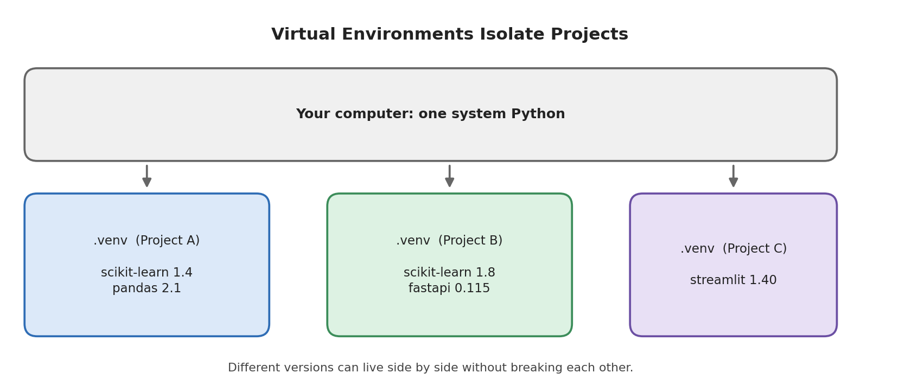

# Module 11: Model Deployment

## Part 4 of 7: Requirements File and Virtual Environment

**Topics covered in this file:** 9. Requirements File, 10. Virtual Environment

**Why this matters now:** in Part 1 we saw that a model file must be loaded with the same library versions that created it. These two tools are how you guarantee that, on your laptop, a teammate's laptop, and a server.

---

## 9. Requirements File

### Core idea

A **requirements file** (`requirements.txt`) is a plain text list of the Python packages a project needs, usually with exact versions. Anyone can recreate the same set of libraries with one command:

```bash
pip install -r requirements.txt
```

### The problem it solves

"It works on my machine" is the classic failure. Your code runs because *your* computer happens to have scikit-learn 1.8.0, pandas 3.0, and so on. On a new machine, `pip install scikit-learn` installs whatever is newest *that day*. Behaviour can change, saved models can fail to load, and the error appears only after deployment.

A requirements file turns "what I happened to install" into a written, shareable, versioned record.

### Format

One requirement per line:

```text
scikit-learn==1.8.0
pandas>=3.0
```

| Specifier | Meaning | When to use |
|---|---|---|
| `==1.8.0` | Exactly this version | Deployed services; the library that created your model file |
| `>=3.0` | This version or newer | Libraries where any recent version is fine |
| `~=1.8.0` | Compatible release: `>=1.8.0` and `<1.9` | Allows patch fixes only |
| *(no version)* | Latest at install time | Avoid in production: results change over time |

### Our project's requirements

The FastAPI service needs only these packages:

```text
# requirements.txt
fastapi==0.156.4
uvicorn==0.54.0
scikit-learn==1.8.0
joblib==1.5.3
pandas==3.0.2
numpy==2.4.4
```

The Streamlit app needs the same packages plus two more. Instead of copying lines, a second file **includes** the first with `-r`:

```text
# requirements-streamlit.txt
-r requirements.txt
streamlit==1.66.0
requests==2.33.1
```

Why split? A deployed service should contain only what it uses. Streamlit brings dozens of extra packages. If the API does not need them, leaving them out makes installs faster, images smaller (Part 5), and reduces what can go wrong or be attacked.

Pinned versions here are the ones this module was tested with. Pin the versions from **your own working environment**.

### Two ways to create the file

**1. Write it by hand** (as above): list only the packages your code imports directly. The file is short and readable. The weakness is that the packages' own dependencies are not pinned. When we resolved the Streamlit file in a fresh environment, pip picked `scipy 1.18.1`, a library that scikit-learn needs, while the development machine had `1.17.1`. The two environments differ slightly, even though every line in the file was pinned.

**2. Generate it with `pip freeze`:**

```bash
pip freeze > requirements.txt
```

`pip freeze` prints **every** installed package with its exact version, including dependencies of dependencies. This gives much stronger reproducibility, but the file becomes long and hard to read. Run it only **inside a virtual environment** (next section); otherwise it lists everything installed on the computer, including packages unrelated to this project.

| | Hand-written | `pip freeze` |
|---|---|---|
| Readability | High | Low (dozens of lines) |
| Reproducibility | Good | Very good |
| Risk | Hidden dependency versions can drift | May include unneeded packages if the environment is messy |

For larger projects, tools such as `pip-tools`, `uv`, or Poetry generate a fully pinned **lock file** from a short list of top-level packages, combining the benefits of both. For this module, either method above is enough.

### Python version

A requirements file records libraries but **not the Python version**. State it somewhere (a README, or the `FROM python:3.12-slim` line in the Dockerfile in Part 5). Newer pandas releases, for example, require a recent Python.

### Common mistakes

- Forgetting to update `requirements.txt` after installing a new package.
- Leaving a library unpinned, then retraining and saving a model with one scikit-learn version while production uses another.
- Freezing from the global environment, which fills the file with unrelated packages.
- Pinning to a version that is not available for your Python version, so installation fails.

---

## 10. Virtual Environment

### Core idea

A **virtual environment** is an isolated, project-specific Python installation: a folder containing a link to a Python interpreter plus its own set of installed packages. Packages installed while it is active go only into that folder.



### Why it is needed

Without virtual environments, every project shares one global set of packages. Then:

- Project A needs scikit-learn 1.4 and Project B needs scikit-learn 1.8. Only one can be installed at a time, so one project breaks.
- Installing something for a new project can silently change an old project.
- `pip freeze` cannot tell which packages belong to which project.
- You can damage Python tools that your operating system itself relies on.

A virtual environment per project removes all four problems. It is also what makes a requirements file trustworthy: the file describes exactly what is inside that one environment.

### Creating and activating

Run these commands in the project folder (`iris-deployment/`):

```bash
python -m venv .venv
```

This creates a `.venv` folder. Then **activate** it:

| System | Command |
|---|---|
| macOS / Linux | `source .venv/bin/activate` |
| Windows PowerShell | `.venv\Scripts\Activate.ps1` |
| Windows Command Prompt | `.venv\Scripts\activate.bat` |

After activation your prompt shows `(.venv)` at the start. From now on `python` and `pip` refer to the environment's copies.

### The standard workflow

```bash
python -m venv .venv                       # 1. create (once per project)
source .venv/bin/activate                  # 2. activate (every new terminal)
pip install -r requirements-streamlit.txt  # 3. install everything the project needs
python train.py                            # 4. work normally
deactivate                                 # 5. leave the environment
```

If you install an additional package later, add it to the requirements file (or run `pip freeze > requirements.txt` while the environment is active).

### Checking that you are inside the environment

```bash
which python        # macOS/Linux; use "where python" on Windows
pip list            # shows only this environment's packages
```

`which python` should print a path inside `.venv`. If it prints a system path, the environment is not active, and `pip install` would modify the global installation.

### Removing and recreating

A virtual environment is disposable. To start fresh, delete the folder and run the workflow again. Because the requirements file is the real record, nothing is lost.

### Version control

Add `.venv/` to `.gitignore`. Commit `requirements.txt` instead. A virtual environment contains absolute paths and compiled files specific to one computer, so copying the folder to another machine does not work; recreate it from the requirements file.

### Using the environment in VS Code and Jupyter

- **VS Code:** open the Command Palette and choose *Python: Select Interpreter*, then pick the interpreter inside `.venv`.
- **Jupyter notebooks:** register the environment as a kernel with `pip install ipykernel` followed by `python -m ipykernel install --user --name iris-deployment`, then select that kernel in the notebook.

### Related tools

- **conda** manages environments and can also install non-Python packages; the idea of isolation is the same.
- `uv` and Poetry combine environment creation with dependency management and lock files.

### Common mistakes

| Mistake | Result |
|---|---|
| Installing packages without activating the environment | They go into the global installation |
| Activating in one terminal but running commands in another | Wrong interpreter used |
| Committing `.venv/` to Git | Huge, useless repository |
| Copying the environment folder to another computer | Does not work; recreate it |
| Notebook kernel still using the global Python | Imports fail or use different versions |

---

## Recap

- `requirements.txt` records which libraries (and versions) a project needs; pin exact versions for anything you deploy, especially the library that created your model file.
- Write it by hand for readability or use `pip freeze` for full reproducibility; neither records the Python version.
- A virtual environment gives each project its own isolated packages; create it with `python -m venv .venv`, activate it every session, and never commit it.
- Together they let anyone rebuild your environment with: create, activate, `pip install -r`.

**Next (Part 5):** Docker goes one step further and packages not only the Python libraries but the entire runtime environment, together with your code and model.
