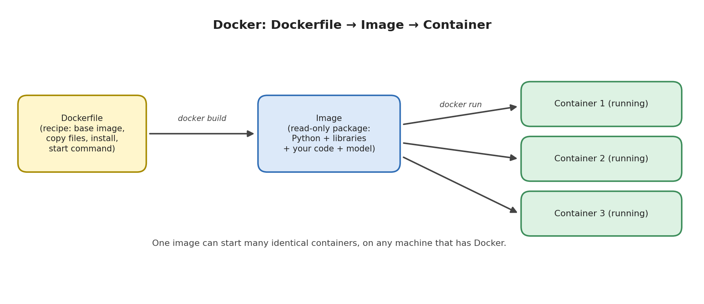

# Module 11: Model Deployment

## Part 5 of 7: Docker Basics

**Topic covered in this file:** 11. Docker Basics

**Reused from earlier parts:** `main.py` and `predictor.py` (Parts 2 and 3), `requirements.txt` (Part 4), `models/iris_model.joblib` (Part 1).

---

## 11. Docker Basics

### Core idea

**Docker** is a tool that packages an application together with everything it needs to run (operating system files, Python, libraries, your code, your model) into a single unit that behaves the same on any computer with Docker installed.

### The problem it solves

A virtual environment (Part 4) pins your Python **packages**. But a program also depends on things outside Python: the Python version itself, the operating system, system libraries. A server with a different Linux version or Python version can still behave differently.

| | Virtual environment | Docker |
|---|---|---|
| Isolates | Python packages | The whole runtime: OS files, Python version, packages, code |
| Reproducibility | Same libraries | Same everything |
| Setup on a new machine | Install Python, create env, install packages | Install Docker, run one command |

For ML deployment this means: the model, the exact scikit-learn version, and the serving code travel together. If it runs on your laptop, it runs on the server.

### Three terms to understand



| Term | Meaning | Analogy |
|---|---|---|
| **Dockerfile** | A text file of instructions describing how to build the package | A recipe |
| **Image** | The built, read-only package | The finished meal in a sealed box |
| **Container** | A running instance of an image | One serving, opened and being eaten |

One image can start many containers, and containers are disposable: stop one, delete it, start a fresh one from the same image. (A Python analogy: image is a class, container is an object created from it.)

### Installing Docker

Install **Docker Desktop** (Windows, macOS) or Docker Engine (Linux). Check that it works:

```bash
docker --version
```

### The Dockerfile for our API

Place this file named exactly `Dockerfile` (no extension) in the project folder:

```dockerfile
FROM python:3.12-slim

WORKDIR /app

COPY requirements.txt .
RUN pip install --no-cache-dir -r requirements.txt

COPY predictor.py main.py ./
COPY models/ models/

EXPOSE 8000

CMD ["uvicorn", "main:app", "--host", "0.0.0.0", "--port", "8000"]
```

| Instruction | What it does |
|---|---|
| `FROM python:3.12-slim` | Start from an official image that already contains Python 3.12 on a minimal Linux. This line fixes the Python version |
| `WORKDIR /app` | Set the working folder inside the image; later commands run here |
| `COPY requirements.txt .` | Copy the requirements file from your computer into `/app` |
| `RUN pip install --no-cache-dir -r requirements.txt` | Install the libraries while building the image. `--no-cache-dir` avoids storing download caches, keeping the image smaller |
| `COPY predictor.py main.py ./` | Copy only the code the service needs |
| `COPY models/ models/` | Copy the saved model into the image |
| `EXPOSE 8000` | Documents the port the app uses (it does not publish it; see `-p` below) |
| `CMD [...]` | The command that runs when a container starts. Written as a list, one argument per item |

Why **requirements first, code second**? Docker builds an image in **layers**, one per instruction, and caches them. If a layer and everything before it is unchanged, Docker reuses it. Your code changes often; your requirements rarely. By copying and installing requirements first, editing `main.py` only rebuilds the last layers instead of reinstalling every library. Order instructions from least to most frequently changing.

### The `.dockerignore` file

Like `.gitignore`, this tells Docker what **not** to send when building:

```text
.venv/
__pycache__/
*.pyc
.git/
logs/
```

Without it, a large `.venv` folder could be sent to Docker on every build.

### Building the image

Run in the project folder (the final `.` means "use the current folder as the build context"):

```bash
docker build -t iris-api:1.0 .
```

`-t iris-api:1.0` gives the image a name and a **tag** (here a version label). The first build downloads the base image and installs libraries, so it takes a while. Later builds reuse cached layers and are fast.

List images with `docker images`.

### Running a container

```bash
docker run -d --name iris-api -p 8000:8000 iris-api:1.0
```

| Flag | Meaning |
|---|---|
| `-d` | Run in the background (detached) |
| `--name iris-api` | A name so you can refer to the container easily |
| `-p 8000:8000` | **Publish** a port: `host_port:container_port`. Traffic to port 8000 on your computer goes to port 8000 inside the container |

Test it exactly as before:

```bash
curl http://localhost:8000/health
```

Open `http://localhost:8000/docs` to see the same interactive documentation. The difference is that this API is now running **inside** the container, using the container's Python and libraries, not your virtual environment.

To run a second copy on another port, change only the left number: `-p 8001:8000`. Both containers come from the same image.

### Everyday commands

| Command | Purpose |
|---|---|
| `docker ps` | List running containers (`-a` includes stopped ones) |
| `docker logs iris-api` | Show the application's output; first place to look when something fails |
| `docker stop iris-api` | Stop the container |
| `docker rm iris-api` | Delete a stopped container (the image remains) |
| `docker images` | List images |
| `docker rmi iris-api:1.0` | Delete an image |
| `docker run -e NAME=value ...` | Pass an environment variable to the container |

### Containers are temporary

Anything a container writes to its own filesystem is **lost when the container is removed**. Two consequences:

- Do not store important data (for example, prediction logs) only inside a container. Mount a folder from your computer with a **volume**: `-v $(pwd)/logs:/app/logs` (syntax varies slightly on Windows).
- Do not "fix" a running container by editing files in it. Change the code or Dockerfile, rebuild the image, and start a new container. The image is the single source of truth.

### Containerizing the Streamlit app

The idea is identical; only a few lines differ:

- install `requirements-streamlit.txt` instead of `requirements.txt`,
- copy `app.py` as well,
- use the start command `streamlit run app.py --server.port 8501 --server.address 0.0.0.0`,
- publish port 8501.

To run the API and a frontend together as separate containers, the next step is **Docker Compose**, a tool that starts several containers from one configuration file. We do not cover it in this module.

### Common mistakes

| Mistake | Symptom | Fix |
|---|---|---|
| Starting uvicorn without `--host 0.0.0.0` | Container runs, but `curl` from your computer cannot connect | Inside a container, `127.0.0.1` means "only this container". Bind to `0.0.0.0` |
| Forgetting `-p` | Same: nothing reachable | Publish the port with `-p` |
| Model file not in the image (not copied, or excluded) | Container exits at startup with `FileNotFoundError` | Check `COPY models/ models/` and `.dockerignore`; run `docker logs` |
| Copying everything with `COPY . .` and no `.dockerignore` | Huge image, possibly includes `.venv` and secrets | Copy only what is needed and use `.dockerignore` |
| Copying code before installing requirements | Every code edit reinstalls all libraries | Copy `requirements.txt` first |
| Building on an Apple Silicon Mac, deploying to an Intel/AMD server | Image will not start on the server | Build for the target: `docker build --platform linux/amd64 ...` |
| Unpinned libraries in `requirements.txt` | Two builds of the "same" image contain different versions | Pin versions (Part 4) |

---

## Recap

- Docker bundles code, model, libraries, Python, and OS files into an **image**; a running instance of it is a **container**.
- A **Dockerfile** is the recipe: `FROM`, `COPY`, `RUN`, `CMD`. Order it so slow, rarely-changing steps (installing requirements) come first.
- `docker build` creates the image; `docker run -p host:container` starts a container and publishes its port.
- Inside a container, bind the server to `0.0.0.0`; treat containers as disposable and rebuild instead of editing.

**Next (Part 6):** the image runs on our machine. Part 6 explains the decisions around running it for real users: batch vs real-time, scaling, environments, release strategies, and where to host it.
