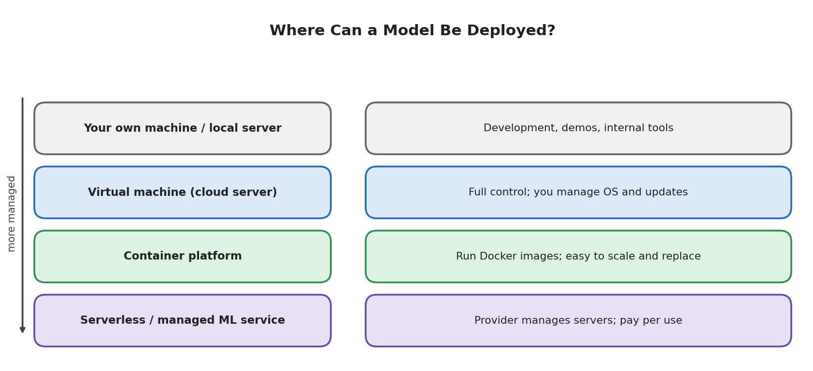

# Module 11: Model Deployment

## Part 6 of 7: Deployment Concepts

**Topic covered in this file:** 12. Deployment Concepts

**Where we are:** Parts 1 to 5 built a working service and packaged it in a Docker image. This part is about the **decisions** that surround running it for real users. It is mostly conceptual; small code appears only where it changes how you write your service.

---

## 12. Deployment Concepts

### Core idea

"It runs in a container" is not the same as "it is deployed well". A deployment must answer six questions:

1. **How** are predictions delivered (one at a time, or in bulk)?
2. **How fast** must they be?
3. **How many** users or requests must be handled?
4. **Where** does the service run?
5. **How** do we change settings and release new versions safely?
6. **How** do we keep it secure?

The sections below follow these questions.

---

### 12.1 How predictions are delivered: serving patterns

| Pattern | How it works | Typical use |
|---|---|---|
| **Real-time (online)** | A request arrives, the model answers within milliseconds to seconds | Our Iris API, fraud checks at payment time, recommendations on a page |
| **Batch** | A scheduled job scores a whole file or table at once | Nightly churn scores, weekly demand forecast, monthly credit review |
| **Streaming** | The model scores a continuous flow of events as they arrive | Sensor monitoring, live transaction streams |
| **Edge / on-device** | The model runs on the user's phone or device, no server call | Offline apps, camera features, privacy-sensitive data |

The choice depends on **how soon the answer is needed**. If nobody needs the result until tomorrow morning, batch is simpler and cheaper than keeping a server running all day.

A batch job reuses everything from Parts 1 and 2. It loads the model once and predicts a whole file:

```python
import pandas as pd
from predictor import FEATURES, CLASS_NAMES, load_model

model = load_model()
data = pd.read_csv("new_flowers.csv")  # columns must match FEATURES
data["species"] = [CLASS_NAMES[i] for i in model.predict(data[FEATURES])]
data.to_csv("predictions.csv", index=False)
```

Given three rows, the output file adds a `species` column with `setosa`, `virginica`, and `versicolor`. The same model file serves both the real-time API and the batch job.

### 12.2 How fast: latency and throughput

- **Latency**: time to answer one request.
- **Throughput**: how many requests are handled per second.

They are different. A system can answer each request quickly yet collapse when 1,000 arrive at once.

Our Iris model is tiny; in a test run the prediction step took about 1.7 ms on average (the number depends on hardware). A large ensemble, a deep network, or a model that needs heavy feature preparation can take hundreds of milliseconds or more. Always **measure** latency instead of assuming. Part 7 adds logging that does exactly that.

If a model is too slow, the usual options are: use a smaller or simpler model, reduce the work done per request (precompute expensive features), cache repeated answers, accept batches of inputs together, or run more copies of the service.

### 12.3 How many: scaling

| Approach | Meaning | Limit |
|---|---|---|
| **Vertical scaling** | Use a bigger machine (more CPU, more memory) | There is a ceiling, and one machine is a single point of failure |
| **Horizontal scaling** | Run more copies and spread requests across them with a **load balancer** | Requires copies to be independent |

Our API is a good candidate for horizontal scaling because it is **stateless**: each request carries everything it needs, and the loaded model is only read, never modified. Any copy can answer any request. This is also why containers (Part 5) work so well: starting ten identical containers from one image is straightforward.

Design rule: do not keep per-user information in the memory of a single copy, because the next request may reach a different copy.

### 12.4 Where it runs: deployment options



| Option | You manage | Examples of services | Good for |
|---|---|---|---|
| Your own machine or local server | Everything | A laptop, an office server | Development, demos |
| Virtual machine in the cloud | Operating system, Docker, updates, security patches | Cloud provider virtual machines | Full control; small steady workloads |
| Container platform | Only your image | Managed container services from the major cloud providers, and simpler hosting platforms | Most API deployments; easy scaling and replacement |
| Serverless / managed ML service | Mostly the model | Managed ML platforms from the major cloud providers | Teams who want the provider to handle servers, scaling, and monitoring |
| Hosting made for demos | Almost nothing | Streamlit Community Cloud, Hugging Face Spaces | Showing a Streamlit or similar app publicly |

The more the provider manages, the less operational work you do, but the less control you have and the more specific the setup becomes. Features and prices of these services change often, so check each provider's current documentation before choosing.

Because we built a Docker image, we can move between most of these options with little change. That portability is a major reason to containerize.

### 12.5 Configuration: do not hard-code environment details

The same image should run in development, testing, and production. What differs between them (URLs, allowed origins, which model version to load) must come from **configuration**, not from edits to the code. The standard mechanism is **environment variables**.

In Part 3 we wrote the allowed CORS origins directly in `main.py`. A deployable version reads them from the environment:

```python
import os

origins = os.getenv("ALLOWED_ORIGINS", "http://localhost:5500").split(",")
# then: allow_origins=origins
```

Locally the default is used. In production you would start the container with `-e ALLOWED_ORIGINS=https://your-site.example.com` (Part 5, `-e` flag). Part 7 uses the same technique to choose a model version.

**Secrets** (API keys, passwords, tokens) need extra care: never write them in code, never commit them to Git, and never bake them into an image. Supply them at run time through the platform's secret or environment-variable settings.

Environments are usually separated into:

| Environment | Purpose |
|---|---|
| Development | You experiment; things break freely |
| Staging / testing | A copy of production used to verify a new release with realistic conditions |
| Production | Real users; changes must be careful |

### 12.6 Releasing a new version safely

Replacing the old service with the new one in a single step is the riskiest option: if the new model misbehaves, every user is affected. Common safer strategies:

| Strategy | How it works | Benefit |
|---|---|---|
| **Blue-green** | Run the new version (green) beside the old one (blue); switch all traffic at once; switch back if needed | Instant, clean rollback |
| **Canary** | Send a small share of traffic (for example 5%) to the new version, watch it, then increase | Limits the damage of a bad release |
| **Shadow** | The new model receives a copy of real requests, but its answers are only logged, not returned | Compare against the live model with zero user risk |
| **A/B test** | Different users receive different models, and business outcomes are compared | Measures real impact, not just offline accuracy |

Whatever the strategy, the essential requirement is a **fast rollback**: the ability to return to the previous version quickly. Part 7 (versioning) is what makes rollback possible.

### 12.7 Security basics

| Area | Practice |
|---|---|
| Transport | Serve the API over HTTPS, normally through the hosting platform or a reverse proxy |
| Access | If the API is not public, require authentication (API keys or tokens) |
| Input | Validate every request; we already do this with Pydantic (Part 3) |
| Abuse | Limit request rates so one client cannot overload the service |
| CORS | Allow only the origins that need access (not `"*"`) |
| Model files | Load only files you created or fully trust (Part 1 warning) |
| Data | Be careful about what you log; inputs can contain personal information |
| Dependencies | Pinned requirements (Part 4) make it possible to know and update what you run |

### 12.8 Pre-launch checklist

- The model is saved as a full pipeline and loads without warnings.
- Library versions are pinned; Python version is recorded.
- The service loads the model once at startup.
- Inputs are validated; errors return clear status codes.
- `/health` responds.
- Settings come from environment variables; no secrets in code or image.
- The Docker image builds from scratch and a fresh container works.
- You know how to roll back.
- Logging and monitoring are in place (Part 7).

---

## Recap

- Pick the serving pattern (real-time, batch, streaming, edge) according to how quickly answers are needed.
- Measure latency; scale horizontally by keeping the service stateless.
- Choose hosting by how much operational work you want to own; containers keep your options open.
- Put environment-specific settings in environment variables, secrets included, never in code.
- Release gradually (blue-green, canary, shadow) and always keep a rollback path.

**Next (Part 7):** model versioning, which makes rollbacks and comparisons possible, and basic monitoring, which tells you when the deployed model needs attention.
