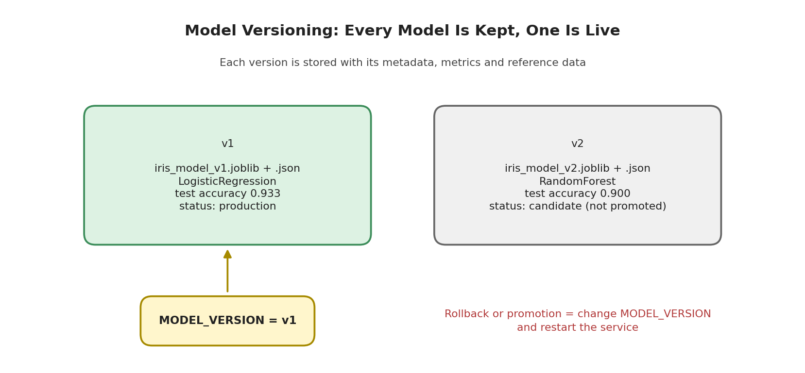
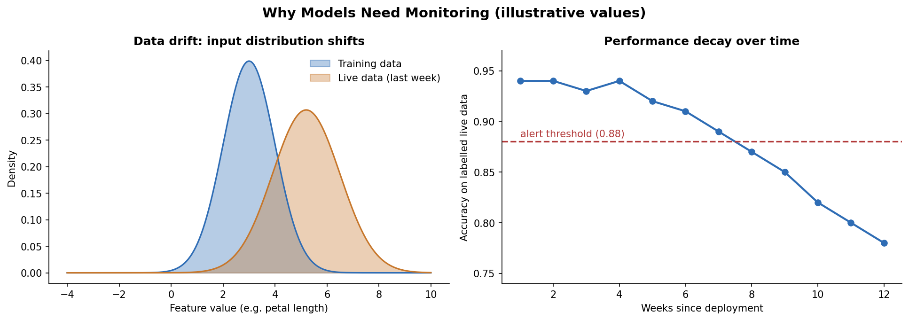
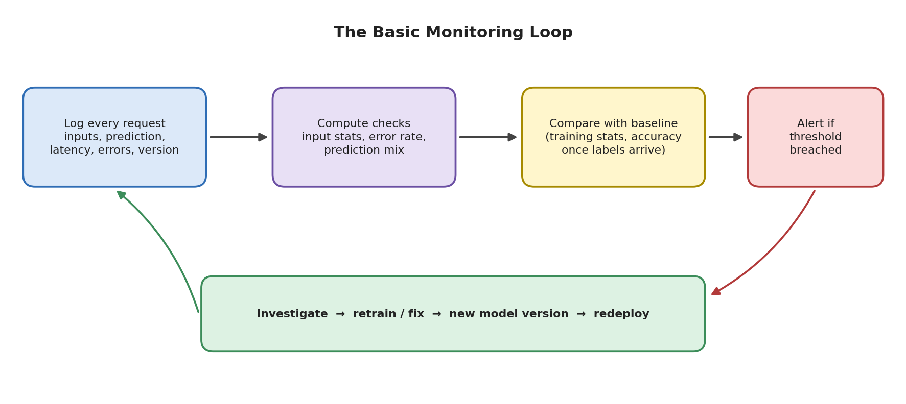

# Module 11: Model Deployment

## Part 7 of 7: Model Versioning and Basic ML Monitoring

**Topics covered in this file:** 13. Model Versioning, 14. Basic ML Monitoring

**Reused from earlier parts:** `train.py` (Part 1), `predictor.py` (Part 2), `main.py` (Part 3), environment variables and rollback ideas (Part 6), `docker run -e` and volumes (Part 5).

---

## 13. Model Versioning

### Core idea

**Model versioning** means giving every trained model a unique identifier and storing, with it, the information needed to understand, reproduce, compare, and replace it.

### Why it matters

Models are not deployed once and forgotten. They are retrained on new data, tried with new algorithms, and sometimes found to be worse than the previous one. Without versions:

- Someone reports a strange prediction and you cannot tell **which model** produced it.
- A new model performs badly in production and there is **nothing to roll back to**, because `iris_model.joblib` was overwritten.
- You cannot compare two models fairly, because you do not know how each was trained.

### What belongs to a version

| Item | Why it is recorded |
|---|---|
| Model file | The artifact itself |
| Version label | Unique name, for example `v1`, `v2` |
| Training date | When it was produced |
| Algorithm and hyperparameters | What was trained |
| Library versions | Needed to load it safely (Part 1 warning) |
| Metrics | How good it was when released |
| Training data identity | Which data it learned from |
| Code version | Which Git commit produced it |
| Feature names and order | The input contract with the API |

We will save the first seven items next to every model in a small JSON file. Code versions are handled by Git, and large datasets by tools such as DVC (see the end of this section).

### Naming versions

Choose a scheme and keep it consistent. Simple counters (`v1`, `v2`, `v3`) are enough for most projects. Some teams use semantic numbering (`1.2.0`: a major number for a new algorithm or feature set, a minor number for retraining on fresh data) or timestamps (`2026-10-21`). The same label can also be used as the Docker image tag from Part 5.

### Version-aware training

The training logic is unchanged. What is new: the version comes from the command line, the file name includes it, and we also write a metadata file and a copy of the training inputs, which monitoring will need in section 14. This file replaces the `train.py` from Part 1.

```python
# train.py  (version-aware)
import json
import sys
from datetime import datetime, timezone
from pathlib import Path

import joblib
import sklearn
from sklearn.datasets import load_iris
from sklearn.ensemble import RandomForestClassifier
from sklearn.linear_model import LogisticRegression
from sklearn.metrics import accuracy_score
from sklearn.model_selection import train_test_split
from sklearn.pipeline import Pipeline
from sklearn.preprocessing import StandardScaler

VERSION = sys.argv[1] if len(sys.argv) > 1 else "v1"

iris = load_iris(as_frame=True)
X, y = iris.data, iris.target
X_train, X_test, y_train, y_test = train_test_split(
    X, y, test_size=0.2, stratify=y, random_state=42
)

classifiers = {
    "v1": LogisticRegression(max_iter=200),
    "v2": RandomForestClassifier(n_estimators=200, random_state=42),
}
model = Pipeline([("scaler", StandardScaler()), ("clf", classifiers[VERSION])])
model.fit(X_train, y_train)
accuracy = round(accuracy_score(y_test, model.predict(X_test)), 3)

model_dir = Path("models")
model_dir.mkdir(exist_ok=True)

joblib.dump(model, model_dir / f"iris_model_{VERSION}.joblib")
X_train.to_csv(model_dir / f"reference_{VERSION}.csv", index=False)

metadata = {
    "version": VERSION,
    "trained_at": datetime.now(timezone.utc).isoformat(timespec="seconds"),
    "algorithm": type(model.named_steps["clf"]).__name__,
    "sklearn_version": sklearn.__version__,
    "train_rows": len(X_train),
    "test_accuracy": accuracy,
    "features": list(X.columns),
}
(model_dir / f"iris_model_{VERSION}.json").write_text(json.dumps(metadata, indent=2))
print(f"Saved {VERSION}: test accuracy {accuracy}")
```

Run it twice (delete the old `models/iris_model.joblib` from Part 1, which is replaced by `v1`):

```bash
python train.py v1
python train.py v2
```

```text
Saved v1: test accuracy 0.933
Saved v2: test accuracy 0.9
```

The `models/` folder now holds, for each version, a model file, a metadata file, and a reference CSV:



The metadata for `v1`:

```json
{
  "version": "v1",
  "trained_at": "2026-10-21T02:09:42+00:00",
  "algorithm": "LogisticRegression",
  "sklearn_version": "1.8.0",
  "train_rows": 120,
  "test_accuracy": 0.933,
  "features": ["sepal length (cm)", "sepal width (cm)", "petal length (cm)", "petal width (cm)"]
}
```

(The file is written on several lines; shortened here.)

### Interpreting the comparison

`v2` (a random forest) scored 0.900 against 0.933 for `v1`. The test set has only 30 rows, so this difference is **one single flower**. That is far too little evidence to say either model is truly better. What we can say is that there is **no evidence that `v2` is an improvement**, so we do not promote it. Newer is not the same as better: a release decision should rest on trustworthy evaluation (Modules 7 and 9, for example cross-validation), not on one small test score.

### Selecting a version at run time

Only two small changes are needed. In `predictor.py`, replace the `MODEL_PATH` line:

```python
import os  # add at the top

MODEL_VERSION = os.getenv("MODEL_VERSION", "v1")
MODEL_PATH = Path(__file__).parent / "models" / f"iris_model_{MODEL_VERSION}.joblib"
```

Then choose the version when starting the service:

```bash
MODEL_VERSION=v2 uvicorn main:app          # macOS / Linux
$env:MODEL_VERSION="v2"; uvicorn main:app  # Windows PowerShell
docker run -e MODEL_VERSION=v2 -p 8000:8000 iris-api:1.0
```

The default is `v1`. This is the environment-variable technique from Part 6: the same code and the same Docker image serve any version, because the `models/` folder (with all versions) is inside the image.

### Making the live version visible

In `main.py`, import the label and include it in the health response:

```python
from predictor import MODEL_VERSION, load_model, predict_species  # MODEL_VERSION added

@app.get("/health")
def health():
    return {"status": "ok", "model_version": MODEL_VERSION}
```

```text
{"status":"ok","model_version":"v1"}
```

Now anyone can check which model is running. Section 14 also writes the version into every prediction log, which answers the question "which model produced this?"

### Rollback and promotion

- **Promote** `v2` to production: set `MODEL_VERSION=v2` and restart.
- **Roll back**: set it back to `v1` and restart. Nothing needs retraining because the old file still exists.

Never overwrite a released model file. Add a new version beside it.

### Keeping the API compatible

A new model version must accept the **same inputs** the API already promises. If a new version needs different features, the API contract changes, and old clients would break. In that case publish a new API version (for example `/v2/predict`) and keep the old one until clients have moved.

### Tools that automate this

| Tool | Helps with |
|---|---|
| Git | Versions code; record the commit that trained each model |
| DVC | Versions datasets and large model files outside Git |
| MLflow (Model Registry) | Tracks experiments, metrics, and model versions with labels such as "staging" and "production" |
| Cloud model registries | The same idea inside managed ML platforms |

Our folder-and-JSON approach is a minimal version of what these tools provide.

### Common mistakes

- Overwriting `model.joblib` so previous versions vanish.
- Saving the model but no metadata, so nobody knows how it was trained.
- Versioning the model file but not the code or data that produced it.
- Promoting a model because it won on a tiny test set.
- Retraining with a different library version and not recording it.

---

## 14. Basic ML Monitoring

### Core idea

**ML monitoring** means continuously watching a deployed model's inputs, outputs, and results to detect when it stops working well.

### Why models need monitoring

Ordinary software fails loudly: it crashes or throws an error. A model fails **silently**. It keeps returning confident-looking predictions while those predictions become less correct, because the world it learned from has changed.



The left panel shows **data drift**: live inputs no longer resemble the training data. The right panel shows the consequence, **performance decay** (illustrative values). Two related terms:

| Term | Meaning | Example |
|---|---|---|
| **Data drift** | The distribution of the inputs changes | A sensor is recalibrated and all readings shift upward |
| **Concept drift** | The relationship between inputs and the correct answer changes | Customers with the same profile now behave differently after a market change |

### What to monitor

| Layer | Examples | Needs true labels? |
|---|---|---|
| Service health | Uptime, error rate, latency | No |
| Input quality | Rejected (`422`) requests, missing or out-of-range values | No |
| Data drift | Input distributions compared with the training data | No |
| Prediction drift | Share of each predicted class, average confidence | No |
| Model performance | Accuracy, precision, recall over time | **Yes** |

Performance is the most important signal, yet the hardest to get: the true outcome often arrives late (a loan default is known months later) or never. That is why the label-free layers above act as an early-warning system.

### The monitoring loop



### Step 1: Log every prediction

We add logging to `main.py`. The log is a **JSON Lines** file: one JSON object per line, easy to append to and easy to read with pandas. New imports and code go near the top of `main.py` (after the model is loaded), and the `predict` function is replaced:

```python
import json
import time
from datetime import datetime, timezone
from pathlib import Path

LOG_PATH = Path("logs/predictions.jsonl")
LOG_PATH.parent.mkdir(exist_ok=True)


def log_prediction(inputs, result, latency_ms):
    record = {
        "time": datetime.now(timezone.utc).isoformat(timespec="seconds"),
        "model_version": MODEL_VERSION,
        "inputs": inputs,
        "prediction": result["species"],
        "confidence": result["confidence"],
        "latency_ms": round(latency_ms, 2),
    }
    with LOG_PATH.open("a") as f:
        f.write(json.dumps(record) + "\n")


@app.post("/predict", response_model=IrisOutput)
def predict(data: IrisInput):
    start = time.perf_counter()
    inputs = data.model_dump()
    result = predict_species(model, **inputs)
    log_prediction(inputs, result, (time.perf_counter() - start) * 1000)
    return result
```

One log line looks like this:

```json
{"time": "2026-10-21T02:09:50+00:00", "model_version": "v1", "inputs": {"sepal_length": 6.3, "sepal_width": 2.9, "petal_length": 5.6, "petal_width": 1.8}, "prediction": "virginica", "confidence": 0.814, "latency_ms": 5.8}
```

Each record answers: when, which model, what input, what output, how long. Remember Part 5: files written inside a container disappear with it, so mount `logs/` as a volume in a real deployment. Also be careful about logging personal data (Part 6), and plan to rotate or archive the file, since it grows forever.

### Step 2: Simulate traffic

To practise without real users, this script sends requests built from the training data, either as-is (`normal`) or with the petal measurements shifted upward (`drift`). Start the API first (`uvicorn main:app`).

```python
# simulate_traffic.py
import sys

import numpy as np
import pandas as pd
import requests

URL = "http://127.0.0.1:8000/predict"
reference = pd.read_csv("models/reference_v1.csv")
rng = np.random.default_rng(0)


def send_requests(n, petal_shift=0.0):
    sample = reference.sample(n, replace=True, random_state=int(rng.integers(1_000_000)))
    for row in sample.itertuples(index=False):
        payload = {
            "sepal_length": round(row[0] + rng.normal(0, 0.1), 2),
            "sepal_width": round(row[1] + rng.normal(0, 0.1), 2),
            "petal_length": round(row[2] + petal_shift + rng.normal(0, 0.1), 2),
            "petal_width": round(row[3] + petal_shift / 3 + rng.normal(0, 0.05), 2),
        }
        requests.post(URL, json=payload, timeout=5)


mode = sys.argv[1] if len(sys.argv) > 1 else "normal"
send_requests(100, petal_shift=1.5 if mode == "drift" else 0.0)
print(f"Sent 100 {mode} requests")
```

### Step 3: Check for drift

`reference_v1.csv` (saved by `train.py`) is the **baseline**: what the model saw during training. The check compares recent live inputs against it, feature by feature, with a **two-sample Kolmogorov-Smirnov (KS) test**. The KS statistic is the largest gap between the two cumulative distributions: 0 means identical, values closer to 1 mean very different. The **p-value** is the probability of seeing a gap at least this large if both samples came from the same distribution; a very small p-value suggests they did not.

```python
# drift_check.py
import json

import pandas as pd
from scipy.stats import ks_2samp

WINDOW = 100  # compare only the most recent requests

reference = pd.read_csv("models/reference_v1.csv")
with open("logs/predictions.jsonl") as f:
    logs = pd.DataFrame([json.loads(line) for line in f]).tail(WINDOW)

live = pd.DataFrame(list(logs["inputs"]))
live.columns = reference.columns  # same feature order as training

print(f"Requests checked: {len(logs)} | avg latency: {logs['latency_ms'].mean():.1f} ms")
print("Prediction mix:", logs["prediction"].value_counts(normalize=True).round(2).to_dict())

for col in reference.columns:
    stat, p_value = ks_2samp(reference[col], live[col])
    status = "DRIFT" if p_value < 0.01 else "ok"
    print(f"{col:20s} KS={stat:.2f}  p={p_value:.4f}  {status}")
```

`scipy` is already installed as a dependency of scikit-learn; because this script imports it directly, list it in your requirements as well (Part 4).

Run: `python simulate_traffic.py normal`, then `python drift_check.py`; afterwards `python simulate_traffic.py drift` and `python drift_check.py` again.

**After normal traffic:**

```text
Requests checked: 100 | avg latency: 1.7 ms
Prediction mix: {'setosa': 0.39, 'versicolor': 0.36, 'virginica': 0.25}
sepal length (cm)    KS=0.13  p=0.2888  ok
sepal width (cm)     KS=0.11  p=0.5277  ok
petal length (cm)    KS=0.15  p=0.1636  ok
petal width (cm)     KS=0.18  p=0.0585  ok
```

**After drifted traffic:**

```text
Requests checked: 100 | avg latency: 1.7 ms
Prediction mix: {'virginica': 0.59, 'setosa': 0.37, 'versicolor': 0.04}
sepal length (cm)    KS=0.13  p=0.2888  ok
sepal width (cm)     KS=0.11  p=0.5277  ok
petal length (cm)    KS=0.36  p=0.0000  DRIFT
petal width (cm)     KS=0.33  p=0.0000  DRIFT
```

### Interpreting the results

- Only the shifted features (`petal length`, `petal width`) are flagged; the unchanged ones stay `ok`. The check points to **where** the problem is.
- The **prediction mix** changed sharply: `versicolor` fell from 36% to 4%. Even without labels, a shift in predicted classes is a warning sign.
- In the normal run, `petal width` came close to the threshold (p = 0.0585) even though nothing was wrong. Random fluctuation always exists, which is why we use a sensible threshold (0.01 here) and a reasonably sized window instead of reacting to a single reading.
- **Drift is a warning, not proof of failure.** The model may still be accurate. It means the model is now operating on data unlike what it learned from, so its quality needs checking.

### Limits of this simple check

- With very large samples, even trivial differences become "statistically significant". Look at the KS statistic as well as the p-value, and set thresholds based on experience with your data.
- Testing many features raises the chance of a false alarm.
- It looks at one feature at a time and can miss changes in the *relationships* between features.
- It cannot detect concept drift. Only real outcomes can reveal that.

### Measuring performance when labels arrive

When true outcomes become available, link them to the logged predictions (this needs a unique request ID in each log record, which our minimal log does not yet include), then compute accuracy or other metrics per week or per month. Compare against the metrics saved in the version's metadata. A sustained drop below an agreed threshold is the clearest sign that the model needs action.

### Alerts and responses

| Signal | Typical response |
|---|---|
| Error rate or latency spikes | Fix the service or scale it (Part 6) |
| Input quality problems (many `422` errors, missing values) | Investigate the upstream data pipeline; often a bug, not a real change |
| Data or prediction drift | Check whether the change is real, then consider retraining |
| Performance below threshold | Retrain on recent data, release it as a **new version**, and roll back if the new version is worse |

This closes the cycle of the whole module: monitoring triggers retraining, retraining produces `v3`, versioning keeps `v1` and `v2` available, and the release strategies from Part 6 put `v3` into production safely.

### Tools beyond the basics

Production setups usually add dashboards and automatic alerts. Prometheus and Grafana are widely used for service metrics, and open-source libraries such as Evidently generate drift and performance reports. Cloud ML platforms include similar features. The principles are the ones practised here: log, compare with a baseline, alert, act.

### Common mistakes

- Monitoring only uptime and never the quality of predictions.
- Not saving any baseline (reference data) at training time.
- Alerting on every small fluctuation, which teaches people to ignore alerts.
- Logging sensitive data, or letting log files grow without limit.
- Waiting for labels before monitoring anything, when label-free checks are available immediately.

---

## Module Recap

| Part | What you learned |
|---|---|
| 01 | Deployment means making a model usable; save the whole pipeline with `joblib`; load it once |
| 02 | Separate prediction logic from the interface; Streamlit reruns the script and needs cached models |
| 03 | FastAPI serves predictions over HTTP with validation; frontends call it with JSON and need CORS permission |
| 04 | `requirements.txt` plus a virtual environment make setups reproducible |
| 05 | Docker packages code, model, and runtime into an image you can run anywhere |
| 06 | Choose serving pattern, scaling, hosting, configuration, and release strategy deliberately |
| 07 | Version every model with metadata, and monitor inputs, predictions, and performance after release |

**Suggested practice:** take a model from an earlier module and carry it through the same steps: save the pipeline, wrap it in `predictor.py`, expose it with FastAPI, pin the requirements, containerize it, add version labels and prediction logging, and write a drift check for its most important features.
